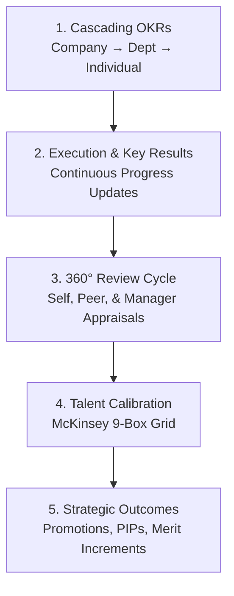
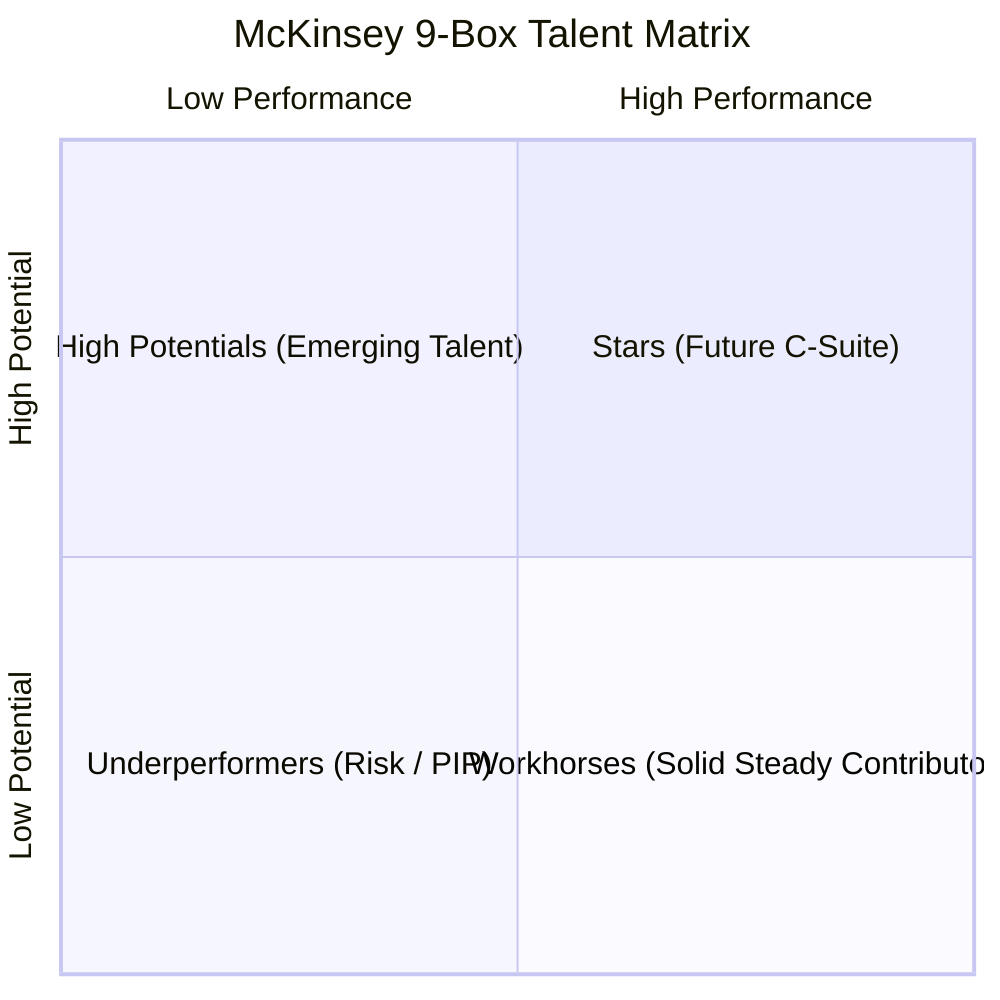

# 08. Performance Reviews & OKRs (`/hr/performance`)

The **Performance Management** module provides HR Specialists with strategic tools to evaluate employee output, identify future leaders, align organizational goals via OKRs (Objectives and Key Results), and calibrate talent using the **McKinsey 9-Box Matrix**.

---

## 📸 Interface Screenshot

<!-- SCREENSHOT_PLACEHOLDER: /hr/performance -->
> *[Screenshot Placeholder: HR Performance & 9-Box Calibration Matrix]*

---

## 🧭 Performance Framework Architecture

---

## 📂 Navigation Workspaces

### 1. 🔲 `9-Box Matrix` (Talent Calibration Grid)
The **9-Box Matrix** maps employees across two core dimensions: **Current Performance** (X-axis) and **Future Growth Potential** (Y-axis):

#### The 9 Talent Quadrants Defined:

| Quadrant | Potential | Performance | Talent Profile | Recommended HR Strategy |
| :--- | :---: | :---: | :--- | :--- |
| **⭐ Stars** | High | High | Top tier innovators and natural leaders. | Fast-track promotions, retention bonuses, executive mentorship. |
| **🚀 High Potentials** | High | Medium | Capable of significant leadership with grooming. | Stretch assignments, technical leadership training. |
| **❓ Enigmas** | High | Low | High raw intelligence but low current output. | Investigate mismatch, assign new team, or provide direct coaching. |
| **🏆 High Performers** | Medium | High | Strong, dependable subject matter experts. | Reward with salary increments, retain in core roles. |
| **⚖️ Core Employees** | Medium | Medium | Reliable backbone of daily operational delivery. | Continuous skill enhancement and regular recognition. |
| **⚠️ Dilemmas** | Medium | Low | Borderline output needing corrective oversight. | Clarify expectations, assign 60-day review timeline. |
| **🐴 Workhorses** | Low | High | Excellent execution, content in current position. | Value as stable foundation; do not force unwanted management roles. |
| **⚙️ Grinders** | Low | Medium | Adequate delivery but limited ceiling. | Keep in well-defined scope; monitor progress. |
| **🛑 Risk / Underperformers**| Low | Low | Failing to meet minimum job competencies. | Formal Performance Improvement Plan (PIP) or offboarding. |

---

### 2. 🎯 `OKRs` (Objectives & Key Results)
Manage organizational and team alignment through measurable quarterly goals:
* **Create OKR Modal**:
  * **Objective Title**: Qualitative aspirational goal (e.g., *"Accelerate Customer Support SLA to Under 10 Minutes"*).
  * **Hierarchy Level**: `COMPANY`, `DEPARTMENT`, or `INDIVIDUAL`.
  * **Department**: Associated business unit.
  * **Goal Owner**: Department Head or Lead responsible.
  * **Key Results (KRs)**: Specific, quantitative metrics (e.g., *Target: 100%, Current: 65%*).
* **Progress Tracking Bar**: Visual progress indicator calculated dynamically as key result metrics advance.

---

### 3. 🔄 `360-Degree Review Submissions`
Orchestrate comprehensive appraisal cycles combining multiple feedback viewpoints:
* **Review Types**:
  * `Self-Appraisal`: Employee self-evaluation against quarterly milestones.
  * `Manager Appraisal`: Direct supervisor scoring and qualitative remarks.
  * `Peer Feedback`: Anonymous or named peer collaboration feedback.
* **Standard Scoring Criteria (1.0 to 5.0 Scale)**:
  * **Performance Delivery Score**
  * **Leadership & Potential Score**
  * **Technical Proficiency Score**
  * **Communication & Collaboration Score**
* **🤖 AI Coaching Assistant**: Click **Generate AI Coaching Summary** to synthesize review comments into actionable development suggestions for the employee.

---

## ❓ Frequently Asked Questions (FAQ)

??? question "How often should the 9-Box Matrix be calibrated?"
    Most enterprises run formal 9-Box calibrations **bi-annually** or **annually**, immediately following the closure of the 360-degree review cycle.

??? question "Can employees see their quadrant placement on the 9-Box Matrix?"
    No. Under Hub HRMS security policies, the 9-Box Matrix is an internal leadership calibration instrument visible strictly to HR Specialists, Department Directors, and Company Admins.
