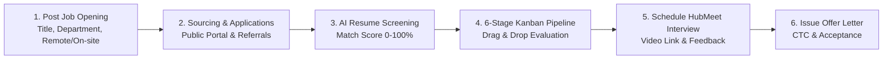
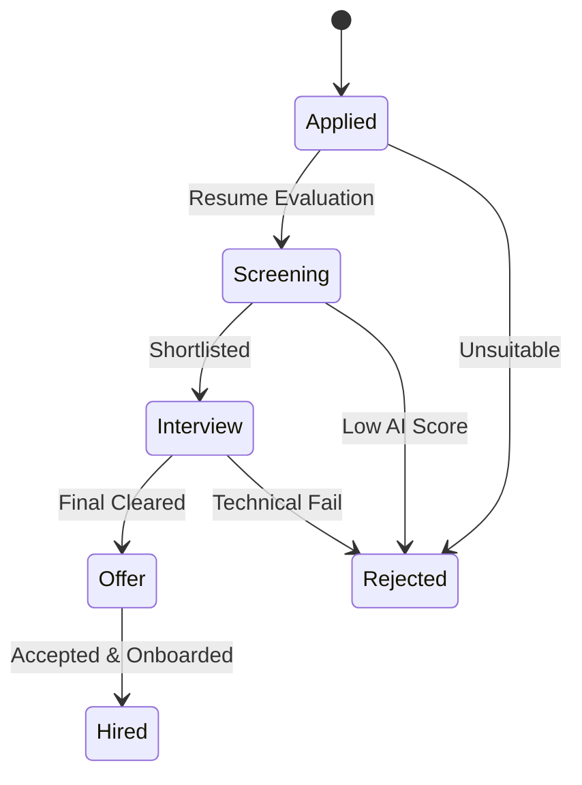

# 02. Talent Acquisition & Recruitment (`/hr/recruitment`)

The **Recruitment** module empowers HR Specialists and Hiring Managers to source talent, track applicants through an interactive 6-stage Kanban pipeline, leverage automated AI resume scoring, schedule video interviews, and release formal offer letters.

---

## 📸 Interface Screenshot

<!-- SCREENSHOT_PLACEHOLDER: /hr/recruitment -->
> *[Screenshot Placeholder: HR Recruitment Console & Pipeline]*

---

## 🧭 Recruitment Architecture & Workflow

---

## 📂 Navigation Tabs

The console is partitioned into three dedicated tabs:

### 1. 💼 `Job Openings` (Requisition Management)
Create and manage active vacancies across business divisions:
* **Create Requisition Modal**:
  * **Job Title**: E.g., `Senior Frontend Engineer`, `HR Operations Associate`.
  * **Department**: Destination department (Engineering, Sales, Operations, Marketing, HR).
  * **Employment Type**: `Full-time`, `Part-time`, `Contract`, `Internship`.
  * **Location**: `Remote`, `Hybrid`, `On-site (Branch Location)`.
  * **Job Description & Requirements**: Rich text specifications detailing required experience and skill stacks.
* **Requisition Statuses**: `Active` (accepting applicants), `Paused` (interviews ongoing), or `Closed`.
* **Applicant Count Badge**: Real-time counter of total applicants attached to each active post.

---

### 2. 👥 `Candidate Pipeline` (Interactive Kanban Board)
Visual board organizing applicants across 6 recruitment stages:

#### The 6 Hiring Stages:
1. **Applied**: Newly received candidate submissions awaiting initial review.
2. **Screening**: Candidates undergoing initial phone or recruiter screening.
3. **Interview**: Candidates shortlisted for technical, leadership, or panel interviews.
4. **Offer**: Finalists selected for compensation discussions and formal offer release.
5. **Hired**: Accepted candidates transitioned to the **Digital Onboarding** queue.
6. **Rejected**: Unsuccessful candidates archived with feedback notes.

#### 🤖 AI Resume Match Scoring (`AI Score`)
Every candidate profile calculates an automated AI score based on keyword match, relevant tenure, and education credentials:

| Score Range | Badge Color | Candidate Rating | Recommended HR Action |
| :--- | :--- | :--- | :--- |
| **85 – 100%** | 🟢 Emerald | Exceptional Match | Fast-track immediately to Interview stage. |
| **70 – 84%** | 🔵 Blue | Strong Candidate | Proceed with standard technical screening. |
| **50 – 69%** | 🟡 Amber | Moderate Match | Review specific skill gaps or consider alternate roles. |
| **< 50%** | 🔴 Red | Low Fit | Archive or issue automated polite regret email. |

#### Candidate Actions & Modals:
* **Drag-and-Drop Stage Transition**: Drag candidate cards directly between columns to update stage instantly.
* **Candidate Profile Drawer**: View contact details, resume PDF preview, prior employers, and recruiter notes.
* **Edit & Archive**: Update application status, re-evaluate AI scores, or delete test profiles.

---

### 3. 🗓️ `Interviews` (HubMeet Video Scheduling)
Coordinate and schedule interview rounds without switching tools:
* **Schedule Interview Modal**:
  * **Candidate**: Pick candidate from active pipeline.
  * **Interviewer**: Assign Lead Engineer, Department Manager, or HR Director.
  * **Date & Time Picker**: Scheduled timestamp.
  * **Meeting Link**: Automatically generate a secure **HubMeet Video Call Room** or paste an external conference URL.
* **Calendar View**: Synchronized list of upcoming, completed, and canceled interviews.
* **Interviewer Scorecard**: Collect structured ratings on *Technical Aptitude*, *Culture Fit*, and *Communication* directly within the candidate card.

---

## 📤 Candidate Export & Pipeline Reporting

* **Export Pipeline**: Download applicant directories in **Excel (.xlsx)** or **CSV** formats filtered by job opening, date range, or stage.
* **Stage Distribution Charts**: Visualize candidate funnel drop-off rates using the built-in Recharts pipeline analytics.

---

## ❓ Frequently Asked Questions (FAQ)

??? question "How does a candidate move from 'Hired' to 'Employees'?"
    When a candidate card is moved to the **Hired** column, an option appears to **Trigger Onboarding**. This automatically creates a draft employee profile in `/hr/employees` under the **Onboarding Pipeline** tab.

??? question "Can candidate resumes be previewed directly in the browser?"
    Yes. Clicking the **View Resume** button opens an embedded PDF viewer modal with download and print capabilities.
