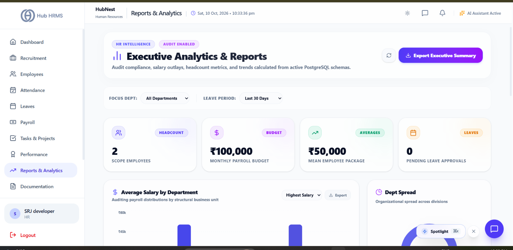
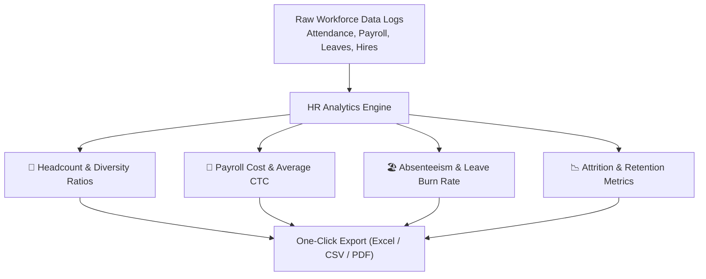

# 09. HR Reports & Analytics (`/hr/reports`)

The **Reports & Analytics** module equips HR Specialists and Leadership with data-driven insights into human capital health, employee turnover patterns, payroll expenditure growth, diversity ratios, and organizational attendance benchmarks.

---

## 📸 Interface Screenshot

{ width="100%" }

---

## 🧭 Intelligence Architecture

---

## 📊 Core Analytical Reports

### 1. 👥 Headcount & Demographics Analytics
* **Total Headcount Evolution**: Monthly line charts illustrating organizational expansion.
* **Department Breakdown**: Proportional distribution of staffing across departments.
* **Gender Diversity Ratio**: Donut charts detailing diversity parity across managerial and operational tiers.
* **Tenure Distribution**: Grouping employees by organizational longevity (< 1 Year, 1–3 Years, 3–5 Years, 5+ Years).

---

### 2. 💸 Compensation & Wage Analytics
* **Monthly Gross Payroll Outflow**: Area chart tracking salary expenditure month-over-month.
* **Departmental Average CTC**: Identifies high-expenditure divisions to inform annual hiring budgets.
* **Overtime Expenditure**: Total overtime disbursements tracked against planned departmental thresholds.

---

### 3. 🏖️ Leave Utilization & Absenteeism Rate
* **Absenteeism Rate Calculation**:
  $$\text{Absenteeism Rate (\%)} = \left( \frac{\text{Total Unplanned Absence Days}}{\text{Total Available Work Days} \times \text{Headcount}} \right) \times 100$$
* **Leave Burn Rate**: Monitors unused casual and earned leave accruals to forecast financial encashment liabilities at financial year-end.

---

### 4. 📉 Attrition & Voluntary Turnover
* **Annualized Attrition Rate**:
  $$\text{Attrition Rate (\%)} = \left( \frac{\text{Separations During Period}}{\text{Average Headcount During Period}} \right) \times 100$$
* **Separation Reasons Analysis**: Pie chart mapping exit interview classifications (*Career Growth*, *Compensation*, *Relocation*, *Health/Personal*).

---

## 📤 Scheduled & On-Demand Report Exports

* **Filter Scope**: Filter all reports by **Specific Department** or **Time Window** (*Last 30 Days*, *Last Quarter*, *Year to Date*, *Custom Calendar Range*).
* **Export Formats**:
  * **Excel Workbook (.xlsx)**: Multi-tab sheets containing raw data, formatted tables, and pivot summaries.
  * **CSV Data Feed**: Standard CSV files for ingestion into external BI platforms (Power BI, Tableau).
  * **Executive PDF Briefing**: Presentation-ready, branded summary charts for executive board reviews.

---

## ❓ Frequently Asked Questions (FAQ)

??? question "Can automated reports be scheduled to send via email?"
    Yes. In Company Settings, HR Directors can configure automated weekly or monthly PDF report digests to be dispatched to executive stakeholders.

??? question "Are employee salaries masked in exported demographic reports?"
    Yes. Export templates without financial privileges automatically mask CTC and base salary columns to protect employee data privacy.
