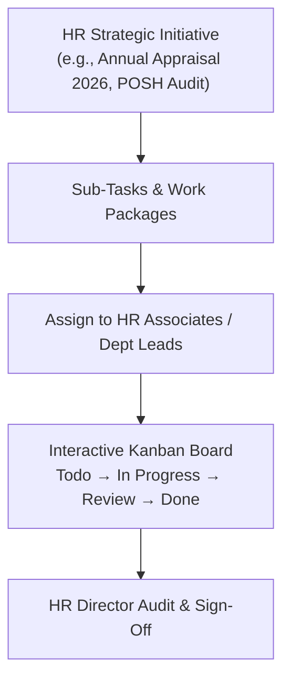

# 07. Tasks & Projects (`/hr/tasks`)

The **Tasks & Projects** module allows HR Specialists to organize human resources initiatives, manage sprint deadlines, track cross-departmental HR deliverables, and oversee employee onboarding project assignments.

---

## 📸 Interface Screenshot

<!-- SCREENSHOT_PLACEHOLDER: /hr/tasks -->
> *[Screenshot Placeholder: HR Task & Project Management Board]*

---

## 🧭 HR Project Execution Framework

---

## 📋 Key Features & Capabilities

### 1. 🗂️ Interactive Task Kanban Board
Organize assignments visually across 4 standard stages:
* **To Do**: Newly created tasks awaiting commencement.
* **In Progress**: Active assignments undergoing execution.
* **Under Review**: Deliverables requiring HR Director or legal sign-off.
* **Completed**: Verified and archived achievements.

### 2. ➕ Task Creation & Assignment Modal
* **Task Title & Description**: Clear scope of work and expected outcome.
* **HR Initiative Category**: `Recruitment Drives`, `Statutory Audit`, `Employee Engagement`, `Appraisal Cycles`, `Policy Updates`.
* **Priority Indicator**: `Urgent` (🔴), `High` (🟠), `Medium` (🟡), `Low` (🟢).
* **Assignee Picker**: Assign to specific HR team members, Department Managers, or cross-functional leads.
* **Due Date & Milestones**: Calendar target deadline with automatic email reminders 24 hours prior to due date.
* **Sub-Task Checklist**: Multi-item progress checklist with completion percentage meter.

---

### 3. 🎯 Standard HR Task Templates

HR Specialists can deploy pre-configured task templates with one click:
* **New Employee Day-1 Onboarding Checklist**:
  * [ ] Collect signed offer letter & NDA
  * [ ] Verify original identity and academic credentials
  * [ ] Assign corporate laptop and create email account
  * [ ] Schedule 30-minute orientation call with HR buddy
* **Statutory Compliance Audit**:
  * [ ] Verify monthly PF ECR challan payment receipt
  * [ ] Update Form B attendance register
  * [ ] Audit maternity benefit register
* **Annual Performance Appraisal Kick-off**:
  * [ ] Finalize OKR completion cut-off date
  * [ ] Dispatch self-appraisal forms to all active employees
  * [ ] Schedule Manager calibration meetings

---

## ❓ Frequently Asked Questions (FAQ)

??? question "Can task deadlines be linked to the company calendar?"
    Yes. Task due dates automatically synchronize with the organizational calendar, alerting assignees via in-app notification bells.

??? question "Can files or legal templates be attached directly to a task?"
    Yes. Users can upload PDF documents, spreadsheets, and reference images up to 25 MB per task card.
