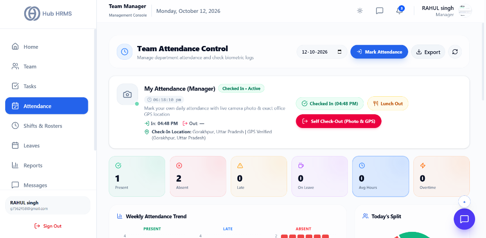
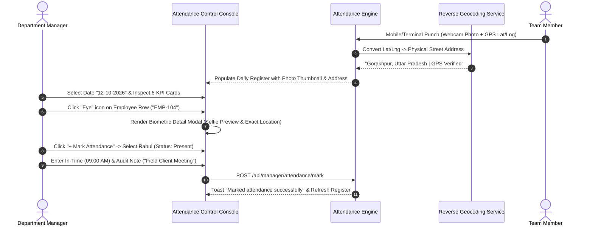

# 05. Team Attendance Control (`/manager/attendance`)

The **Team Attendance Control** module is the frontline biometric compliance and timekeeping audit center for Department Managers in Hub HRMS. Operating with managerial oversight across assigned departments, managers use this console to review daily clock-ins, inspect reverse-geocoded physical addresses, verify punch-in webcam snapshots, execute manual single/bulk attendance regularizations, evaluate weekly attendance trends, and export compliance registries.

---

## 🏛️ Live Interface Overview

Below is the live console layout of the **Department Manager Attendance Control Center**:

---

## 🧭 Page Anatomy & Interactive Controls

The table below catalogs every button, date selector, KPI card, chart, and modal control on the Attendance Control page:

| UI Component / Control | Visual Location | Functional Behavior & Impact |
| :--- | :--- | :--- |
| **Console Header Title** | Header Top Left | Displays `Team Attendance Control` with subtitle *"Manage department attendance and check biometric logs"*. |
| **Audit Date Picker** | Header Top Center | Interactive date selector (`DD-MM-YYYY`, e.g., `12-10-2026`) with a calendar picker to audit historical daily registries. |
| **Mark Attendance Button** | Header Top Right (Solid Blue button w/ LogIn icon) | Launches the **Single & Bulk Attendance Marking Modal** allowing managers to regularize missing punches or log manual entries with an audit note. |
| **Export Dropdown** | Header Top Right | Multi-format exporter allowing managers to download attendance records in **Excel (.xlsx)**, **CSV**, or **PDF** format. |
| **Refresh Button** | Header Top Right | Reloads real-time attendance telemetry from the backend with spinning icon feedback. |
| **My Attendance (Manager)** | Card Below Header | Manager's self-terminal featuring live state (`Checked In • Active`), webcam photo preview, check-in timestamps (`In: 04:48 PM`, `Out: —`), reverse-geocoded location (`Gorakhpur, Uttar Pradesh \| GPS Verified`), **Lunch Out** button, and **Self Check-Out (Photo & GPS)** button. |
| **Present KPI Card** | Stat Grid (Card 1) | Shows count of personnel marked `Present` or `In Office` (e.g., `1`), green CheckCircle icon. |
| **Absent KPI Card** | Stat Grid (Card 2) | Displays unclocked personnel (`Absent`, e.g., `2`), red XCircle icon. |
| **Late KPI Card** | Stat Grid (Card 3) | Counts late arrivals exceeding grace threshold (`Late`, e.g., `0`), amber AlertTriangle icon. |
| **On Leave KPI Card** | Stat Grid (Card 4) | Displays approved leaves (`On Leave`, e.g., `0`), purple Coffee icon. |
| **Avg Hours KPI Card** | Stat Grid (Card 5) | Displays average daily working hours (e.g., `0 Avg Hours`), blue Clock icon. |
| **Overtime KPI Card** | Stat Grid (Card 6) | Tracks cumulative extra-shift hours (`0 Overtime`), orange Zap icon. |
| **Weekly Attendance Trend** | Middle Section Left (8 Cols) | Recharts stacked multi-day Bar Chart displaying daily **Present** (Green), **Late** (Blue), and **Absent** (Red) volumes across the working week. |
| **Today's Split Donut Chart** | Middle Section Right (4 Cols) | Concentric Recharts Donut Chart illustrating percentage distribution between Present, Absent, and Late staff. |
| **DataTableToolbar** | Table Toolbar Top | Houses live text search (`Search by name, ID, dept...`), multi-select Department & Role filters, and sort options. |
| **Detailed Attendance Registry** | Main Data Table | Columns: **Employee** (Avatar + Name + ID), **Status Badge** (Present, Late, Absent, On Leave), **Check In** (12-hr AM/PM), **Check Out**, **Lunch Out/In**, **Working Hours**, **Overtime**, **Late Score**, and **Actions**. |
| **View Biometric Details Modal** | Action Trigger (Eye icon) | Deep-dive modal revealing employee punch selfie snapshot, check-in/out timestamps, and reverse-geocoded physical street address. |
| **Edit Record Modal** | Action Trigger (Pencil icon) | Allows managers to modify in/out times or update statuses with mandatory compliance justification notes. |
| **Delete Record Trigger** | Action Trigger (Trash icon) | Displays toast confirmation dialog with a red **Delete** action to purge invalid records with audit logging. |

---

## 🧭 Biometric Attendance Audit Lifecycle

The sequence diagram below illustrates how attendance telemetry is captured, audited, and regularized by the Department Manager:

---

## ⚙️ Step-by-Step Manager Attendance Procedures

### 1. Auditing Daily Presence & Late Arrivals
1. Locate the **Audit Date Picker** in the top action bar (default is today's date).
2. Review the 6 top metric cards:
   - **Present:** Number of employees actively clocked in.
   - **Absent:** Staff who have not checked in past shift cut-off time.
   - **Late:** Workers who arrived past company grace period (configured under company settings, e.g., 5-15 mins).
   - **On Leave:** Employees on pre-approved leave.
3. Review the **Today's Split** donut chart for an instant visual percentage breakdown.

### 2. Inspecting Biometric Selfie Photos & Physical Addresses
For employees working from field branches, client sites, or remote locations:
1. In the **Attendance Registry**, locate the employee row.
2. Click the **View (Eye)** icon in the Actions column.
3. The **Biometric Attendance Detail Modal** appears:
   - **Check-In Webcam Snapshot:** Verifies the user's facial identity at the moment of clock-in.
   - **Physical Reverse-Geocoded Address:** Displays the exact resolved street location (e.g., *Gorakhpur, Uttar Pradesh*) derived from device GPS coordinates.
   - **Check-Out Snapshot & Location:** Available once the employee punches out.

### 3. Regularizing Missing Punches (`+ Mark Attendance`)
If an employee forgot to clock in, was on external travel, or encountered device connectivity issues:
1. Click the solid blue **+ Mark Attendance** button in the top right header.
2. In the modal:
   - **Select Employee:** Search and select the employee from your department dropdown.
   - **Punch Type:** Choose between `CHECK_IN`, `CHECK_OUT`, or `FULL_DAY_OVERRIDE`.
   - **Time:** Enter time in 12-hour or 24-hour format (e.g., `09:30 AM`).
   - **Status:** Select `PRESENT`, `LATE`, or `HALF_DAY`.
   - **Overtime Hours:** Specify extra hours if applicable.
   - **Compliance Note:** Enter a mandatory explanation (e.g., *"Approved on-site installation at client facility"*).
3. Click **Submit**. The daily register updates immediately, and payroll accruals are synchronized.

### 4. Bulk Marking Attendance for Teams
When logging group training sessions, factory shutdowns, or off-site corporate workshops:
1. In the **Mark Attendance Modal**, toggle to **Bulk Marking Mode**.
2. Select multiple employees using the checkboxes.
3. Set uniform in/out times and status (`PRESENT`).
4. Enter an overarching note (e.g., *"Attended Annual Safety Orientation Seminar"*).
5. Click **Mark Bulk Attendance**. All selected employee records update simultaneously.

---

## 💡 Best Practices for Department Managers

> [!TIP] **Inspect Weekly Trends for Absenteeism Patterns**  
> Review the **Weekly Attendance Trend** stacked bar chart every Monday morning. Recurring dips in attendance on Fridays or Mondays highlight operational morale bottlenecks that warrant team discussions.

> [!IMPORTANT] **Mandatory Audit Notes for Overrides**  
> Always provide clear, compliant reasons when submitting manual attendance regularizations. All manual edits preserve the overriding Manager ID in permanent compliance audit logs.

---

## ❓ Frequently Asked Questions (FAQs)

??? question "Can a manager edit an attendance record after it is created?"
    Yes. Clicking the **Edit (Pencil)** icon allows managers to update check-in/out timestamps or change statuses (e.g., converting an accidental `Absent` mark to `Present`).

??? question "How are working hours computed?"
    $$\text{Working Hours} = (\text{Check Out} - \text{Check In}) - (\text{Lunch In} - \text{Lunch Out})$$
    Break recesses clocked via the **Lunch Out** trigger are automatically deducted from total payable hours.
