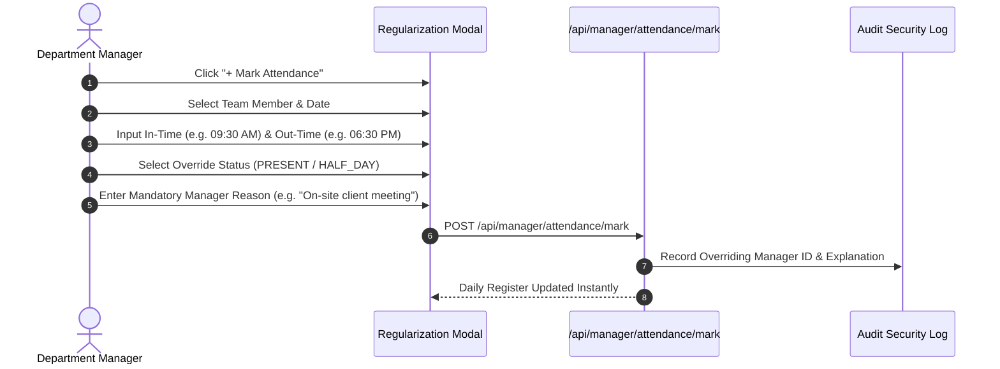

# 05. Team Attendance (`/manager/attendance`)

The **Team Attendance** module provides Department Managers with live visibility into employee check-ins, late arrivals, missing punches, and field hours. It includes tools to review GPS check-in locations, verify punch-in selfie photos, and submit managerial regularizations for team members.

---

## 📸 Interface Screenshot

<!-- SCREENSHOT_PLACEHOLDER: /manager/attendance -->
> *[Screenshot Placeholder: Department Manager Attendance Audit Console]*
> *(Image path to add: `docs/assets/images/HRMS/Manager_/attendance.png`)*

---

## 🧭 Live Presence Statuses & Badge Meanings

Every attendance record is tagged with an automated real-time status:

| Status Code | Badge Color | Definition | Action Required by Manager |
| :--- | :--- | :--- | :--- |
| **`PRESENT`** | 🟢 Emerald | Clocked in on time and fulfilled minimum daily hours (>= 8 hrs). | None; standard working day. |
| **`IN_OFFICE`** | 🔵 Blue | Actively clocked in and currently on shift. | Live shift active. |
| **`LATE`** | 🟡 Amber | Clocked in after designated grace period (e.g., > 15 mins late). | Monitor repeated late patterns. |
| **`ON_LEAVE`** | 🟣 Purple | Pre-approved leave (Casual, Sick, PTO). | Automatically scheduled absence. |
| **`ABSENT`** | 🔴 Red | No check-in record logged by shift cut-off time. | Contact employee or regularize if on duty. |

---

## 🛠️ Step-by-Step Guide: Daily Attendance Operations

### Step 1: Filter and Audit Daily Attendance
* **Date Picker**: Use the calendar bar to view today's register, yesterday's summary, or any past historical date.
* **Search Member**: Enter an employee's name to see their specific clock-in history.
* **Status Filter**: Quickly filter for `LATE` or `ABSENT` members to understand daily department capacity.
* **Effective Hours**: The table automatically computes:
  $$\text{Effective Work Hours} = \text{Clock Out} - \text{Clock In} - \text{Lunch Break}$$

---

### Step 2: Verify Check-In Authenticity (GPS, Selfie & Device)
Click on any employee row to expand their **Check-In Verification Card**:
1. **Clock-In & Clock-Out Time**: Stored in precise 12-hour AM/PM format (e.g., `09:24 AM` to `06:35 PM`).
2. **GPS Geolocation Map**: Shows the exact latitude/longitude coordinate pin where the mobile or desktop check-in was triggered.
3. **Biometric Selfie Photo**: If photo punch is enabled for field or remote staff, verifies the employee's selfie taken during punch-in.
4. **Network IP & Device**: Confirms whether the employee punched in from approved office Wi-Fi or a remote IP.

---

### Step 3: Regularize a Missed Punch (`+ Mark Attendance`)
If an employee was on official client travel, had technical issues, or forgot to punch out:

1. Click the **+ Mark Attendance** button at the top right.
2. Select the **Team Member** from the dropdown.
3. Choose the **Date** needing correction.
4. Enter the **In-Time** and **Out-Time** (e.g., `09:30 AM` to `06:30 PM`).
5. Set the **Status** to `PRESENT` or `HALF_DAY`.
6. **Enter Reason**: Type a mandatory compliance note explaining why the manual override was authorized (e.g., *"Assigned to client headquarters in BKC; manager pre-approved"*).
7. Click **Submit Regularization**. The daily attendance log and monthly payroll calculation update immediately.

---

## 📈 Weekly Attendance Analytics

* Below the register, the **Weekly Presence Trend Bar Chart** displays daily percentages of present vs. absent vs. late staff Monday through Friday.
* Use this chart to identify trends like recurring Friday or Monday absenteeism.

---

## ❓ Frequently Asked Questions (FAQ)

??? question "Can a manager delete an attendance record?"
    No. Attendance records cannot be deleted to maintain compliance and audit integrity. However, managers can submit an override with an audit reason.

??? question "Can an employee clock in while on an approved leave?"
    If an employee clocks in on a day marked `ON_LEAVE`, the system automatically alerts the manager and offers to convert the day into a working day, restoring the deducted leave balance.
