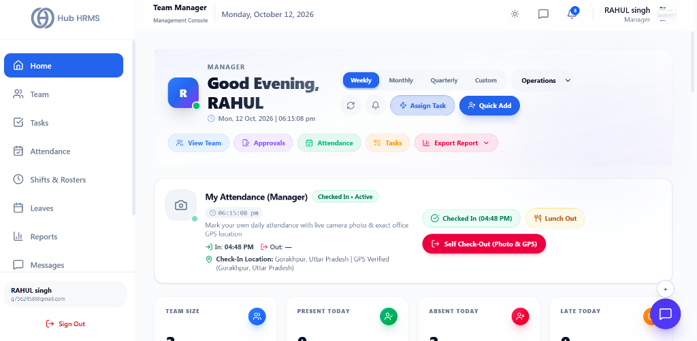
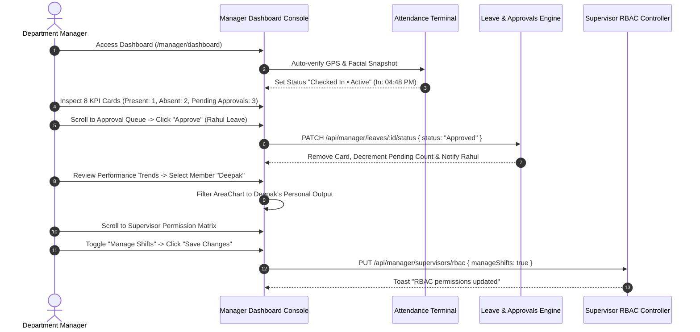

# 02. Manager Dashboard (`/manager/dashboard`)

The **Department Manager Dashboard** (`/manager/dashboard`) is the central operational command bridge for department heads, operations managers, and unit executives in Hub HRMS. Operating with elevated administrative authority compared to frontline supervisors, this console gives managers end-to-end control over department staffing, biometric clock-in verifications, instant leave adjudication, cross-member task load balancing, dynamic supervisor RBAC configuration, and multi-format executive exports.

---

## 🏛️ Live Interface Overview

Below is the live console layout of the **Department Manager Dashboard**:



---

## 🧭 Page Anatomy & Interactive Controls

The table below catalogs every button, dropdown selector, chart, modal, and action trigger on the Department Manager Dashboard:

| UI Component / Control | Visual Location | Functional Behavior & Impact |
| :--- | :--- | :--- |
| **Greeting & Live Clock** | Header Top Left | Displays dynamic greeting (`Good Morning`, `Good Afternoon`, `Good Evening`), manager name, active role badge (`Manager`), and a live running clock with second-by-second updates (`Mon, 12 Oct, 2026 \| 06:15:08 pm`). |
| **Reporting Period Pills** | Header Top Center | Interactive period toggle: `Weekly`, `Monthly`, `Quarterly`, and `Custom`. Switching periods re-queries analytics and performance charts across the department. |
| **Department Filter Dropdown** | Header Top Right | Scoped dropdown displaying assigned manager departments (e.g., *Operations*, *Engineering*, or *All Departments*). Filters all cards and widgets. |
| **Custom Date Picker** | Header Top Right (When Custom selected) | Renders `Start Date` and `End Date` inputs with an execute refresh trigger to query bespoke date intervals. |
| **Refresh Data Button** | Header Right | Triggers manual background telemetry refresh with spinning icon animation without reloading the browser page. |
| **System Alerts Bell Button** | Header Right | Toggles the **System Alerts & Sprints Drawer** (w/ red pulsing badge when alerts are active) displaying neural insights and urgent operational flags. |
| **Assign Task Button** | Header Right (Blue pill w/ Zap icon) | Direct shortcut routing to the task creation pipeline (`/manager/tasks`). |
| **Quick Add Member Button** | Header Right (Solid Blue button w/ UserPlus icon) | Launches the **Quick Add Member Modal** allowing managers to provision new Employees, Supervisors, or Finance Officers directly into their department. |
| **Quick Navigation Bar** | Below Header Banner | High-speed navigation pills: **View Team** (`/manager/team`), **Approvals** (jumps to queue w/ pending count badge), **Attendance** (`/manager/attendance`), **Tasks** (`/manager/tasks`), and **Export Report Dropdown**. |
| **Export Report Dropdown** | Quick Navigation Bar Right | Multi-format exporter: **Export as PDF (Print)**, **Export as CSV**, and **Export as Excel (XLSX)** compiling all 8 dashboard telemetry sections. |
| **My Attendance (Manager)** | Card Below Header | Manager's self-attendance terminal featuring live status (`Checked In • Active`), webcam photo snapshot preview, punch timestamps (`In: 04:48 PM`, `Out: —`), reverse-geocoded GPS physical location, **Lunch Out** break toggle, and **Self Check-Out (Photo & GPS)** button. |
| **8 Interactive KPI Filter Cards** | Top Grid (4x2 on mobile, 8-wide on desktop) | Displays: **Team Size**, **Present Today**, **Absent Today**, **Late Today**, **Pending Approvals**, **Active Tasks**, **Tasks Completed**, and **Overdue Tasks**. Clicking any card filters the charts and bento widgets below to that metric category! |
| **Performance Trends AreaChart** | Bento Row 1 Left (8 Cols) | Interactive Recharts multi-gradient Area Chart showing **Assigned Tasks** (Blue) vs. **Completed** (Green) over time. Features a **Member Filter Dropdown** (`All Members` or specific individual) and standalone **Export PDF** button. |
| **Neural AI Insights Panel** | Bento Row 1 Right (4 Cols) | Live machine-learning analytical summary analyzing team workload bottlenecks, absenteeism patterns, and sprint velocity. Includes a **View Full Report** shortcut. |
| **Approval Queue** | Bento Row 2 Left (6 Cols) | Live adjudication feed with **Sort By** dropdown (`Name`, `Date`, `Type`) and filter pills (`All`, `Leave`, `WFH`, `Overtime`). Features inline **Approve (Thumbs Up)** and **Reject (Thumbs Down)** buttons, and **View All Approvals** link. |
| **Team Performance (MVP & Coaching)** | Bento Row 2 Center (3 Cols) | Surfaces the **MVP of the Week** (Green gradient) and **Needs Coaching** candidate (Rose gradient) based on task velocity and attendance compliance. |
| **Productivity Donut Chart** | Bento Row 2 Right (3 Cols) | Recharts concentric Donut Chart calculating real percentage team productivity with an embedded data table (**Active Tasks**, **Completed**, **Overdue Tasks**) and standalone **Export** dropdown (PDF, CSV, Excel). |
| **Supervisor Permission Matrix** | Bento Row 3 Full Width | **Manager-exclusive RBAC control panel!** Allows department managers to toggle permissions for all supervisors: *View Team*, *View Tasks*, *Approve Leave*, *Approve Attendance*, *View Reports*, *Manage Shifts*, *Approve Overtime*, etc., with a **Save Changes** button. |
| **Attendance Overview BarChart** | Bento Row 4 Left (4 Cols) | Multi-color vertical Bar Chart showing **Present** (Green), **Absent** (Rose), and **Late** (Amber) counts with percentage breakdown and export. |
| **Member Workload BarChart** | Bento Row 4 Center (4 Cols) | Horizontal Recharts Bar Chart illustrating total tasks assigned vs. completed per engineer with export triggers. |
| **Task Priority Donut Chart** | Bento Row 4 Right (4 Cols) | Tri-color pie chart categorizing tasks by **High** (Red), **Medium** (Amber), and **Low** (Blue) priority with export triggers. |

---

## 🧭 Live Manager Operational Workflow

The sequence diagram below details how a manager checks in, monitors live workforce telemetry, resolves leave approvals, balances workloads, and modifies supervisor permissions:



---

## ⚙️ Step-by-Step Manager Operational Procedures

### 1. Performing Manager Self Check-In / Check-Out
Department Managers lead by example using the **My Attendance (Manager)** card:
1. Locate the card directly below the top header banner.
2. Ensure your workstation camera is connected and browser location permissions are granted.
3. The card displays your live check-in time (`In: 04:48 PM`) and physical verified location (`Gorakhpur, Uttar Pradesh | GPS Verified`).
4. To record a mid-day recess, click the amber **Lunch Out** button.
5. At the conclusion of your shift, click the red **Self Check-Out (Photo & GPS)** button to lock in your daily checkout timestamp.

### 2. Using Interactive KPI Filter Cards
Unlike static metric tiles, clicking any of the 8 KPI cards acts as an **interactive page filter**:
* Click **Pending Approvals**: Automatically isolates the view and scrolls to the **Approval Queue**.
* Click **Present Today**, **Absent Today**, or **Late Today**: Highlights the **Attendance Overview Bar Chart** and filters member cards.
* Click **Active Tasks**, **Completed Tasks**, or **Overdue Tasks**: Dynamically adjusts the **Performance Trends Area Chart** and **Member Workload** widgets.
* Click the active card again to reset the filter and display all bento sections.

### 3. Resolving the Pending Approval Queue
1. In the **Approval Queue** widget, select a category pill:
   - **All:** Displays every pending request.
   - **Leave:** Vacation, casual, or medical time-off.
   - **WFH:** Work-from-home remote attendance requests.
   - **Overtime:** Extra-shift overtime compensation claims.
2. Use the **Sort** dropdown to order by **Name**, **Date**, or **Type**.
3. Inspect the employee name, requested date range, total days, and submitted reason.
4. Click **Approve (Thumbs Up)** to immediately approve. The request is processed, quota is deducted, and the employee receives an instant push notification.
5. Click **Reject (Thumbs Down)** to decline the application with an audit record.

### 4. Configuring the Supervisor Permission Matrix (RBAC)
Managers have the exclusive power to dynamically grant or revoke privileges for all Supervisors in their department without contacting system administrators:
1. Scroll down to the **Supervisor Permission Matrix** card.
2. Review the list of operational permissions:
   - *View Team Members* (`Users:read`)
   - *View Team Tasks* (`Tasks:read`)
   - *Approve Leave Requests* (`Leave:approve`)
   - *Approve Attendance Fixes* (`Attendance:approve`)
   - *View Dashboard* (`Dashboard:read`)
   - *View Reports* (`Reports:read`)
   - *Manage Shifts* (`Shifts:write`)
   - *Approve Overtime* (`Overtime:approve`)
3. Click any toggle pill to enable (indigo) or disable (muted grey) the permission.
4. Click the indigo **Save Changes** button in the header. The button transitions to a spinning loader, followed by a green checkmark (`Saved!`), instantly propagating new privileges across all active supervisor logins.

### 5. Provisioning Personnel via Quick Add Member
1. Click the solid blue **Quick Add** button in the top right header.
2. In the **Quick Add Member Modal**, select the role: **Employee**, **Supervisor**, or **Finance Officer**.
3. Fill in the profile fields:
   - Full Name, Official Email, Mobile Number, Password & Confirm Password.
   - Base Salary (between ₹0 and ₹1,00,00,000).
   - Allowances: **TA** (Travel Allowance) and **DA** (Dearness Allowance) selectable as **Amount (₹)** or **Percentage (%)**.
   - **HRA** (House Rent Allowance).
   - Joining Date, Date of Birth, Gender, and Physical Address.
4. Click **Create Member**. The system provisions the account, issues an employee ID, and displays the temporary credentials with a quick copy trigger.

---

## 📊 Comprehensive Dashboard Export Catalogs

When you click **Export Report** in the top action bar, Hub HRMS compiles eight structured data sections into your chosen format (**PDF**, **CSV**, or **Excel XLSX**):

```
┌────────────────────────────────────────────────────────────────────────┐
│                   MANAGER DASHBOARD COMPREHENSIVE REPORT               │
├────────────────────────────────────────────────────────────────────────┤
│ 1. Key Performance Indicators (Team Size, Present, Absent, Overdue...) │
│ 2. Performance Trends (Daily Assigned vs. Completed Tasks & Rate %)    │
│ 3. Today Attendance Overview (Present, Absent, Late Counts & Shares)   │
│ 4. Member Workload Breakdown (Per-engineer tasks, completion rates)    │
│ 5. Task Priority Distribution (High, Medium, Low Task Counts)          │
│ 6. Top Performers (MVP Candidate, Score, Role)                         │
│ 7. Needs Attention (Underperforming members requiring coaching)        │
│ 8. Pending Approvals Queue (Requester, Type, Date, Duration)           │
└────────────────────────────────────────────────────────────────────────┘
```

---

## 💡 Best Practices for Department Managers

> [!TIP] **Review Member Workloads Before Sprint Assignments**  
> Check the **Member Workload** horizontal bar chart before assigning new deliverables. If an engineer already carries a heavy backlog, balance the work orders across other team members to optimize turnaround.

> [!IMPORTANT] **Save RBAC Changes Before Leaving the Page**  
> Toggling switches in the Supervisor Permission Matrix modifies local state. You must click **Save Changes** to commit updates to the relational database.

> [!NOTE] **Scoping by Assigned Department**  
> If you oversee multiple departments (e.g., *Operations* and *Quality Assurance*), use the top department dropdown to toggle between units or view an aggregated overview.

---

## ❓ Frequently Asked Questions (FAQs)

??? question "Can supervisors view the Supervisor Permission Matrix?"
    No. The permission matrix is an exclusive executive management feature only rendered on the Department Manager Dashboard (`/manager/dashboard`). Supervisors only see a read-only permission summary on their profile page.

??? question "What happens if a manager rejects a leave request?"
    The leave status is updated to `Rejected` in the relational database, removing the card from your pending queue and dispatching an immediate notification to the employee.

??? question "How is Team Productivity percentage calculated?"
    Productivity is computed dynamically based on the ratio of completed tasks against total active tasks assigned in the active review period, cross-referenced with team attendance percentage.
