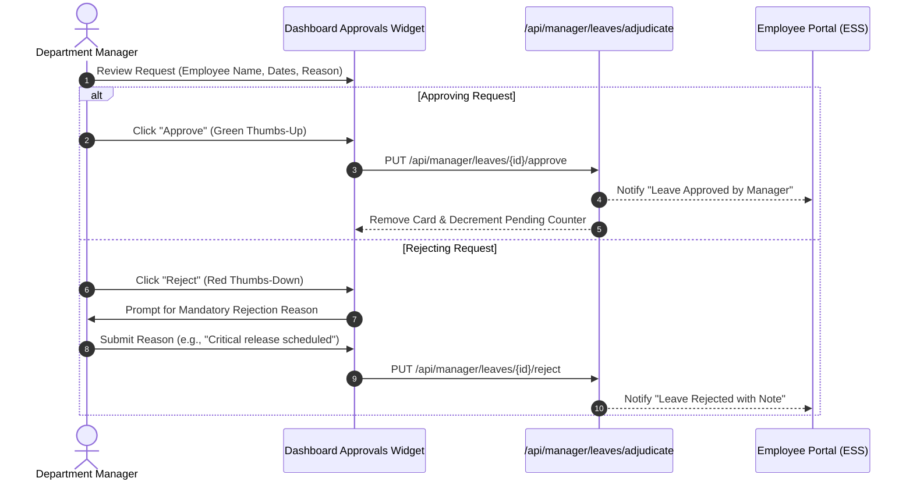

# 02. Manager Dashboard (`/manager/dashboard`)

The **Manager Dashboard** is your daily morning command center. It gives you instant visibility into how many team members are working today, pending approvals waiting for your signature, ongoing project tasks, and potential bottlenecks.

---

## 📸 Interface Screenshot

<!-- SCREENSHOT_PLACEHOLDER: /manager/dashboard -->
> *[Screenshot Placeholder: Department Manager Dashboard Console]*
> *(Image path to add: `docs/assets/images/HRMS/Manager_/dashboard.png`)*

---

## 🧭 The 8 Key Telemetry Cards

At the top of the screen, 8 real-time indicator cards summarize your team's live operational pulse:

```mermaid
graph LR
    A["👥 Team Size<br/>Total department staff"] --> B["🟢 Present Today<br/>Checked-in count"]
    B --> C["🔴 Absent Today<br/>Unreported absences"]
    C --> D["🟡 Late Today<br/>Logged in past grace time"]
    D --> E["📋 Pending Approvals<br/>Leaves & requests"]
    E --> F["⚡ Active Tasks<br/>Tasks currently in progress"]
    F --> G["✅ Tasks Completed<br/>Finished deliverables"]
    G --> H["⚠️ Overdue Tasks<br/>Past target deadline"]
```

| KPI Card | Metric Displayed | How to Use It |
| :--- | :---: | :--- |
| **1. Team Size** | Total Staff Count | Shows all active employees assigned to your department. Clicking jumps to `/manager/team`. |
| **2. Present Today** | Checked-In Count | Real-time count of team members who have clocked in today. Clicking opens `/manager/attendance`. |
| **3. Absent Today** | Absent Count | Team members who have not checked in by shift cut-off time. |
| **4. Late Today** | Late Logins | Members who arrived after the branch grace period (e.g., 15 minutes past start). |
| **5. Pending Approvals**| Pending Sign-Offs | Highlights urgent leave applications or shift regularizations awaiting your decision. |
| **6. Active Tasks** | Open Tasks | Ongoing sprint items currently being worked on by your team. |
| **7. Tasks Completed** | Completed Work | Finished deliverables for the current review period. |
| **8. Overdue Tasks** | Delayed Items | Urgent items that missed their due dates; click to reassign or adjust deadlines. |

---

## 🛠️ Step-by-Step Guide: How to Use Dashboard Features

### Step 1: Select Your Time Window
* At the top right of the dashboard, click the **Period Selector**:
  * **Weekly**: Inspect this week's attendance and task sprint.
  * **Monthly**: Review overall monthly team performance and quota burn.
  * **Quarterly**: Strategic view for quarterly reviews and OKRs.
  * **Custom**: Pick specific start and end calendar dates.

---

### Step 2: Resolve Pending Approvals Directly
Below the KPI cards, the **Pending Approvals** widget displays all team members requesting time off:

1. Look at the **Employee Name**, **Leave Category** (Casual, Sick, PTO), **Date Range**, and **Calculated Days**.
2. Read the employee's submitted explanation reason.
3. Click **Approve (Thumbs Up)** to immediately approve the request.
4. Or click **Reject (Thumbs Down)** to enter a reason and return the request to the employee.

---

### Step 3: Check Team Workload & Top Performers
* **Team Workload Chart (Bar Chart)**: Displays the number of active tasks assigned to each team member.
  * *Tip for Managers*: If one engineer has 8 tasks while another has 1, reassign tasks in `/manager/tasks` to prevent burnout.
* **Top & Low Performers Widget**: Automatically surfaces members exceeding delivery targets or falling behind to help you plan coaching 1-on-1s.

---

### Step 4: Use Dashboard Quick Actions
* **+ Add Member**: Quickly provision a new team member into your department.
* **+ Assign Task**: Open the task creator modal to assign a new deliverable.
* **Export Summary**: Click **Export** to download an executive summary in **Excel (.xlsx)**, **CSV**, or **PDF**.

---

## ❓ Frequently Asked Questions (FAQ)

??? question "Can I see employees from other departments on my dashboard?"
    No. Your dashboard is automatically filtered to show only staff members belonging to your assigned department.

??? question "What does the 'Overdue Tasks' counter track?"
    It counts any task whose due date is in the past and whose status is not yet marked as `Completed`.
