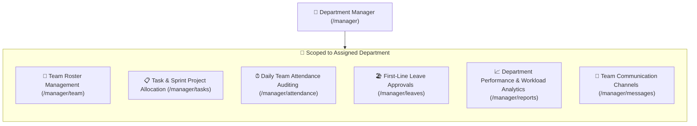

# 👔 Department Manager & Supervisor Guide — Overview

The **Department Manager / Supervisor** portal (`/manager/dashboard`) is the dedicated operational command workspace for team leaders, engineering managers, sales heads, and operational supervisors within Hub HRMS.

---

## 🎯 Role Purpose & Operational Scope

Department Managers are responsible for team delivery, day-to-day attendance tracking, project task allocations, and first-line leave approvals for their assigned department.

Unlike Company Admins or HR Directors who oversee the entire organization, a Department Manager's data view is **scoped strictly to their own department** (e.g., *Engineering*, *Marketing*, *Sales*, or *Operations*).

---

## 🔐 Permissions & Access Rights (RBAC)

| Operational Capability | Employee (ESS) | Department Manager | HR Specialist | Company Admin |
| :--- | :---: | :---: | :---: | :---: |
| **View Own Attendance & Payslips** | ✅ | ✅ | ✅ | ✅ |
| **View Department Team Roster** | ❌ | ✅ (Department only) | ✅ (All Depts) | ✅ (All Depts) |
| **Assign Tasks & Set Deadlines** | ❌ | ✅ (Department team) | ✅ (All staff) | ✅ (All staff) |
| **Approve / Reject Team Leaves** | ❌ | ✅ (Department team) | ✅ (Final HR Gate) | ✅ (Company-wide) |
| **Manual Clock-in / Override for Team** | ❌ | ✅ (With audit reason) | ✅ | ✅ |
| **Add New Department Member** | ❌ | ✅ (Within assigned dept) | ✅ | ✅ |
| **Company-Wide Payroll Execution** | ❌ | ❌ | ✅ | ✅ |
| **Company Multi-Branch Settings** | ❌ | ❌ | ❌ | ✅ |

---

## 🧭 Department Manager Sidebar Modules

The Manager navigation sidebar features 10 purpose-built modules:

| # | Chapter | Route | Primary Responsibilities |
|---|---|---|---|
| **01** | [Overview](index.md) | `/manager/` | Role introduction, department scope, and navigation sitemap. |
| **02** | [Manager Dashboard](dashboard.md) | `/manager/dashboard` | Daily workforce telemetry, pending approvals queue, top performers, and quick actions. |
| **03** | [Team Roster](team.md) | `/manager/team` | Team member directory, slide-out profile drawers, productivity scores, and member onboarding. |
| **04** | [Task Allocation](tasks.md) | `/manager/tasks` | Task boards, sprint deadlines, calendar schedule, and team workload balance charts. |
| **05** | [Team Attendance](attendance.md) | `/manager/attendance` | Real-time presence logs, clock-in times, GPS locations, and shift regularization overrides. |
| **06** | [Leave Approvals](leaves.md) | `/manager/leaves` | Adjudicating leave requests, quota balance inspection, and approval/rejection workflows. |
| **07** | [Performance & Reports](reports.md) | `/manager/reports` | Team productivity trends, task completion velocity, department salary budget outflow. |
| **08** | [Team Messages](messages.md) | `/manager/messages` | Department chat channels, 1-on-1 employee feedback, and one-click HubMeet video calls. |
| **09** | [Support & Grievances](support.md) | `/manager/support` | Departmental IT and administrative helpdesk ticketing console. |
| **10** | [Manager Profile](profile.md) | `/manager/profile` | Personal profile credentials, password updates, language preferences, and security settings. |

---

## 📸 Interface Screenshot

<!-- SCREENSHOT_PLACEHOLDER: /manager/dashboard -->
> *[Screenshot Placeholder: Department Manager Command Console Overview]*
> *(Image path to add: `docs/assets/images/HRMS/Manager_/dashboard.png`)*

---

## 🚀 Recommended Daily Routine for Department Managers

1. **Morning Check (09:30 AM)**: Open `Dashboard` (`/manager/dashboard`) and `Attendance` (`/manager/attendance`) to check who is present, late, or on leave.
2. **Review Leave Queue**: Check `Leaves` (`/manager/leaves`) to approve or reject upcoming time-off requests so shifts remain adequately staffed.
3. **Sprint & Task Sync**: Open `Tasks` (`/manager/tasks`) to allocate daily deliverables, check overdue milestones, and balance team workloads.
4. **Performance & Support**: Monitor the `Team` (`/manager/team`) productivity scores and address any tickets in `Support` (`/manager/support`).
