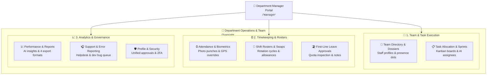
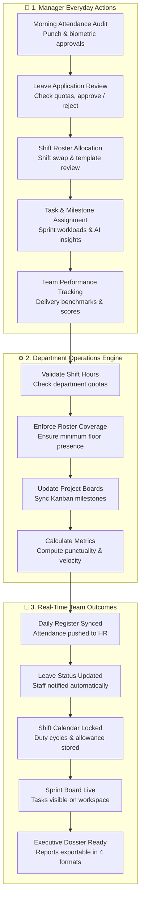

# 👔 Department Manager & Supervisor Comprehensive Guide

The **Department Manager / Supervisor** portal (`/manager/*`) is the dedicated operational command workspace for team leaders, engineering managers, sales directors, and operational supervisors within Hub HRMS. Built with role-scoped authority, it equips managers with the tools needed to oversee team delivery, audit attendance, manage shift rosters, approve leave requests, track productivity, and resolve departmental support requests.

---

## 🏛️ Live Interface Overview

Below is the live console layout of the **Department Manager Command Console**:

---

## 🎯 Role Purpose & Operational Scope

Department Managers are responsible for team delivery, day-to-day attendance tracking, project task allocations, shift cycle planning, and first-line leave approvals for their assigned department.

Unlike Company Admins or HR Directors who oversee the entire organization, a Department Manager's data view is **scoped strictly to their own department** (e.g., *Engineering*, *Marketing*, *Sales*, or *Operations*).

---

## 🧭 Functional Workflow & Managerial Approval Chain

When managing day-to-day operations, actions performed by the Department Manager seamlessly connect with team members and organizational administrators:

---

## 🔐 Permissions & Access Rights (RBAC Matrix)

| Operational Capability | Employee (ESS) | Department Manager | HR Specialist | Company Admin |
| :--- | :---: | :---: | :---: | :---: |
| **View Own Attendance & Payslips** | ✅ | ✅ | ✅ | ✅ |
| **View Department Team Roster** | ❌ | ✅ (Department only) | ✅ (All Depts) | ✅ (All Depts) |
| **Assign Tasks & Set Deadlines** | ❌ | ✅ (Department team) | ✅ (All staff) | ✅ (All staff) |
| **Manage Shift Rosters & Swaps** | ❌ | ✅ (Department team) | ✅ (All staff) | ✅ (All staff) |
| **Approve / Reject Team Leaves** | ❌ | ✅ (Department team) | ✅ (Final HR Gate) | ✅ (Company-wide) |
| **Manual Clock-in / Override for Team** | ❌ | ✅ (With audit reason) | ✅ | ✅ |
| **Add New Department Member** | ❌ | ✅ (Within assigned dept) | ✅ | ✅ |
| **Multi-Format Reports Export (PDF/Excel)** | ❌ | ✅ (Department reports) | ✅ (Company reports) | ✅ (Full BI) |
| **Company-Wide Payroll Execution** | ❌ | ❌ | ✅ | ✅ |
| **Company Multi-Branch Settings** | ❌ | ❌ | ❌ | ✅ |

---

## 🧭 Department Manager Navigation Sitemap

The Manager navigation sidebar features 10 comprehensive modules fully documented with button-level precision and live UI screenshots:

| # | Chapter | Route | Primary Responsibilities & UI Features |
|---|---|---|---|
| **01** | [Overview](index.md) | `/manager/` | Role introduction, department scope, RBAC matrix, and navigation directory. |
| **02** | [Manager Dashboard](dashboard.md) | `/manager/dashboard` | 8 clickable KPI filter cards, live clock self-punch, Performance AreaChart, Neural AI Insights, MVP/Needs Coaching widgets, Productivity Donut, Supervisor Permission Matrix, and Quick Add Member modal. |
| **03** | [Team Roster](team.md) | `/manager/team` | Top Performer Spotlight, 3 analytics cards, Grid/Table view switcher, 5 dropdown filters, member cards w/ presence dots, Top Performers & Needs Attention widgets, Workload Spread chart, and 4-tab Slide-Out Dossier Drawer. |
| **04** | [Task Allocation](tasks.md) | `/manager/tasks` | 4 clickable KPI cards, AI Cognitive Insight ribbon, 5 view tabs (List, Calendar, Workload Map, Projects, AI Insights), Task Creation modal w/ AI assignee recommendation, and Task Review Drawer. |
| **05** | [Team Attendance](attendance.md) | `/manager/attendance` | Audit Date Picker, Self-Attendance terminal, 6 KPI cards, Weekly Trend & Today's Split charts, DataTableToolbar, Detailed Attendance registry, Biometric photo & GPS reverse-geocoded modal, Single/Bulk Mark Attendance modal. |
| **06** | [Shift Rosters & Duty Cycles](shifts.md) | `/manager/shifts` | Active Shift Templates carousel (General, Morning, Evening, Night w/ allowance tags), Define Shift Template modal, Assign Shift modal with custom timing override, Shift Swap Approval queue, and Daily Roster table. |
| **07** | [Leave Approvals](leaves.md) | `/manager/leaves` | 3 clickable KPI filter cards (Pending, Approved, Rejected), 3 Donut/Bar charts (Status, Type, Employee), Search & Filter toolbar, Leave Request Log table, Rejection Reason modal with mandatory text, and Leave Details modal. |
| **08** | [Team Performance & Reports](reports.md) | `/manager/reports` | Period selector (Weekly, Monthly, Quarterly), 4 export formats (PDF, Excel, CSV, Word), 4 KPI filter cards, AI Insight banner, 6 rich charts with embedded tables, and Detailed Team Performance registry. |
| **09** | [Support & Grievances](support.md) | `/manager/support` | Dual queue tabs (Support Tickets vs Reported Errors), Ticket Creation Composer with dev priority routing, two-way chronological message stream, and one-click Close Ticket authorization. |
| **10** | [Manager Profile](profile.md) | `/manager/profile` | Avatar photo upload/delete, 5 management tabs: Personal & Job Info (Personal data, Dual Bank & UPI accounts, Document Vault), Master Approval Center (Leaves, Tasks, Attendance, Overtime), AI Performance, Settings & Security (2FA, Sessions Revoke), and Helpdesk. |

---

## 🚀 Recommended Daily Routine for Department Managers

1. **Morning Attendance Check (09:15 AM)**:
   - Open **Team Attendance** (`/manager/attendance`) and verify real-time check-in dots, biometric photos, and physical GPS addresses.
2. **Shift Roster & Swap Audit (09:45 AM)**:
   - Check **Shift Rosters** (`/manager/shifts`) to review shift allocations, approve peer swap requests, and verify night shift allowance coverage.
3. **Review Master Approval Center (10:15 AM)**:
   - Open **Manager Profile** (`/manager/profile#approvals`) or **Leave Approvals** (`/manager/leaves`) to approve or reject pending leaves, overtime, and attendance corrections.
4. **Sprint & Task Sync (11:00 AM)**:
   - Navigate to **Task Allocation** (`/manager/tasks`) to check overdue deliverables, balance employee workloads, and dispatch new tasks with AI assignee suggestions.
5. **Evening Performance Review (05:30 PM)**:
   - Inspect **Team Performance & Reports** (`/manager/reports`) to evaluate sprint velocity, verify salary bands, and export executive audit dossiers for departmental meetings.

---

## ❓ Frequently Asked Questions (FAQ)

??? question "Can I see employees from other departments on my dashboard?"
    No. Your dashboard is automatically filtered to show only staff members belonging to your assigned department. Inter-departmental visibility is reserved for HR Specialists and Company Admins.

??? question "Can I reassign an employee to another department?"
    Inter-departmental transfers require HR Specialist sign-off. You can update titles and task responsibilities within your own department roster.

??? question "How do I delegate supervisory permissions to my team leads?"
    Open **Manager Dashboard** (`/manager/dashboard`), locate the **Supervisor Permission Matrix** card, toggle the specific permissions (e.g., Mark Attendance, View Reports, Assign Tasks) for your supervisor, and click **Save Changes**.
