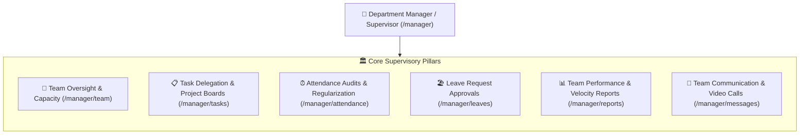

# 👔 Department Manager & Supervisor Guide

The **Department Manager / Supervisor** portal (`/manager/dashboard`) is the dedicated workspace for team leads, supervisors, and department heads. It provides immediate tools to oversee direct reports, track daily attendance, approve time-off requests, delegate tasks, and conduct performance reviews.

---

## 🎯 Role Overview & Supervisory Scope

Department Managers act as the vital bridge between individual employees and corporate administration—maintaining direct operational accountability for team deliverables, attendance compliance, and capacity balancing.

---

## 🧭 Manager Portal Sidebar Modules

| # | Module | Route | Primary Responsibilities |
|---|---|---|---|
| **01** | [Home / Dashboard](dashboard.md) | `/manager/dashboard` | Daily team pulse, pending approvals counter, active roster, and task deadlines. |
| **02** | [Team](team.md) | `/manager/team` | Direct reports directory, contact details, skill tags, and reporting hierarchy. |
| **03** | [Tasks](tasks.md) | `/manager/tasks` | Team task delegation, Kanban project boards, and sprint milestone tracking. |
| **04** | [Attendance](attendance.md) | `/manager/attendance` | Reviewing daily punch logs, approving regularization requests, and monitoring tardiness. |
| **05** | [Leaves](leaves.md) | `/manager/leaves` | Approving or rejecting employee leave applications while maintaining shift coverage. |
| **06** | [Reports](reports.md) | `/manager/reports` | Team productivity trends, attendance percentages, and project completion velocity. |
| **07** | [Messages](messages.md) | `/manager/messages` | Direct chat with direct reports, department channels, and HubMeet calling. |
| **08** | [Help & Support](support.md) | `/manager/support` | Raising departmental IT, equipment, or HR support tickets. |
| **09** | [Profile](profile.md) | `/manager/profile` | Personal account credentials, 2FA security, and approval delegation. |

---

## 📸 Interface Screenshots

<!-- SCREENSHOT_PLACEHOLDER: Manager Dashboard Overview -->
> *Screenshot will be added here upon user submission.*
