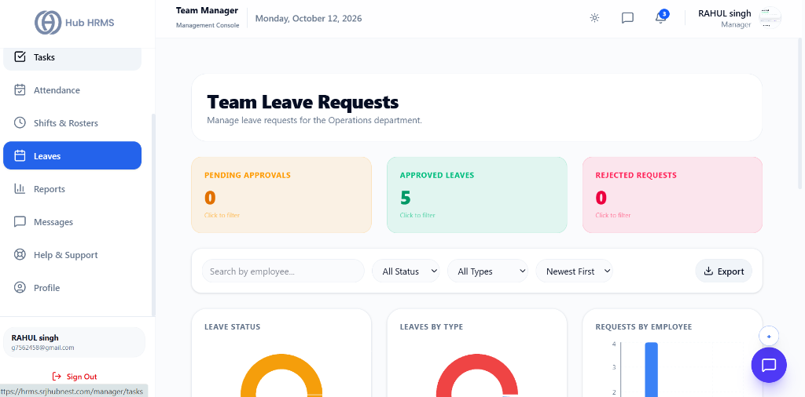
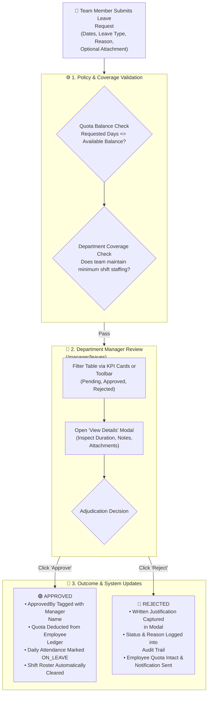
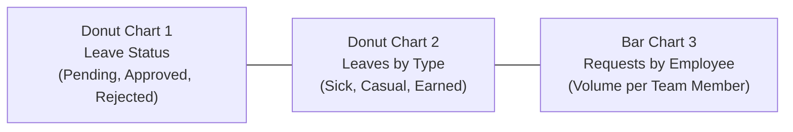
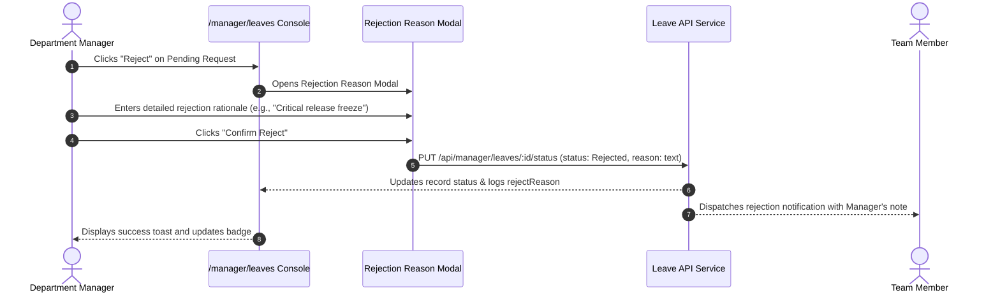

# 06. Leave Approvals & Team Coverage (`/manager/leaves`)

The **Leave Approvals** module allows Department Managers to inspect, adjudicate, and audit time-off applications submitted by their department team members. Serving as the primary authorization barrier, managers ensure that client deliverables, sprint milestones, and shift staffing remain balanced while honoring employee leave entitlements.

---

## 🏛️ Live Interface Overview

Below is the live console layout of the **Department Manager Leave Approvals** console:

---

## 🧩 Leave Approval Workflow Architecture

The diagram below details how leave requests submitted by employees flow to the Department Manager, undergo policy validation, update leave balances, and send instant system notifications:

---

## 🧭 Page Anatomy & Control Directory

The `/manager/leaves` interface consists of four primary functional zones: interactive KPI filter cards, an enterprise search and filtering toolbar, real-time analytics distribution charts, and a responsive Leave Request Log table with detail & rejection modals.

### 1. Interactive KPI Filter Cards

At the top of the console, three high-contrast metric cards summarize the department's leave pipeline. **Each card functions as an instant table filter toggle**:

| Card Name | Accent Color | Metric Displayed | Interactive Behavior & Filter Action |
| :--- | :--- | :--- | :--- |
| **Pending Approvals** | Amber (`#f59e0b`) | Count of active, unreviewed leave requests awaiting manager decision | Clicking filters the table to display only **Pending** requests. An active glowing border and "✕ Clear filter" badge appear. Clicking again restores all records. |
| **Approved Leaves** | Emerald (`#10b981`) | Count of authorized leave requests for the department | Clicking filters the table to display only **Approved** leaves. Toggles on/off. |
| **Rejected Requests** | Rose (`#ef4444`) | Count of denied leave requests | Clicking filters the table to display only **Rejected** leaves. Toggles on/off. |

---

### 2. Search, Filter & Export Toolbar

Positioned immediately above the charts and table, this utility bar enables rapid multidimensional querying and one-click data extraction:

| Control | Type | Values / Scope | Operational Purpose |
| :--- | :--- | :--- | :--- |
| **Search by employee...** | Text Input | Case-insensitive string search | Dynamically filters leave requests in real time by employee name or email address. |
| **Status Filter** | Dropdown Menu | `All Status`, `Pending`, `Approved`, `Rejected` | Restricts the record set by approval lifecycle status. Synced with the top KPI cards. |
| **Leave Type Filter** | Dropdown Menu | `All Types`, `Sick Leave`, `Casual Leave`, `Earned Leave` | Filters applications by specific entitlement bucket. |
| **Sort By** | Dropdown Menu | `Newest First` (Default), `Oldest First` | Orders requests chronologically based on their start date (`startDate`). |
| **Export Data** | Export Dropdown Button | CSV Download (`Leave_Requests_Report_[Dept].csv`) | Exports the filtered table rows with complete metadata including Request ID, Employee Name, Email, Leave Type, Dates, Total Days, Reason, Status, and Manager Comments. |

---

### 3. Analytics & Distribution Charts

Positioned above the registry, three auto-calculating visual charts provide department-wide leave trends:

1. **Leave Status (Donut Chart):** Visualizes the proportion of Pending, Approved, and Rejected requests across the department using distinct theme colors. Hovering reveals total volume and percentage split.
2. **Leaves by Type (Donut Chart):** Displays entitlement consumption patterns (e.g., whether the team is primarily utilizing Sick Leave or Casual Leave), assisting managers in identifying burnout or health patterns.
3. **Requests by Employee (Bar Chart):** Renders vertical frequency bars displaying total time-off requests submitted per individual team member, highlighting repeat absences at a glance.

---

### 4. Leave Request Log & Adjudication Controls

The primary table renders all filtered department applications with responsive adaptations for desktop and mobile viewports:

| Column / Field | Description | Visual Badges & Elements |
| :--- | :--- | :--- |
| **Employee** | Team member identification | Displays circular employee avatar or initials avatar badge, full name, email address, and official Employee ID (`#EMP-XXXX`). |
| **Leave Type** | Entitlement category | Highlighted category text (e.g., Casual Leave, Sick Leave, Earned Leave). |
| **Duration** | Date span and calendar count | Start Date (`YYYY-MM-DD`) to End Date (`YYYY-MM-DD`) with computed calendar days badge (`X day(s)`). |
| **Reason** | Employee-submitted explanation | Truncated note preview with full text available on hover tooltip. Shows *No reason* if left blank. |
| **Status** | Current adjudication state | Glowing status pill with indicator dot: Amber for Pending, Emerald for Approved, Rose for Rejected. Displays `Approved by: [Name]` or `Rejected by: [Name]` once adjudicated. |
| **Actions** | Manager decision buttons | Quick actions: **View Details** (Modal), **Approve** (Green checkmark button), and **Reject** (Red cross button). |

---

## 🛠️ Step-by-Step Operations

### Approving a Leave Request
1. Navigate to **Leave Approvals** (`/manager/leaves`) from the side navigation bar.
2. Locate the employee's request in the table. You can click the **Pending Approvals** KPI card to isolate all pending requests immediately.
3. Review the leave type, dates, and total duration.
4. Click the green **Approve** button.
5. The system immediately captures your authenticated manager name (`approvedBy`), updates the status badge to **Approved** (Emerald), deducts the requested days from the employee's remaining quota, and notifies the employee.

---

### Rejecting a Leave Request with Mandatory Justification
Company policy requires a clear written explanation whenever an employee's time-off request is denied:

1. On the target row, click the red **Reject** button.
2. The **Reject Leave Request** modal appears.
3. In the text area, type a clear, professional reason for the refusal (e.g., *“High client launch volume during this week; please reschedule to next sprint”*). A blank reason cannot be submitted.
4. Click **Confirm Reject**. The modal closes, a confirmation toast displays, and the employee is notified with your note.

---

### Inspecting Leave Details & Supporting Documents
1. Click the **View Details** button on any leave entry.
2. The **Leave Request Details** modal opens, presenting:
   - **Employee ID & Email:** Verified identity records.
   - **Leave Type & Current Status:** Official classification.
   - **Adjudicator Footprint:** Displays who approved or rejected the request (if already reviewed).
   - **Start & End Dates:** Exact timeline.
   - **Reason for Leave:** Complete un-truncated submission text.
   - **Rejection Reason:** Logged rejection explanation (if previously rejected).
   - **Attachment Link:** If the employee uploaded medical certificates or travel documents, a clickable download link opens the file in a new tab.
3. Click the **✕** button to close the modal.

---

## 💡 Best Practices for Department Managers

> [!TIP] **Reviewing Overlapping Requests**  
> Before approving extended leave, check your **Team Attendance** (`/manager/attendance`) and **Shift Rosters** (`/manager/shifts`) consoles to ensure your department maintains minimum staffing coverage for operational continuity.

> [!IMPORTANT] **Mandatory Rejection Documentation**  
> Always provide constructive, polite reasons in the Rejection Modal. The written explanation is permanently recorded in the employee's HR profile and visible to HR Specialists and Company Admins.

> [!NOTE] **Automated Shift Adjustment**  
> Once a leave request is marked **Approved**, the system automatically clears the employee's active shift assignments for those dates and flags their daily attendance status as **ON_LEAVE**.

---

## ❓ Frequently Asked Questions (FAQs)

**Q1: Can I reverse my decision if I accidentally approved or rejected a leave?**  
Once adjudicated, the status is committed to the employee's quota balance. If an approval needs cancellation (e.g., the employee decides to come to work), the employee can submit an attendance punch or contact HR to re-credit the leave ledger.

**Q2: What happens if an employee submits a leave request with zero balance?**  
The system allows leave requests subject to company policy; however, unpaid leave (Loss of Pay) rules configured by your HR department will automatically apply during monthly payroll calculation.

**Q3: How do I export leave reports for department meetings?**  
Apply your desired date filters or employee search criteria, then click the **Export Data** dropdown and select **CSV**. The system downloads a complete, formatted spreadsheet ready for review.
