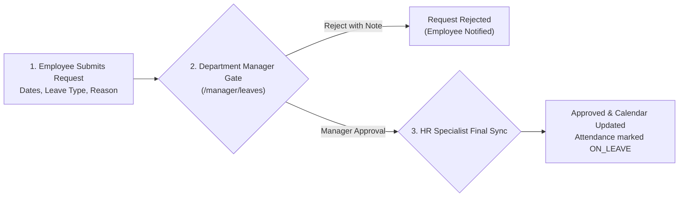

# 06. Leave Approvals (`/manager/leaves`)

The **Leave Approvals** module allows Department Managers to review and adjudicate time-off requests submitted by their team members. Managers act as the primary operational approval gate before requests are locked in company records.

---

## 📸 Interface Screenshot

<!-- SCREENSHOT_PLACEHOLDER: /manager/leaves -->
> *[Screenshot Placeholder: Department Manager Leave Approvals Console]*
> *(Image path to add: `docs/assets/images/HRMS/Manager_/leaves.png`)*

---

## 🧭 The Two-Tier Approval Hierarchy

1. **Step 1: Employee Submission**: The employee applies for leave through their ESS portal (`/employee/leaves`).
2. **Step 2: Department Manager Gate**: The request appears immediately in your `/manager/leaves` queue. You verify team coverage and approve or reject.
3. **Step 3: HR Synchronization**: Once approved, the leave is deducted from the employee's quota and automatically synced with daily attendance and payroll cut-offs.

---

## 🛠️ Step-by-Step Guide: How to Process Leave Requests

### Step 1: Filter the Approvals Queue
* **Filter by Status**:
  * `PENDING`: Urgent requests awaiting your managerial decision.
  * `APPROVED`: Historical requests you have signed off on.
  * `REJECTED`: Declined requests with explanatory notes.
  * `ALL`: Complete department leave history.
* **Filter by Leave Type**: View specifically `Sick Leave`, `Casual Leave`, or `Paid Time Off (PTO)`.
* **Search Box**: Search by team member name or keywords in the submitted explanation.

---

### Step 2: Review Request Details
Click on any pending request row to review:
* **Employee Avatar & Name**: Identifies the requester.
* **Leave Type**: E.g., `Casual Leave (CL)`, `Sick Leave (SL)`, or `Privileged Leave (PL)`.
* **Date Span & Days**: E.g., *14 Oct 2026 to 16 Oct 2026 (3 Days)*.
* **Remaining Quota Balance**: Displays how many leave days the employee has remaining in their annual allotment.
* **Reason Provided**: Personal explanation submitted by the employee (e.g., *"Attending family wedding"*).

---

### Step 3: Approve or Reject the Request
* **To Approve**:
  * Click the green **Approve (Checkmark)** button.
  * The status changes immediately to `APPROVED`.
  * The employee receives an automated email and in-app alert informing them their leave is confirmed.
* **To Reject (With Mandatory Reason)**:
  * Click the red **Reject (X)** button.
  * A modal opens prompting you to provide a **Rejection Reason**:
    * *Example*: *"High priority sprint release scheduled during requested dates; please reschedule."*
    * *Example*: *"Team already operating at minimum capacity due to existing approved leaves."*
  * Click **Confirm Rejection**. The reason is sent directly to the employee for transparent feedback.

---

## 📊 Leave Analytics & Distribution Charts

* **Leave Type Breakdown (Donut Chart)**: Displays the ratio of Casual vs. Sick vs. Earned leaves across your department.
* **Monthly Leave Trend (Bar Chart)**: Visualizes historical leave volume month-by-month to assist in seasonal capacity planning (e.g., festival seasons, year-end holidays).

---

## ❓ Frequently Asked Questions (FAQ)

??? question "Can a manager cancel an already approved leave?"
    Yes. If project circumstances change with mutual consent, a manager can open the approved record and click **Revoke Approval**, restoring the deducted leave balance to the employee.

??? question "What happens if a manager does not approve a request before the leave date?"
    The request remains in `PENDING` status. If the employee does not report to work, their attendance is logged as `ABSENT` until the manager regularizes the entry or approves the back-dated leave.
