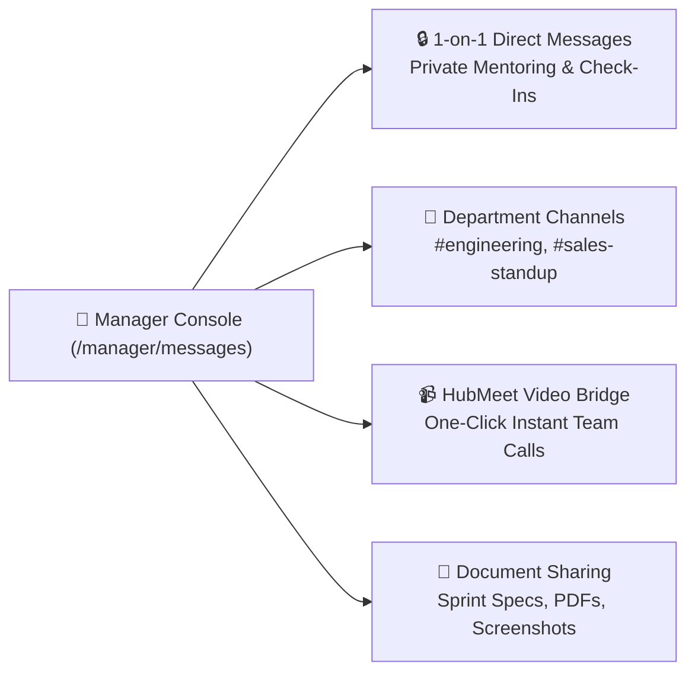

# 08. Team Communication (`/manager/messages`)

The **Team Communication** module provides Department Managers with an integrated chat and collaboration hub. Managers can direct-message team members for 1-on-1 feedback, coordinate in department-wide group channels, and launch instant **HubMeet video calls** without leaving the platform.

---

## 📸 Interface Screenshot

<!-- SCREENSHOT_PLACEHOLDER: /manager/messages -->
> *[Screenshot Placeholder: Department Manager Communication Console]*
> *(Image path to add: `docs/assets/images/HRMS/Manager_/messages.png`)*

---

## 🧭 Communication Channels & Features

---

## 🛠️ Step-by-Step Guide: How to Communicate with Your Team

### Step 1: Start a 1-on-1 Direct Chat
1. In the left panel, click on any team member's name from your contacts list.
2. Type your message in the text input box and press **Enter**.
3. **Presence Indicators**: Check the status dot next to their avatar to see if they are `Online` (🟢), `In a Meeting` (🔴), `Away` (🟡), or `Offline` (⚪).
4. Use 1-on-1 chats for private 1-on-1 performance feedback, sprint blockers, or quick questions.

---

### Step 2: Coordinate in Department Channels
* **Department Channel (e.g., `#engineering-team`)**: All members assigned to your department are automatically added to this channel.
* Use this channel for daily standup updates, milestone announcements, and team-wide circulars.
* **Mention Team Members**: Type `@name` to notify a specific team member directly.

---

### Step 3: Launch an Instant HubMeet Video Call
When an issue requires live verbal discussion or screen sharing:
1. Open the direct chat with the team member or open your department channel.
2. In the top-right header of the chat window, click the **Video Call (Camera)** icon.
3. Hub HRMS generates a secure **HubMeet Video Call Room** link automatically.
4. The link is posted into the chat so team members can join with one click.
5. In the call, you can share your screen, use the collaborative whiteboard, and record meeting minutes.

---

### Step 4: Share Files and Attachments
* Click the **Paperclip (Attachment)** icon to upload sprint specs, bug screenshots, or PDF documents up to 50 MB.
* Embedded previews allow team members to view images and read PDF documents directly within the chat window.

---

## ❓ Frequently Asked Questions (FAQ)

??? question "Can other department managers see my team's private chats?"
    No. Direct messages between a manager and their team members are private and end-to-end encrypted. Department channels are visible only to members assigned to that specific department.
