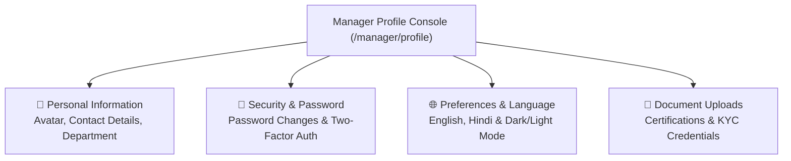

# 10. Manager Profile (`/manager/profile`)

The **Manager Profile** module allows Department Managers to keep their personal details updated, manage administrative credentials, configure multi-factor security, adjust interface languages, and manage security sessions.

---

## 📸 Interface Screenshot

<!-- SCREENSHOT_PLACEHOLDER: /manager/profile -->
> *[Screenshot Placeholder: Department Manager Profile & Security Settings]*
> *(Image path to add: `docs/assets/images/HRMS/Manager_/profile.png`)*

---

## 🧭 Navigation Workspaces

---

## 🛠️ Step-by-Step Guide: How to Manage Profile & Settings

### Step 1: Update Personal Contact Details
1. **Profile Photo**: Hover over your avatar circle, click the **Camera Icon**, select a professional JPEG or PNG photo, and save. The image updates across company directories.
2. **Contact Numbers**: Update your mobile phone number and direct corporate extension for workplace reachability.
3. **Emergency Contacts**: Maintain designated primary and secondary emergency contact details.

---

### Step 2: Change Your Login Password
1. Click the **Change Password** section.
2. In the modal:
   * Enter your **Current Password**.
   * Enter your **New Password** (Must be at least 8 characters, containing uppercase, lowercase, numbers, and symbols).
   * Re-enter your password in the **Confirm Password** field.
3. Click **Update Password**. All active sessions are refreshed with the new authentication token.

---

### Step 3: Configure Two-Factor Authentication (2FA)
* Enable Multi-Factor Authentication (MFA) using **Google Authenticator**, **Microsoft Authenticator**, or **Authy**.
* Scan the presented QR code with your authenticator mobile app and enter the 6-digit confirmation code.
* Once active, every subsequent login will require both your password and your temporary 6-digit authenticator code.

---

### Step 4: Interface Language & Dark Mode
* **Language Selection**: Toggle between **English**, **Hindi**, and international languages using the language dropdown.
* **Theme Toggle**: In the top navigation bar, click the **Sun / Moon** icon to toggle between **Light Mode**, **Dark Mode**, or **System Default**.

---

## ❓ Frequently Asked Questions (FAQ)

??? question "Can I change my department or manager title from my profile page?"
    Official department allocations and designations are governed centrally by HR Specialists. To request a title or department update, contact HR or raise an internal ticket via `/manager/support`.
