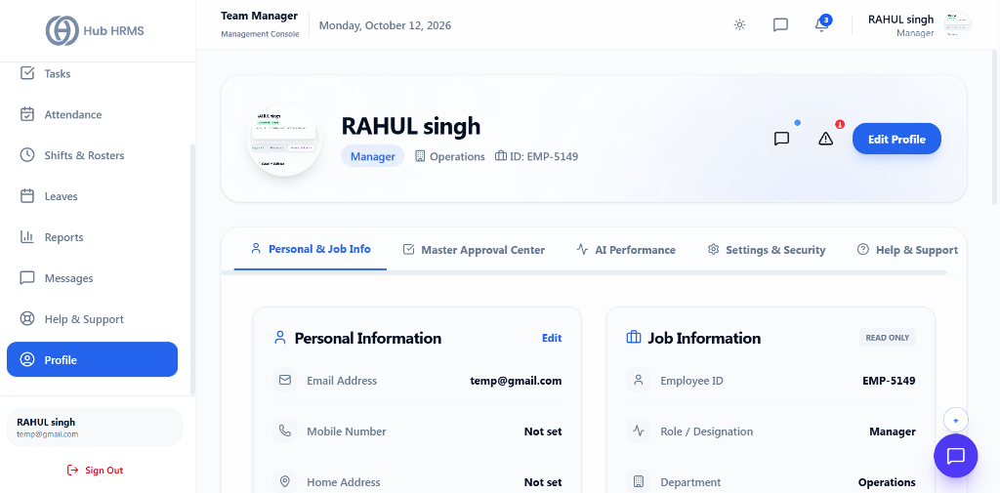
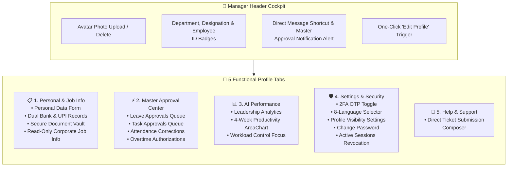
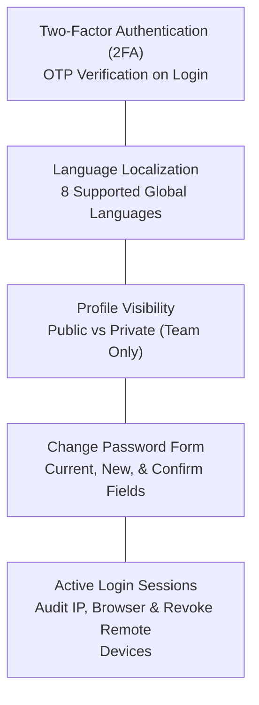

# 11. Manager Profile, Master Approvals & Security (`/manager/profile`)

The **Manager Profile** module serves as the executive cockpit and personal administration hub for Department Managers. Beyond managing contact details and dual banking information, it integrates a unified **Master Approval Center** across all subordinate requests (leaves, tasks, attendance corrections, and overtime), tracks leadership analytics with 4-week productivity curves, safeguards account access via two-factor authentication (2FA) and session revocation, and houses a secure document vault.

---

## 🏛️ Live Interface Overview

Below is the live console layout of the **Department Manager Profile & Security** workspace:

---

## 🧩 Manager Profile & Executive Operations Architecture

The diagram below details the five integrated functional hubs accessible directly from the Manager Profile console:

---

## 🧭 Page Anatomy & Control Directory

The `/manager/profile` workspace is structured into an executive identity header and five specialized management tabs:

### 1. Executive Identity Header

Located at the top of the screen with a glassmorphism backdrop and background ambient gradient:

| Element / Control | Visual Representation | Operational Action |
| :--- | :--- | :--- |
| **Profile Photo Avatar** | Circular 96px avatar with camera overlay | Hovering displays a **Change Photo** (Camera icon) and **Delete Photo** (Trash can icon) button. Selecting an image automatically updates the user profile photo across the entire portal. |
| **Identity Badges** | Full name, role badge, department tag, and ID | Displays manager full name, designated leadership title (e.g., `Engineering Manager`), assigned department (`Building` icon), and Employee ID (`Briefcase` icon). |
| **Direct Message Shortcut** | Message bubble button with blue pulsing dot | Navigates immediately to the internal messaging center (`/manager/messages`). |
| **Master Approval Alert** | Triangle warning icon with red badge | Displays aggregate pending requests count (`Leaves + Tasks`). Clicking opens the **Master Approval Center** tab instantly. |
| **Edit Profile Button** | High-contrast primary action button | Switches to the `info` tab and opens the Personal Information edit form. |

---

### 2. Tab 1: Personal & Job Info (`#info`)

This workspace manages personal contact details, payroll banking accounts, secure documents, and organizational position records:

#### A. Personal Information Card
- **View Mode:** Renders verified Email Address, Mobile Number, Home Address, Date of Birth, and Emergency Contact with distinct icons.
- **Edit Mode:** Clicking **Edit** opens an inline form with input sanitation for:
  - *Full Name*
  - *Email*
  - *Mobile*
  - *Address*
  - *Date of Birth (Date picker)*
  - *Emergency Contact Phone*
  - *Employee ID*
  - Actions: **Save Details** (commits changes immediately) and **Cancel**.

#### B. Banking & Payroll Info (Dual Account Architecture)
Designed to accommodate split payroll disbursements or backup bank routing:
- **Bank Account 1 & Bank Account 2:** Captures Account Holder Name, Bank Name (e.g., *HDFC Bank*, *ICICI Bank*), Account Number, and IFSC Code for two independent accounts.
- **UPI ID:** Dedicated UPI Virtual Payment Address (e.g., `name@upi`) for instant company reimbursements.
- **Set Primary Toggle:** A single click designates either Bank Account 1 or Bank Account 2 as the official `PRIMARY` account for monthly payroll crediting.

#### C. Document Vault (Secure Document Management)
- **Upload Document:** Managers can upload contracts, certifications, or tax records (`.pdf`, `.doc`, `.docx`, images) directly into their encrypted vault.
- **Document List:** Displays file name, upload category badge (`Manager Document`), and an instant **Download** icon link.

#### D. Job Information (Read-Only Corporate Record)
- Displays verified corporate attributes: Employee ID, Designation, Assigned Department, Joining Date, and Corporate Work Location (e.g., *Corporate Headquarters - Hybrid*).
- **AI Career Insight:** Automated note highlighting the manager's operational standard and recommending upcoming leadership training modules.

---

### 3. Tab 2: Master Approval Center (`#approvals`)

The Master Approval Center consolidates all departmental approvals into a 4-column operational matrix, enabling managers to adjudicate requests without visiting separate pages:

| Column Queue | Source Module | Details Presented | Inline Manager Actions |
| :--- | :--- | :--- | :--- |
| **Leave Approvals** | Team Leave Pipeline | Requester name, leave type title, requested days count | **Approve** (Green) or **Reject** (Red) |
| **Task Approvals** | Sprint & Project Board | Task title, assignee name, current submission status | **Approve** (Green) or **Reject** (Red) |
| **Attendance Corrections** | Daily Punch Records | Flagged employee punch, date, manual override notes | **Approve** (Green) or **Reject** (Red) |
| **Overtime Approvals** | Shift & Extra Hours | Requester name, shift title, requested overtime hours | **Approve** (Green) or **Reject** (Red) |

---

### 4. Tab 3: AI Performance (`#performance`)

Provides diagnostic tracking of management output and department delivery velocity:

1. **Leadership Analytics Score:** Displays leadership scoring benchmarks computed from team satisfaction, milestone completion, and attendance consistency.
2. **Productivity Trend (Last 4 Weeks):** High-resolution AreaChart plotting week-over-week efficiency scores (`Week 1` to `Week 4`) with hover tooltips.
3. **Workload Control & Focus:** Surfaces distribution across strategic planning, team reviews, and direct execution, with a quick-link button to **Manage Task Distribution** in `/manager/tasks`.

---

### 5. Tab 4: Settings & Security (`#settings`)

Comprehensive account security and privacy configuration:

- **Two-Factor Authentication (2FA):** Clickable capsule toggle. Green `Enabled` badge indicates active OTP protection; clicking toggles security states instantly.
- **Language Preference:** Select from 8 global languages including English (US), Español, Français, Deutsch, Hindi (हिन्दी), Arabic (العربية), Chinese (中文), and Portuguese (Português).
- **Profile Visibility:** Choose between `Public (Everyone)` and `Private (Team Only)` to control phone/email visibility across the corporate directory.
- **Change Password:** Accordion form requiring Current Password, New Password, and Confirm New Password with real-time complexity validation.
- **Active Login Sessions:** Lists all authenticated browser sessions showing IP Address, Browser User Agent, and Login Timestamp. Each session features a red **Revoke** button to terminate suspicious or remote sessions immediately.
- **Privacy Policy Modal:** Dedicated **View Policy** button opening full legal and data retention terms.

---

### 6. Tab 5: Help & Support (`#helpdesk`)

Allows managers to submit quick support tickets directly from their profile without navigating away. Includes subject, description, and automatic routing to the Manager module support queue.

---

## 🛠️ Step-by-Step Operations

### Updating Dual Bank Accounts and Designating Primary
1. Navigate to **Manager Profile** (`/manager/profile`).
2. Ensure the **Personal & Job Info** tab is selected.
3. Scroll down to the **Banking & Payroll Info** card and click **Edit**.
4. Input your primary bank account details (Name, Bank, Account Number, IFSC, UPI ID).
5. Input your secondary bank details if desired.
6. Click the **Set Primary** button next to your preferred account.
7. Click **Save Bank Info**. A confirmation toast confirms that your payroll routing has been updated.

---

### Adjudicating Team Requests via Master Approval Center
1. In the header, click the alert bell or click the **Master Approval Center** tab.
2. Review pending cards across the four queues:
   - For a leave request: Click **Approve** to commit the leave, or **Reject** to decline.
   - For a completed task: Click **Approve** to close the ticket.
   - For an attendance punch override: Click **Approve** to validate the correction.
   - For overtime hours: Click **Approve** to release overtime allowances into payroll.
3. The card vanishes instantly upon adjudication, and the header badge counter updates in real time.

---

### Revoking a Remote Device Session
1. Click the **Settings & Security** tab.
2. Scroll to the **Active Login Sessions** section.
3. Review the listed IP addresses, browser types, and login timestamps.
4. Locate the unrecognized or obsolete device session.
5. Click the red **Revoke** button. The session is immediately invalidated on the server, forcing that device to log in again.

---

## 💡 Best Practices for Department Managers

> [!TIP] **Enabling Two-Factor Authentication**  
> Because managers hold approval authority over salaries, overtime, and leave quotas, always keep **Two-Factor Authentication (2FA)** enabled to safeguard against unauthorized access.

> [!IMPORTANT] **Verify Primary Bank Account**  
> When editing banking records, double-check that the `PRIMARY` badge is assigned to your active salary account. Payroll disbursements credit the primary account exclusively.

> [!NOTE] **Session Hygiene**  
> If you log into Hub HRMS from a shared conference room workstation or mobile device, remember to visit **Active Login Sessions** and revoke that session upon completion.

---

## ❓ Frequently Asked Questions (FAQs)

**Q1: Can I change my Employee ID or Department from the profile edit form?**  
Official organizational attributes such as Department, Designation, and Corporate Employee ID are governed by HR policy and synchronized with the master company registry. Contact your HR Specialist if your department assignment requires updating.

**Q2: What happens when I upload a new profile photo?**  
Your avatar is instantly resized, stored securely, and reflected across all team rosters, sprint task assignments, meeting rooms, and chat threads.

**Q3: Does revoking an active session log me out of my current browser?**  
Revoking another session terminates only that specific device token. Your current active session remains unaffected unless you revoke your own current session.
