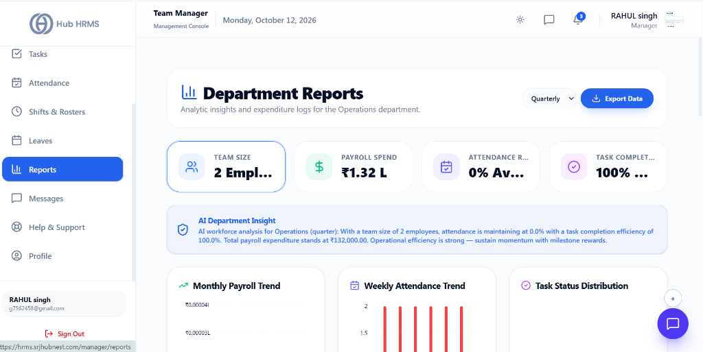
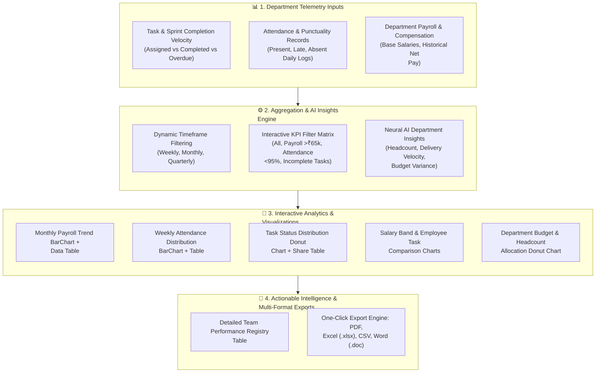
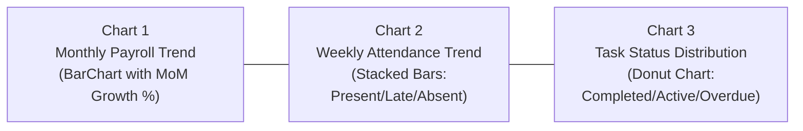
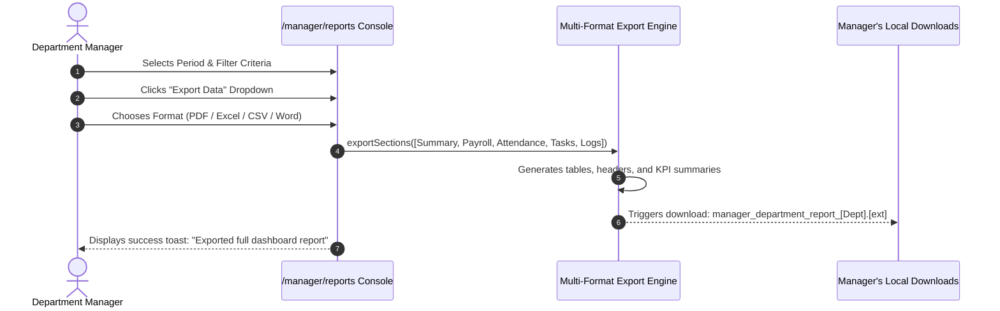

# 08. Team Performance & Reports (`/manager/reports`)

The **Team Performance & Reports** module equips Department Managers with an enterprise analytics console covering sprint delivery velocity, individual member workload, attendance compliance benchmarks, and departmental compensation expenditure trends. Enhanced with real-time AI department insights, it detects delivery bottlenecks, tracks salary bands, and enables boardroom-ready multi-format data exports.

---

## 🏛️ Live Interface Overview

Below is the live console layout of the **Department Manager Performance & Reports** dashboard:

---

## 🧩 Department Analytics & Intelligence Architecture

The diagram below illustrates how attendance timestamps, sprint task milestones, and compensation records flow from the database into the real-time analytics aggregation engine and AI summarizer:

---

## 🧭 Page Anatomy & Control Directory

The `/manager/reports` workspace features six synchronized analytical zones:

### 1. Global Timeframe & Multi-Format Export Header

Located at the top right of the dashboard, this control cluster governs report periods and export jobs:

| Control | Type | Options / Triggers | Operational Impact |
| :--- | :--- | :--- | :--- |
| **Period Selector** | Dropdown | `Weekly`, `Monthly`, `Quarterly` (Default) | Re-queries the analytics database across the selected historical period and updates all charts and metric cards in real time. |
| **Export Data** | Action Dropdown | `Export PDF`, `Export CSV`, `Export Excel (.xlsx)`, `Export Word (.doc)` | Compiles a formatted multi-section executive dossier containing Executive Summary, Payroll Trends, Weekly Attendance, Task Distribution, Payroll Aggregates, and Detailed Team Logs. |

---

### 2. Interactive KPI Metric Cards

Four high-visibility cards summarize departmental health at a glance. **Clicking a card toggles a deep-dive metric filter on the team table below**:

| Metric Card | Accent Color | Metric Computed | Interactive Table Filter Action |
| :--- | :--- | :--- | :--- |
| **Team Size** | Blue (`#3b82f6`) | Total headcount (`X Employees`) in the manager's department | Clicking resets all filters and displays the full department roster. |
| **Payroll Spend** | Emerald (`#10b981`) | Aggregate monthly base compensation in Indian Currency (`₹X.XX L` / `₹X.XX Cr`) | Clicking toggles the **PAYROLL** filter, isolating high-earner members (base salary > ₹65,000) sorted by highest compensation. |
| **Attendance Rate** | Indigo (`#6366f1`) | Average team punctuality & presence compliance (`XX.X% Average`) | Clicking toggles the **ATTENDANCE** filter, isolating employees with attendance compliance under 95% to identify absenteeism patterns. |
| **Task Completion** | Purple (`#a855f7`) | Aggregate delivery velocity percentage (`XX.X% Completion`) | Clicking toggles the **TASK** filter, surfacing team members with incomplete tasks or completion rates under 100%. |

---

### 3. AI Department Insight Ribbon

Positioned immediately below the KPI cards, the **AI Department Insight** banner provides an automated natural-language executive summary generated directly from real-time department statistics (headcount, attendance consistency, task completion velocity, and payroll expenditure). It identifies potential operational risks, overtime bottlenecks, or sprint achievements automatically without manual calculation.

---

### 4. Core Visualization Suite & Embedded Data Tables

The middle row presents three responsive interactive charts, each paired with an embedded numeric breakdown table:

1. **Monthly Payroll Trend (Bar Chart + Table):**
   - **Chart:** Displays chronological month-by-month departmental wage expenditure formatted in Indian Lakhs (`₹X.XL`).
   - **Table:** Details exact monthly spend alongside Month-over-Month (MoM) percentage growth indicators (Emerald for positive, Rose for negative).
2. **Weekly Attendance Trend (Grouped Bar Chart + Table):**
   - **Chart:** Plots Monday through Sunday attendance logs broken down into **Present** (Emerald), **Late** (Amber), and **Absent** (Rose).
   - **Table:** Presents exact daily counts and daily compliance percentage rates (`Rate %`).
3. **Task Status Distribution (Donut Chart + Table):**
   - **Chart:** Displays proportional split between **Completed**, **Active**, and **Overdue** tasks.
   - **Table:** Lists task counts alongside percentage workload share (`Share %`).

---

### 5. Advanced Resource & Compensation Analytics

Two additional diagnostic visualizations allow deep workforce analysis:

1. **Salary Band Distribution:**
   - Categorizes department members into structured compensation brackets: `Under 50k`, `50k - 70k`, and `Above 70k`.
   - Accompanied by a distribution table detailing employee counts and proportional percentage breakdown.
2. **Employee Tasks Completion Comparison:**
   - Comparative multi-bar chart plotting assigned sprint tasks (`totalTasks`) against completed items (`completedTasks`) for individual members.
   - Highlights workload distribution imbalances across the team.
3. **Department Payroll & Headcount Allocation:**
   - Donut chart and breakdown table displaying total expenditure, headcount, and budget share per sub-department.

---

### 6. Detailed Team Performance Registry Table

The primary data grid lists comprehensive operational metrics for every team member:

| Column Header | Data Displayed | Sortable & Filter Behaviors |
| :--- | :--- | :--- |
| **Employee** | Full name, avatar, and official ID (`#EMP-XXXX`) | Click column header to sort alphabetically (A-Z / Z-A). |
| **Role** | Designation title with briefcase icon | Sortable by role title. |
| **Department** | Assigned operational unit | Sortable by department. Filterable via top dropdown. |
| **Salary (INR)** | Monthly base salary (`₹XX,XXX`) | Sortable by compensation value. |
| **Attendance Rate** | Individual attendance compliance score + visual progress bar | Color-coded: Emerald (≥90%), Amber (75–89%), Red (<75%). Sortable. |
| **Tasks (Completed/Total)** | Ratio of completed sprint tasks to total assignments | Emerald count for completed vs muted count for total. Sortable. |
| **Status** | Active employment status badge | Emerald badge for `ACTIVE`, Red badge for inactive. |

---

## 🛠️ Step-by-Step Operations

### Generating and Filtering Department Reports
1. Navigate to **Team Performance & Reports** (`/manager/reports`) from the main sidebar.
2. Select your reporting window using the **Period** dropdown (`Weekly`, `Monthly`, or `Quarterly`).
3. To inspect members requiring attendance coaching, click the **Attendance Rate** KPI card. The table immediately filters to employees below 95% attendance compliance.
4. To search for a specific team member, enter their name or employee ID in the search field in the table toolbar.
5. Filter by sub-department or role using the respective dropdown selectors.

---

### Exporting Boardroom-Ready Executive Reports

1. Click the **Export Data** button in the top-right corner.
2. Choose your preferred output file format:
   - **Export PDF:** Clean executive dossier with high-contrast headers, KPI summary tables, and full team logs.
   - **Export Excel (.xlsx):** Multi-sheet workbook formatted with numeric cells for financial and HR audit modeling.
   - **Export CSV:** Comma-separated raw data for integration with external business intelligence tools.
   - **Export Word (.doc):** Formatted document suitable for meeting minutes and executive briefings.
3. The browser automatically downloads the generated file named `manager_department_report_[Department].[ext]`.

---

## 💡 Best Practices for Department Managers

> [!TIP] **Correlating Task Velocity with Attendance**  
> Use the **Employee Tasks Completion Comparison** chart alongside the **Weekly Attendance Trend**. Employees with sudden dips in task velocity often show corresponding late arrivals or unplanned leave patterns.

> [!IMPORTANT] **Monthly Payroll Planning**  
> The **Monthly Payroll Trend** chart updates dynamically based on processed payroll runs. Review this section prior to month-end approvals to verify overtime impact and budget variances.

> [!NOTE] **Audit Integrity**  
> Exported reports contain immutable timestamps and user session identifiers, making them fully compliant with corporate internal audit standards.

---

## ❓ Frequently Asked Questions (FAQs)

**Q1: Why is the Monthly Payroll Trend chart blank?**  
If your department was recently established or the HR payroll team has not yet processed a completed monthly payroll cycle for your team, the chart displays an informational placeholder until the first run is committed.

**Q2: How is the Attendance Rate percentage calculated?**  
The attendance rate is computed by dividing the sum of `Present` and `Late` check-ins by the total working days in the selected period (excluding weekends and approved holidays).

**Q3: Can I export records for just one specific role or employee?**  
Yes. Use the table search bar or the Role dropdown filter to isolate the target subset, and the export engine will compile only the active filtered records into your chosen file format.
