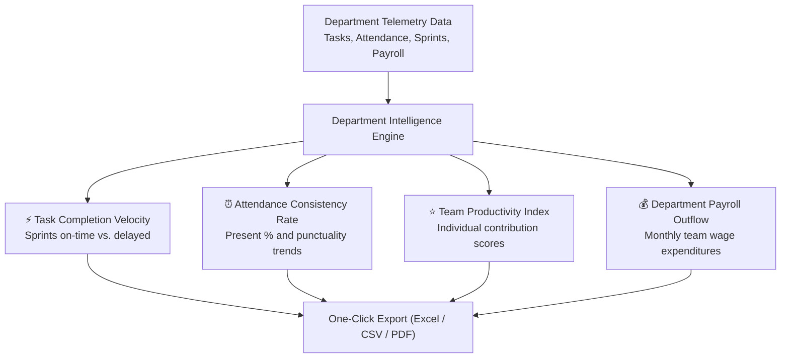

# 07. Team Performance & Reports (`/manager/reports`)

The **Team Performance & Reports** module provides Department Managers with data-driven analytics covering team delivery velocity, individual member output, attendance punctuality benchmarks, and departmental compensation budget trends.

---

## 📸 Interface Screenshot

<!-- SCREENSHOT_PLACEHOLDER: /manager/reports -->
> *[Screenshot Placeholder: Department Manager Analytics & Performance Reports]*
> *(Image path to add: `docs/assets/images/HRMS/Manager_/reports.png`)*

---

## 🧭 Intelligence Architecture & Core Report Categories

---

## 🛠️ Step-by-Step Guide: How to Analyze Reports

### Step 1: Filter by Review Period
At the top of the analytics dashboard, select your evaluation timeframe:
* **Current Month**: Track active operational progress and sprint milestones.
* **Quarterly (Q1, Q2, Q3, Q4)**: Evaluate quarterly performance reviews and departmental OKRs.
* **Annual**: Strategic review of long-term staffing delivery and team growth.

---

### Step 2: Use Metric Category Filters
Toggle between specific operational dimensions using the top metric pills:
* **ALL**: Consolidated master view of all metrics.
* **TASK**: Focuses exclusively on task volume, sprint throughput, and overdue ratios.
* **ATTENDANCE**: Focuses on punctuality rates, absenteeism spikes, and overtime logs.
* **PAYROLL**: Reviews monthly department wage costs formatted in Indian numbering standards (₹ Lakhs and ₹ Crores).

---

### Step 3: Inspect Individual Employee Contributions
Below the summary graphs, the **Team Contribution Register** breaks down metrics per individual:
* **Employee Name & Designation**: Identifies team member.
* **Tasks Assigned vs. Completed**: Deliverables finished within the selected timeframe.
* **On-Time Delivery Rate (%)**: Percentage of tasks completed on or before the due date.
* **Attendance Score (%)**: Percentage of scheduled workdays present and on time.
* **Overall Rating**: Composite rating score (1.0 to 5.0 scale) used for annual appraisal recommendations.

---

### Step 4: 🤖 Read AI Performance Insights
The report header features an automated **AI Intelligence Summary**:
* Flags team delivery patterns (e.g., *"Engineering team achieved 94% on-time delivery; backend velocity increased by 12% following sprint restructuring"*).
* Identifies potential risks (e.g., *"Friday absenteeism has risen by 8% over the past 30 days"*).

---

## 📤 Exporting Managerial Reports

* Click the **Export Dropdown** at the top right to download multi-tab reports:
  * **Excel (.xlsx)**: Raw table data with formulas and summary charts.
  * **CSV Data Feed**: Clean data rows ready for import into spreadsheets.
  * **Executive PDF**: Branded, presentation-ready briefing for executive management meetings.

---

## ❓ Frequently Asked Questions (FAQ)

??? question "Can I see salary details for individual employees in this report?"
    Depending on role permissions configured by Company Admin, individual salaries may be masked, while aggregate departmental payroll outflow (total monthly team CTC) is visible for budget tracking.

??? question "How often are these reports updated?"
    Reports refresh in real time as tasks are completed and daily attendance punches are logged.
