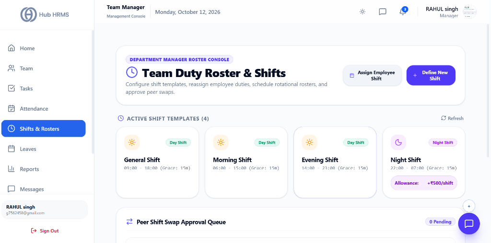
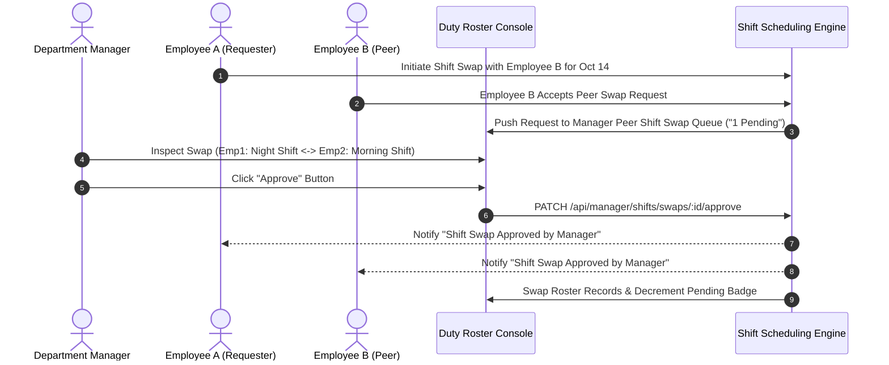

# 06. Team Duty Roster & Shifts (`/manager/shifts`)

The **Team Duty Roster & Shifts** module (`/manager/shifts`) is the operational shift scheduling and workforce rotation console for Department Managers in Hub HRMS. Operating under the **Department Manager Roster Console**, managers configure standard shift templates (Day Shifts, Night Shifts with allowances), establish custom employee timing overrides, schedule rotational team rosters, and adjudicate peer-to-peer shift swap requests.

---

## 🏛️ Live Interface Overview

Below is the live console layout of the **Department Manager Duty Roster & Shifts** workspace:

---

## 🧭 Page Anatomy & Interactive Controls

The table below catalogs every button, template card, modal, and approval queue control in the Shift Management workspace:

| UI Component / Control | Visual Location | Functional Behavior & Impact |
| :--- | :--- | :--- |
| **Console Banner Header** | Header Top Left | Tagged with `DEPARTMENT MANAGER ROSTER CONSOLE`, displays `Team Duty Roster & Shifts` with subtitle *"Configure shift templates, reassign employee duties, schedule rotational rosters, and approve peer swaps."* |
| **Assign Employee Shift Button** | Header Top Right (Outlined pill w/ Calendar icon) | Opens the **Assign Employee Shift Modal** to assign an active shift template or configure bespoke start/end hour overrides for a specific team member. |
| **Define New Shift Button** | Header Top Right (Solid Indigo button w/ Plus icon) | Opens the **Define New Shift Template Modal** to establish new rotational working windows across the department. |
| **Active Shift Templates Carousel/Grid** | Top Section (Below Header) | Displays active department shift templates with a top **Refresh** button and total template counter (e.g., `ACTIVE SHIFT TEMPLATES (4)`). |
| **General Shift Card** | Templates Grid (Card 1) | Sun icon, `Day Shift` badge, timings `09:00 - 18:00 (Grace: 15m)`. |
| **Morning Shift Card** | Templates Grid (Card 2) | Sun icon, `Day Shift` badge, timings `06:00 - 15:00 (Grace: 15m)`. |
| **Evening Shift Card** | Templates Grid (Card 3) | Sun icon, `Day Shift` badge, timings `14:00 - 23:00 (Grace: 15m)`. |
| **Night Shift Card** | Templates Grid (Card 4) | Moon icon, `Night Shift` badge, timings `22:00 - 07:00 (Grace: 15m)`, plus custom monetary stipend pill (`Allowance: +₹500/shift`). |
| **Peer Shift Swap Approval Queue** | Mid Section Header | Dedicated queue header with pending count badge (e.g., `0 Pending`). Displays peer-to-peer swap requests requiring managerial authorization. |
| **Swap Requests Action Table** | Mid Section Body | Displays requester name, peer swap colleague, requested swap date, reason note, and inline **Approve** and **Reject** buttons. |
| **Daily Shift Roster Table** | Lower Section | Comprehensive daily calendar and roster registry featuring a date picker, member search bar, active shift badges, and an inline **Reassign** button for quick schedule changes. |
| **Define New Shift Template Modal** | Center Screen Overlay | Dialog for creating shift templates: **Shift Name**, **Type** (`DAY` / `NIGHT`), **Start Time**, **End Time**, **Grace Period (Minutes)**, **Night Shift Allowance (₹)**, and Color theme picker. |
| **Assign Employee Shift Modal** | Center Screen Overlay | Dialog for schedule assignment: **Employee Selector**, **Shift Template**, **Effective Date Range**, and **Custom Timing Override** checkboxes. |

---

## 🧭 Shift Governance & Swap Approval Sequence

The sequence diagram below outlines how shift assignments and peer-to-peer swap approvals are handled by the Department Manager:

---

## ⚙️ Step-by-Step Manager Shift Procedures

### 1. Creating a New Shift Template (`+ Define New Shift`)
When rolling out a new rotational duty cycle across your department:
1. Click the solid indigo **+ Define New Shift** button in the top action bar.
2. In the template configuration modal:
   - **Shift Title**: Give the template a distinct name (e.g., *"Weekend Graveyard Shift"* or *"Quality Inspection Shift"*).
   - **Shift Category**: Select `Day Shift` (Standard daytime operations) or `Night Shift` (Overnight duty).
   - **Operating Hours**: Configure standard **Start Time** and **End Time** (e.g., `10:00 PM` to `06:00 AM`).
   - **Grace Period (Minutes)**: Specify allowable tardiness before marking an arrival as `Late` (e.g., `15 Minutes`).
   - **Shift Allowance (₹)**: For night or hazardous duty shifts, configure monetary stipends (e.g., `+₹500/shift`) credited automatically in payroll.
3. Click **Save Template**. The card renders immediately in the **Active Shift Templates** carousel.

### 2. Assigning Shifts with Custom Timing Overrides
1. Click the **Assign Employee Shift** button in the header.
2. Select the team member from your department dropdown.
3. Choose the target shift template (e.g., *Morning Shift*).
4. Specify the **Effective Date Range** (single date or rotational multi-week cycle).
5. *(Optional)* If the employee requires specialized medical or operational adjustments, check **Custom Timing Override** and specify non-standard clock-in/out hours.
6. Click **Confirm Assignment**. The employee's self-attendance terminal and roster update instantly.

### 3. Adjudicating the Peer Shift Swap Approval Queue
To prevent unauthorized roster swaps that could compromise floor coverage or lead to fatigue violations:
1. Scroll to the **Peer Shift Swap Approval Queue**.
2. If pending swaps exist, the header badge indicates the count (e.g., `2 Pending`).
3. Review the request details:
   - **Requesting Employee** and current assigned shift.
   - **Peer Colleague** who agreed to swap duties.
   - **Target Date** and submitted justification.
4. Click **Approve** to authorize the exchange and reassign the roster, or click **Reject** to decline the swap.

---

## 💡 Best Practices for Department Managers

> [!TIP] **Enforce Minimum Rest Hours Between Shifts**  
> When reassigning duties from Night Shift (`22:00 - 07:00`) to Morning Shift (`06:00 - 15:00`), ensure the employee receives at least 24 hours of rest to comply with labor safety regulations.

> [!NOTE] **Automatic Payroll Integration for Night Stipends**  
> Any shift configured with an allowance (e.g., `Allowance: +₹500/shift`) automatically accrues in the monthly payroll ledger when the employee completes their full overnight punch cycle.

---

## ❓ Frequently Asked Questions (FAQs)

??? question "Can employees execute a shift swap without manager approval?"
    No. While peer employees can request and mutually consent to a shift exchange in their employee portal, the swap remains in `Pending` state and does not take effect until authorized by the Department Manager.

??? question "Can supervisors define shift templates?"
    Yes, if the Department Manager has granted the `Manage Shifts` (`Shifts:write`) permission in the **Supervisor Permission Matrix** on the manager dashboard. Otherwise, template creation is restricted to Managers and Admins.
