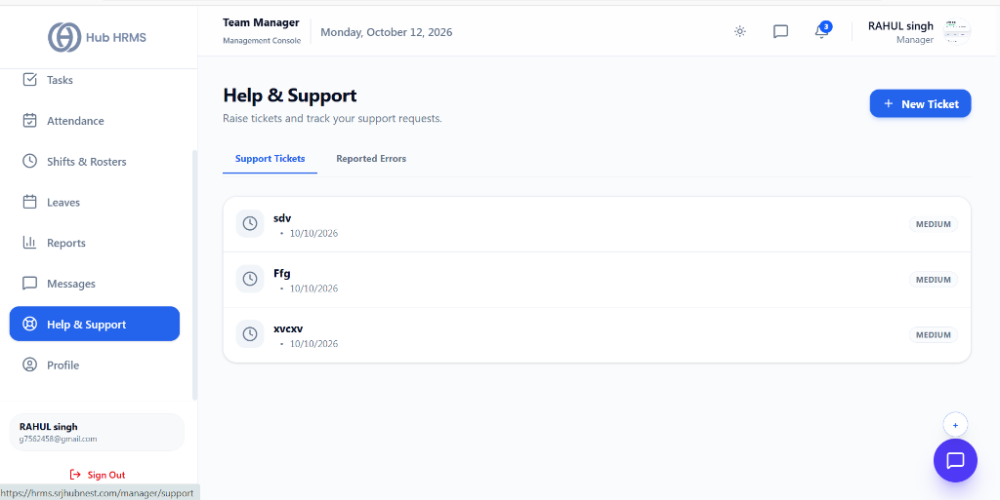
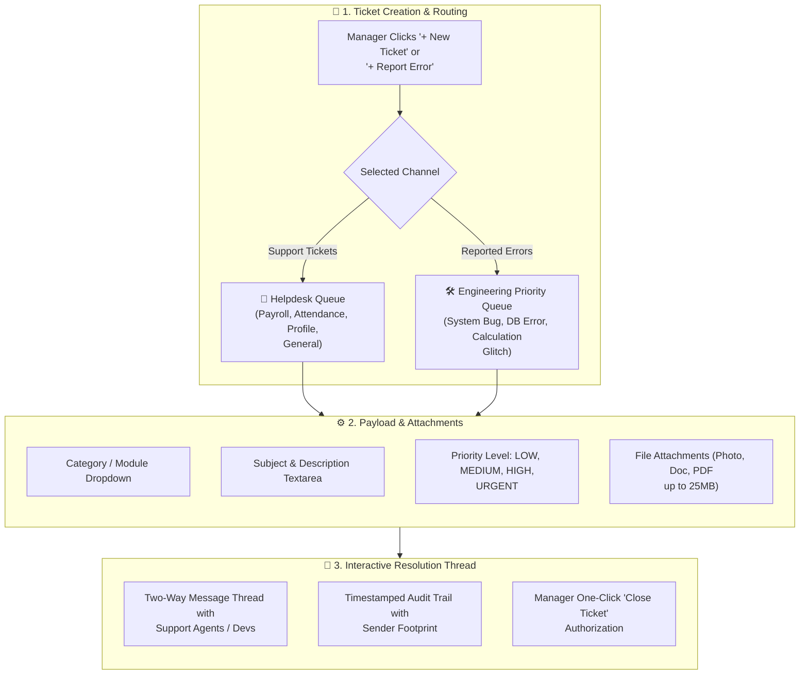
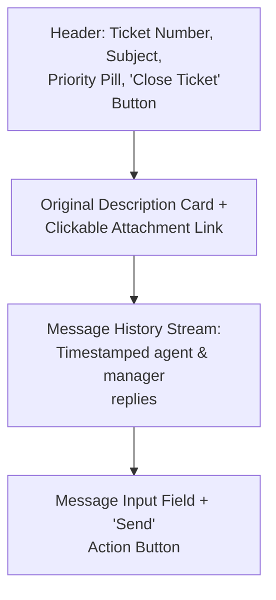

# 10. Support & Grievances (`/manager/support`)

The **Help & Support** module provides Department Managers with an enterprise ticketing and incident resolution hub. It supports two dedicated operational tracks: **Support Tickets** (general HR, payroll, account, and administrative inquiries routed to the corporate helpdesk) and **Reported Errors** (software bugs, calculation discrepancies, and system glitches routed directly to the engineering development team).

---

## 🏛️ Live Interface Overview

Below is the live console layout of the **Department Manager Help & Support** workspace:

---

## 🧩 Support & Engineering Escalation Architecture

The diagram below illustrates how tickets and technical bug reports submitted by managers are routed into distinct queues, assigned priority benchmarks, and resolved through real-time communication threads:

---

## 🧭 Page Anatomy & Control Directory

The `/manager/support` interface is structured into three distinct interaction layers: queue navigation tabs, a modal ticket composer with contextual routing, and an interactive two-way conversation console.

### 1. Queue Navigation Tabs & Creation Header

Located at the top of the console, these controls govern queue switching and ticket creation:

| Control | Type | Active State / Label | Operational Function |
| :--- | :--- | :--- | :--- |
| **Support Tickets** | Navigation Tab | Active blue bottom border | Displays the helpdesk queue containing administrative, payroll, leave policy, and HR assistance requests. |
| **Reported Errors** | Navigation Tab | Active blue bottom border | Displays the technical priority queue containing system bugs, server errors, and UI anomalies. |
| **+ New Ticket / + Report Error** | Action Button | Dynamic button label matching the selected tab | Opens the Ticket Creation Composer pre-configured for the active queue. |

---

### 2. Ticket Creation Composer

Clicking the creation button opens an inline form equipped with category selectors, priority indicators, and secure file attachment tools:

| Field / Control | Input Type | Scope / Options | Operational Impact |
| :--- | :--- | :--- | :--- |
| **Queue Badge** | Visual Banner | `Helpdesk Queue` (Blue) or `Engineering Priority Queue` (Rose) | Confirms the operational routing target before submission. |
| **Category / Module** | Dropdown Selector | **Support Queue:** • `General Support` • `Payroll & Salary Query` • `Attendance / Leave Request` • `Profile & Documentation` • `Other`  **Error Queue:** • `System Error (Technical Bug)` • `Server / Database Error` • `Report / Calculation Discrepancy` • `UI & Display Glitch` • `Authentication & Login Issue` | Directly tags the ticket for automated assignment to the appropriate tier-1 helpdesk agent or software engineer. |
| **Subject** | Text Input | Single-line summary (Required) | Summarizes the core issue for quick scanning in the ticket list. |
| **Description** | Textarea | Multi-line text field (Required) | Captures detailed diagnostic steps, error codes, affected employees, or policy questions. |
| **Priority** | Dropdown Selector | `LOW`, `MEDIUM`, `HIGH`, `URGENT` | Establishes the resolution priority and response-time benchmark. |
| **Attachment** | File Upload Button | Photo (`.png`, `.jpg`), Doc (`.docx`), PDF (`.pdf`) | Uploads error screenshots, log files, or medical/bank verification records directly to secure storage. Displays green checkmark with filename and remove button. |
| **Submit Ticket** | Submit Button | Form submission | Commits the record to the backend, assigns a unique tracking number (`TICK-XXXX`), and sends an instant alert to the resolvers. |

---

### 3. Ticket List & Status Indicators

The main registry displays all submitted tickets within the active tab:

| Visual Element | Representation | Indicator Styling |
| :--- | :--- | :--- |
| **Status Icon** | Ticket lifecycle status | • `OPEN`: Amber alert circle (`AlertCircle`) • `IN_PROGRESS`: Blue clock badge (`Clock`) • `RESOLVED`: Emerald check circle (`CheckCircle2`) |
| **Subject & Ticket Number** | Summary identification | Displays the subject heading alongside the tracking code (`#TICK-XXXX`) and submission date (`YYYY-MM-DD`). |
| **Priority Badge** | Urgency tag | Upper-right capsule badge displaying `LOW`, `MEDIUM`, `HIGH`, or `URGENT`. |
| **Empty State** | Zero-ticket confirmation | Green checkmark with message: *"All systems are running smoothly"* (Error tab) or *"No active tickets"* (Support tab). |

---

### 4. Interactive Ticket Detail & Two-Way Conversation Console

Clicking any ticket row opens a dedicated communication portal:

- **Back Navigation:** Click `← Back to Tickets` to return to the main list.
- **Close Ticket:** Managers can click the green **Close Ticket** button at any time to mark the issue as `RESOLVED`.
- **Attachment Viewer:** Click **View Attachment** (Paperclip icon) to open the original uploaded file in a secure preview tab.
- **Two-Way Thread:** Real-time chronological chat stream showing agent responses and manager replies with exact timestamps (`HH:MM AM/PM`).
- **Send Message:** Enter follow-up details in the bottom input bar and press `Enter` or click **Send** to reply immediately.

---

## 🛠️ Step-by-Step Operations

### Submitting a General HR or Payroll Query
1. Navigate to **Help & Support** (`/manager/support`) from the sidebar.
2. Ensure the **Support Tickets** tab is selected.
3. Click **+ New Ticket** in the top-right corner.
4. Select the appropriate **Category** (e.g., *Payroll & Salary Query* or *Attendance / Leave Request*).
5. Enter a concise **Subject** (e.g., *“Salary advance query for team member”*).
6. Provide full details in the **Description** box.
7. Set the **Priority** (e.g., *MEDIUM*).
8. If applicable, click **Choose File** to attach supporting documentation.
9. Click **Submit Ticket**.

---

### Reporting a Technical Bug or Data Discrepancy
1. Click the **Reported Errors** tab at the top of the page.
2. Click **+ Report Error**.
3. Under **Category / Module**, select the affected component (e.g., *Report / Calculation Discrepancy* or *UI & Display Glitch*).
4. Enter a descriptive **Subject** (e.g., *“Quarterly attendance report export shows 0% on Mondays”*).
5. In the **Description**, outline the exact reproduction steps:
   - What page you were on
   - What filter or button you clicked
   - What error message or behavior occurred
6. Click **Choose File** to attach a screenshot of the glitch.
7. Click **Submit Ticket**. The ticket is routed immediately to the engineering backlog.

---

### Communicating with Support Resolvers & Closing Tickets
1. On the ticket list, click the target ticket to open the conversation view.
2. Review updates from the support agent or engineer in the message stream.
3. To provide additional information, type your reply in the bottom bar and click **Send**.
4. Once the issue has been resolved to your satisfaction, click the **Close Ticket** button in the top-right corner of the conversation header.

---

## 💡 Best Practices for Department Managers

> [!TIP] **Separate Technical Bugs from HR Requests**  
> Always use the **Reported Errors** tab for software bugs and calculations. This bypasses the tier-1 HR helpdesk and places the issue directly in front of the engineering team for faster code fixes.

> [!IMPORTANT] **Clear Reproduction Steps for Errors**  
> When reporting an error, specify the browser you are using, the affected employee ID, and the exact sequence of clicks. Attaching a screenshot reduces resolution turnaround time significantly.

> [!NOTE] **Audit Integrity & Automatic Archive**  
> Closed tickets are permanently archived in the system and remain accessible for reference. You can review past resolutions by locating the ticket in the list.

---

## ❓ Frequently Asked Questions (FAQs)

**Q1: Can I reopen a ticket after clicking 'Close Ticket'?**  
Once a ticket is marked resolved, it is locked. If the same issue recurs, you can reference the previous ticket number (e.g., *“Follow-up to TICK-1042”*) when creating a new ticket.

**Q2: What file formats can I attach to a ticket?**  
You can attach images (`PNG`, `JPG`), documents (`DOCX`, `TXT`), spreadsheets (`XLSX`, `CSV`), and PDF files up to 25 MB in size.

**Q3: Who sees my tickets?**  
Support tickets are visible to authorized HR Specialists and Company Admins. Reported Errors are accessible by system engineers and technical operations staff.
