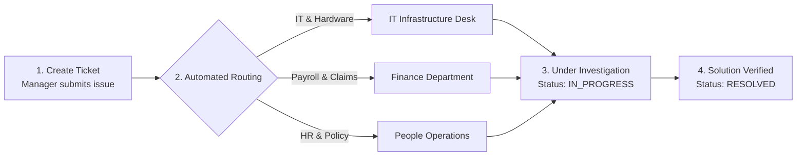

# 09. Support & Grievances (`/manager/support`)

The **Help & Support** module gives Department Managers a formal channel to report technical issues, request equipment for team members, resolve IT access blockers, and escalate employee grievances to HR.

---

## 📸 Interface Screenshot

<!-- SCREENSHOT_PLACEHOLDER: /manager/support -->
> *[Screenshot Placeholder: Department Manager Support & Ticketing Console]*
> *(Image path to add: `docs/assets/images/HRMS/Manager_/support.png`)*

---

## 🧭 Ticket Lifecycle & Routing

---

## 🛠️ Step-by-Step Guide: How to Raise and Manage Tickets

### Step 1: Create a New Support Ticket (`+ New Ticket`)
1. Click the **+ New Ticket** button at the top right of the dashboard.
2. In the ticket creation modal, select:
   * **Category**:
     * `IT & Hardware`: Laptop repairs, secondary monitors, software licenses, VPN/network access.
     * `HR & People Operations`: Probation reviews, role title adjustments, department transfer requests.
     * `Payroll & Finance`: Salary advance inquiries, reimbursement disputes, PF/tax clarification.
     * `Facilities & Admin`: Access cards, desk seating, parking permits.
   * **Priority Level**: Choose `Low`, `Medium`, `High`, or `Urgent` (🔴).
   * **Subject**: Clear headline of the problem (e.g., *"Developer requires AWS Cloud IAM credentials for staging deployment"*).
   * **Description**: Detailed explanation of the blocker, error messages, and affected team members.
   * **Attachment**: Attach screenshots or error logs if applicable.
3. Click **Submit Ticket**. The ticket is routed immediately to the appropriate resolution team.

---

### Step 2: Track Active Ticket Progress
* **Status Badges**:
  * `OPEN`: Ticket logged and awaiting assignment to an agent.
  * `IN_PROGRESS`: Assigned to a technical support or HR specialist actively working on the solution.
  * `RESOLVED`: Solution provided; awaiting manager confirmation.
  * `CLOSED`: Completed and archived.
* **Exchange Comments**: Open any ticket to communicate directly with assigned IT or HR specialists, adding further context or updates.

---

## ❓ Frequently Asked Questions (FAQ)

??? question "Can a manager raise a ticket on behalf of a team member?"
    Yes. Department Managers often raise IT hardware or system access tickets on behalf of newly joined engineers or staff. Simply specify the employee's name in the description.

??? question "What is the expected resolution time for Urgent tickets?"
    Under standard enterprise SLAs, `Urgent` priority tickets trigger immediate notifications to IT/HR directors with an initial response target within 2 hours.
