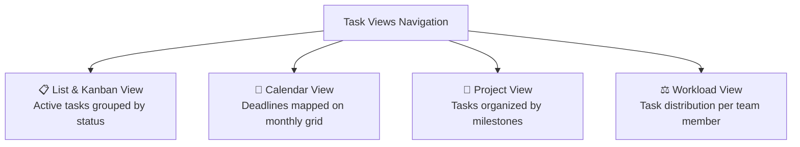
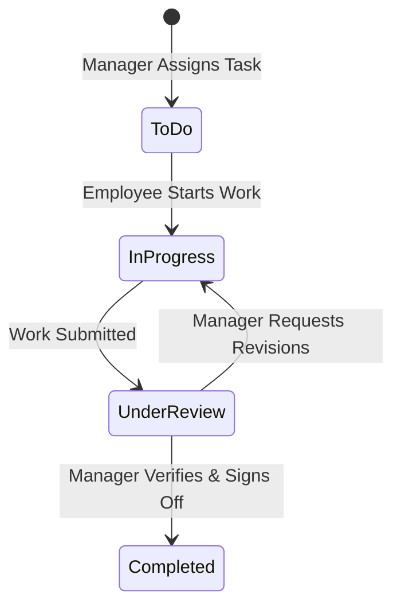

# 04. Task & Project Allocation (`/manager/tasks`)

The **Task & Project Allocation** module is where Department Managers plan team deliverables, assign work items to specific employees, monitor sprint progress, track approaching deadlines on a calendar, and balance workloads across team members.

---

## 📸 Interface Screenshot

<!-- SCREENSHOT_PLACEHOLDER: /manager/tasks -->
> *[Screenshot Placeholder: Department Manager Task Allocation Board]*
> *(Image path to add: `docs/assets/images/HRMS/Manager_/tasks.png`)*

---

## 🧭 Navigation Views & Workspaces

The console provides 4 specialized views across the top navigation bar:

1. **List & Kanban View**: Displays tasks in structured table rows or status cards (`To Do`, `In Progress`, `Under Review`, `Completed`).
2. **Calendar View**: Visual calendar plotting due dates, helping you spot project delivery crunches before they happen.
3. **Project View**: Organizes deliverables under parent projects or departmental milestones.
4. **Workload View**: An interactive bar chart comparing the number of active tasks assigned to each employee to avoid overloading individual contributors.

---

## 🛠️ Step-by-Step Guide: How to Manage Tasks

### Step 1: Create a New Task (`+ New Task`)
1. Click the green **+ New Task** button at the top right.
2. In the modal, fill in the following details:
   * **Task Title**: Concise summary of the deliverable (e.g., *"Implement Stripe Payment Webhook"*).
   * **Description**: Detailed acceptance criteria, links to documentation, or sprint guidelines.
   * **Priority Level**: Select `Urgent` (🔴), `High` (🟠), `Medium` (🟡), or `Low` (🟢).
   * **Assignee**: Choose an employee from your department roster dropdown.
   * **Due Date**: Pick the target completion date using the calendar picker.
   * **Estimated Hours**: Expected time commitment (e.g., `8 Hours`).
3. Click **Create Task**. The assigned team member receives an instant in-app notification and email alert.

---

### Step 2: Filter and Search Active Tasks
* **Filter by Employee**: Click the **Assignee Dropdown** to see tasks belonging exclusively to a single team member.
* **Filter by Status**: View only `In Progress` items or `Under Review` items waiting for your sign-off.
* **Filter by Priority**: Filter for `Urgent` or `High` priority items to focus on critical blockers.
* **Search Box**: Search by keywords contained in the task title or description.

---

### Step 3: Review and Update Task Statuses
As work progresses, tasks move through 4 lifecycle stages:

1. When an employee completes a task, it appears with the status **Under Review**.
2. Click on the task row to review attached deliverable files or notes.
3. Click **Mark Completed** to close out the task, or update status back to **In Progress** with feedback remarks.

---

### Step 4: Balance Team Workload (The Workload View)
1. Switch to the **Workload** tab.
2. Inspect the **Task Distribution Bar Chart**:
   * If Employee A has **7 active tasks** while Employee B has only **1 task**, an orange **Workload Imbalance Alert** appears.
3. Click on the overloaded employee's bar to see their open tasks, and click **Reassign** to distribute items evenly.

---

## 📤 Exporting Task Reports

* Click the **Export Dropdown** button at the top right to download task records in **Excel (.xlsx)**, **CSV**, or **PDF** format.
* The exported file includes task titles, assigned employees, priority levels, creation dates, due dates, and completion timestamps for sprint retrospectives.

---

## ❓ Frequently Asked Questions (FAQ)

??? question "Can I assign a task to someone outside my department?"
    Department Managers can only assign tasks to personnel within their own department. Cross-department tasks must be requested through HR or Company Admins.

??? question "What triggers an automated task reminder to an employee?"
    Hub HRMS sends an automated notification reminder to the assignee 24 hours prior to the due date, and a high-priority alert if the due date passes without completion.
