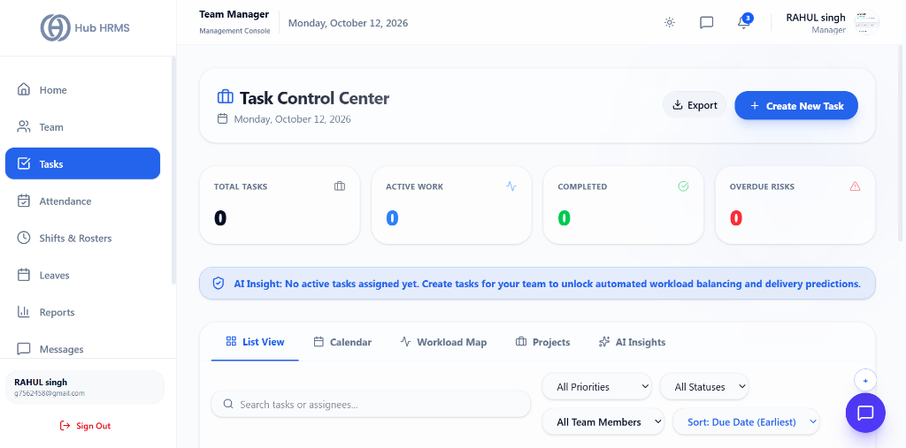
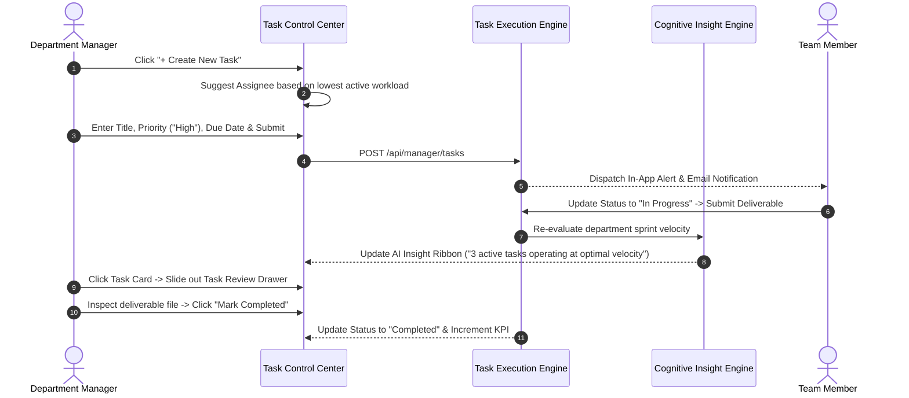

# 04. Task Control Center & Sprints (`/manager/tasks`)

The **Task Control Center** (`/manager/tasks`) is the operational project management engine for Department Managers in Hub HRMS. Built for agile work order distribution and sprint delivery, this console allows managers to provision deliverables, monitor execution across multi-view tabs (**List View**, **Calendar**, **Workload Map**, **Projects**, and **AI Cognitive Insights**), detect employee burnout thresholds, audit deliverables via the **Task Review Drawer**, and export pipeline data.

---

## 🏛️ Live Interface Overview

Below is the live console layout of the **Department Manager Task Control Center**:

---

## 🧭 Page Anatomy & Interactive Controls

The table below catalogs every button, filter dropdown, view tab, modal, and drawer control in the Task Control Center:

| UI Component / Control | Visual Location | Functional Behavior & Impact |
| :--- | :--- | :--- |
| **Control Center Title & Date** | Header Top Left | Displays `Task Control Center` with an official Briefcase icon and live localized calendar date (e.g., `Monday, October 12, 2026`). |
| **Export Dropdown** | Header Top Right | Exports filtered tasks in **Excel (.xlsx)**, **CSV**, or **PDF** format. |
| **Create New Task Button** | Header Top Right (Solid Blue button w/ Plus icon) | Opens the **Task Creation Modal** to deploy work directly to team members. |
| **Total Tasks KPI Card** | Top KPI Grid (Card 1) | Shows cumulative task count (e.g., `0` or `24`), Briefcase icon, and acts as an **All Tasks** reset filter. |
| **Active Work KPI Card** | Top KPI Grid (Card 2) | Displays currently ongoing work orders (`In Progress` or `Pending`), blue pulse icon, and acts as an **Active Work** filter. |
| **Completed KPI Card** | Top KPI Grid (Card 3) | Displays finished work orders, green CheckCircle icon, and acts as a **Completed** filter. |
| **Overdue Risks KPI Card** | Top KPI Grid (Card 4) | Highlights missed deadline items (`Overdue`), red AlertTriangle icon, and acts as an **Overdue Risks** filter. |
| **AI Insight Alert Ribbon** | Full-Width Ribbon Below KPIs | Machine-learning generated summary diagnosing sprint velocity (e.g., *"No active tasks assigned yet. Create tasks for your team to unlock automated workload balancing and delivery predictions"*). |
| **List View Tab** | Navigation Tab Bar (Tab 1) | Displays deliverables in responsive cards with priority tags, status badges, employee initials, due dates, and 3-dot context menus. |
| **Calendar Tab** | Navigation Tab Bar (Tab 2) | Monthly grid visualizer plotting tasks by deadline dates to identify sprint delivery crunches. |
| **Workload Map Tab** | Navigation Tab Bar (Tab 3) | Interactive Recharts Bar Chart showing active task count per employee. Automatically turns red if an engineer holds $>5$ active tasks. |
| **Projects Tab** | Navigation Tab Bar (Tab 4) | Organizes deliverables into parent projects, milestone deliverables, and department initiatives. |
| **AI Insights Tab** | Navigation Tab Bar (Tab 5) | Neural cognitive engine diagnosing bottleneck audits, suggesting overdue mitigation sprints, and recommending subtask partitioning. |
| **Search Tasks or Assignees** | List Toolbar Left | Live keyword search filtering tasks by deliverable title or assigned employee name. |
| **All Priorities Dropdown** | List Toolbar Center | Filters tasks by severity: `All Priorities`, `High Priority`, `Medium Priority`, `Low Priority`. |
| **All Statuses Dropdown** | List Toolbar Center | Filters tasks by lifecycle state: `All Statuses`, `Pending`, `In Progress`, `Completed`, `Overdue`. |
| **All Team Members Dropdown** | List Toolbar Center | Filters tasks by specific assignee or department cadre. |
| **Sort By Dropdown** | List Toolbar Right | Orders deliverables by: `Due Date (Earliest)`, `Due Date (Latest)`, `Priority Level`, `Title (A-Z)`. |
| **Task Cards (Grid)** | List Canvas | Visual cards displaying priority pill, status badge, 3-dot menu (`View`, `Edit`, `Delete`), deliverable title, assignee avatar & name, and deadline timestamp. Clicking any card opens the **Task Review Drawer**. |
| **Create Task Modal** | Center Screen Overlay | Dialog for task provisioning: **Task Title**, **Description**, **Assignee** (w/ AI easiest assignee recommendation), **Priority**, **Due Date**, **Attachment URL**, and **Link URL**. |
| **Task Review Drawer** | Slide-Over Panel (Right 500px) | Slide-out audit console allowing managers to inspect submitted files, test links, add feedback comments, update status, or mark tasks as `Completed`. |

---

## 🧭 Task Lifecycle & Sprint Architecture

The sequence diagram below illustrates how work orders progress from manager assignment to AI bottleneck analysis and deliverable review:

---

## ⚙️ Step-by-Step Task Management Procedures

### 1. Creating and Assigning a Deliverable
1. Click the blue **+ Create New Task** button in the top header.
2. In the creation modal, fill in:
   - **Task Title**: Concise, descriptive summary of the deliverable (e.g., *"Prepare Q4 Budget Audit Ledger"*).
   - **Description**: Acceptance criteria, instructions, or scope definition.
   - **Assignee**: Choose a team member from your department dropdown. Notice the system highlights the employee with the lowest active task count to assist workload balancing!
   - **Priority Level**: Select `High` (🔴), `Medium` (🟡), or `Low` (🔵).
   - **Due Date**: Pick the target completion deadline using the date picker.
   - **Attachment URL / Link URL**: Optional URLs for technical blueprints, Figma designs, or document folders.
3. Click **Create Task**. The task appears instantly in the pipeline.

### 2. Auditing Sprints across the 5 View Tabs
* **List View:** The default operational canvas. Filter tasks by priority, status, or assignee, and sort by due dates to focus on impending deadlines.
* **Calendar:** Renders monthly calendar blocks with color-coded task pills, allowing you to identify milestone clustering.
* **Workload Map:** Inspect the vertical bar chart. Bars color-code automatically:
  - 🟢 **Primary/Blue:** 1 to 5 active tasks (Optimal load)
  - 🔴 **Red Alert:** $>5$ active tasks (Burnout risk requiring task redistribution)
  - ⚪ **Muted Grey:** 0 active tasks (Available bandwidth)
* **Projects:** Groups tasks by project tags and parent initiatives.
* **AI Insights:** Deep-dive into cognitive recommendations like **Subtask Partitioning** (breaking large tasks under 4 hours increases completion by 35%) and **Overdue Mitigation**.

### 3. Reviewing Submitted Work (Task Review Drawer)
When a team member marks a task as submitted or completed:
1. Click on the task card in the **List View**.
2. The **Task Review Drawer** slides open from the right.
3. Inspect the deliverable submission details:
   - Attached files or document links.
   - Elapsed completion time and submission timestamp.
4. If the work meets acceptance criteria, click **Mark Completed**.
5. If revisions are required, change the status back to **In Progress** and enter feedback notes.

---

## 💡 Best Practices for Department Managers

> [!TIP] **Use the AI Insight Ribbon for Morning Briefings**  
> Check the top **AI Insight Ribbon** before your daily standup. It synthesizes overdue alerts and active workload distributions into actionable 1-sentence summaries.

> [!NOTE] **Quick Assignee Filtering via URL**  
> Clicking **Review Tasks** or **Tasks** from the Team Management page automatically sets the `assignee` filter in the Task Control Center, immediately isolating that specific employee's deliverables.

---

## ❓ Frequently Asked Questions (FAQs)

??? question "Can Department Managers assign tasks to employees in other departments?"
    No. Hub HRMS enforces departmental boundaries. Department Managers can only assign tasks to personnel enrolled in their assigned department(s). Cross-departmental initiatives must be routed through Executive Admins.

??? question "What happens when a task becomes overdue?"
    The system automatically flags the status as `Overdue` (Red badge), increments the **Overdue Risks** KPI card, triggers an AI alert in the header ribbon, and sends a reminder push notification to the assignee.
