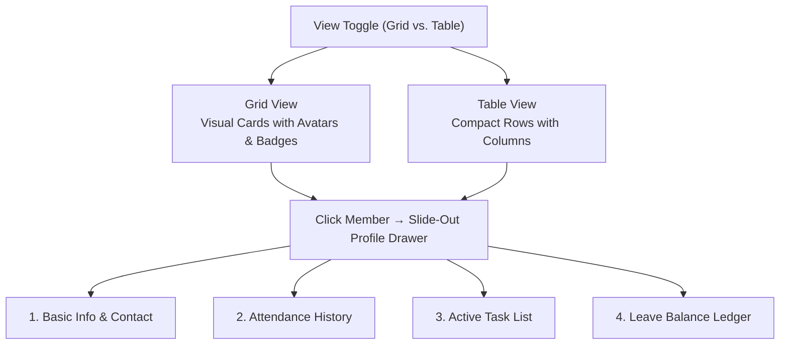
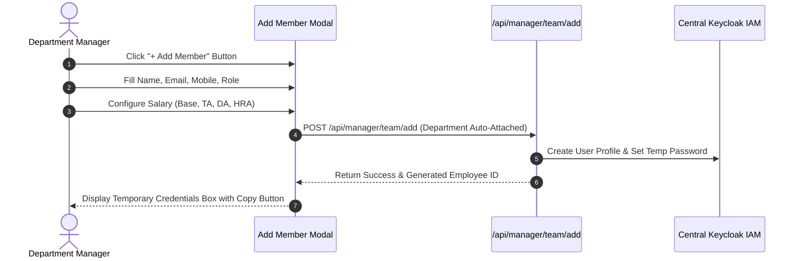

# 03. Team Roster (`/manager/team`)

The **Team Roster** module is your department directory. As a manager, you can view all members reporting to you, inspect individual employee dossiers (attendance logs, active tasks, leave histories), monitor productivity scores, and provision new staff directly into your team.

---

## 📸 Interface Screenshot

<!-- SCREENSHOT_PLACEHOLDER: /manager/team -->
> *[Screenshot Placeholder: Department Team Roster & Member Cards]*
> *(Image path to add: `docs/assets/images/HRMS/Manager_/team.png`)*

---

## 🧭 Team Roster Layout & View Options

At the top right of the team directory, use the **View Toggle** buttons:
* **Grid View (Cards)**: Displays members as visual cards showing their profile avatar, official designation, real-time presence dot, productivity meter, and direct contact buttons.
* **Table View (List)**: Compact spreadsheet rows ideal for comparing multiple employees simultaneously.

---

## 🛠️ Step-by-Step Guide: How to Work with Team Members

### Step 1: Search & Filter Your Team
* **Live Search**: Type any name, email address, or employee ID in the search box to find a member instantly.
* **Role Filter**: Filter by `Employee`, `Supervisor / Team Lead`, or `Finance Officer`.
* **Attendance Status Filter**: Filter to see who is currently `Present`, `Late`, `On Leave`, or `Absent`.
* **Productivity Filter**: Filter by `High` (⭐ Top performers), `Medium` (Core contributors), or `Low` (Members needing assistance).

---

### Step 2: Open the Member Slide-Out Profile Drawer
Click on any team member's card or row to open their comprehensive profile drawer on the right side of the screen:

1. **Basic Info Tab**:
   * View official Email, Mobile phone number, Employee ID, and Date of Joining.
   * Send a direct message or launch an email with one click.
2. **Attendance Tab**:
   * Inspect the member's monthly attendance percentage (e.g., `96.4% on-time rate`).
   * View daily clock-in timestamps and overtime hours worked.
3. **Tasks Tab**:
   * See all current tasks assigned to this person with priority tags and due dates.
   * Directly assign a new task to this member by clicking **+ Assign Task**.
4. **Leaves Tab**:
   * View their available leave balance across Casual Leave, Sick Leave, and Paid Time Off.
   * Review their history of past approved and rejected leave requests.

---

### Step 3: Add a New Team Member (`+ Add Member`)
Department Managers can onboard new personnel directly into their team:

1. Click the **+ Add Member** button at the top right.
2. **Account Details**:
   * **Full Legal Name**: E.g., `Rohit Sharma`.
   * **Corporate Email**: E.g., `rohit.sharma@srjhubnest.com`.
   * **Mobile Number**: 10-digit phone number.
   * **Role**: Choose between `Employee`, `Supervisor`, or `Finance Officer`. *(Note: Department is locked automatically to your department).*
3. **Salary Structure**:
   * Input **Base Salary** (Monthly).
   * Configure **Travelling Allowance (TA)** and **Dearness Allowance (DA)** as either a **Fixed ₹ Amount** or **% Percentage of Base**.
   * Add **House Rent Allowance (HRA)**.
4. **Submit & Copy Credentials**:
   * Click **Save Member**. A success screen will present the generated **Employee ID** and **Temporary Password**.
   * Click the **Copy Credentials** button to securely share login instructions with the new hire.

---

### Step 4: Edit Member Details
If an employee receives a promotion or internal title change:
1. Click the **Pencil (Edit)** icon on their profile card.
2. Update their display name or designation role.
3. Click **Save Changes** to immediately update company directories.

---

## ❓ Frequently Asked Questions (FAQ)

??? question "Can I change an employee's department to transfer them to another team?"
    Department transfers require HR authorization. As a Department Manager, you can edit roles within your own team, but cross-department transfers must be processed via `/hr/employees`.

??? question "How is the Productivity Score calculated?"
    The productivity badge combines two automated metrics: on-time task completion rate (weight: 60%) and monthly attendance punctuality (weight: 40%).
