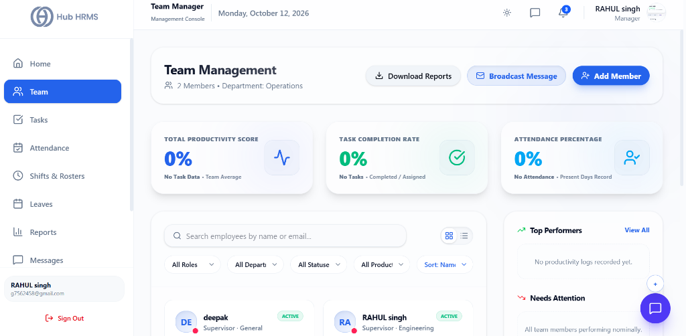
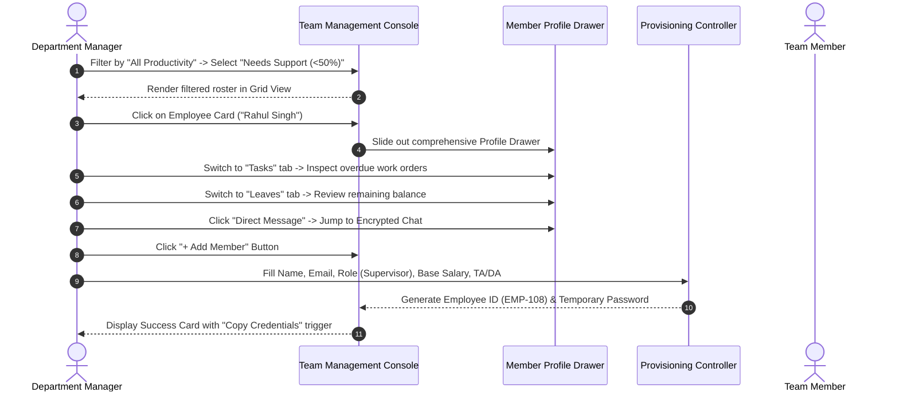

# 03. Team Management & Profiles (`/manager/team`)

The **Team Management** module is the central human resource directory for Department Managers in Hub HRMS. Designed for granular workforce governance, this console empowers managers to evaluate collective productivity metrics, filter personnel across designations and efficiency tiers, inspect deep 4-tab employee dossiers in a slide-out drawer, broadcast department announcements, audit compliance documents, and provision new staff directly into their department.

---

## 🏛️ Live Interface Overview

Below is the live console layout of the **Department Manager Team Management** workspace:

---

## 🧭 Page Anatomy & Interactive Controls

The table below catalogs every button, filter, view mode, drawer tab, and action trigger on the Team Management page:

| UI Component / Control | Visual Location | Functional Behavior & Impact |
| :--- | :--- | :--- |
| **Department Summary Header** | Header Top Left | Displays `Team Management` with active member headcount and department tag (e.g., `2 Members • Department: Operations`). |
| **Download Reports Button** | Header Top Center (w/ Download icon) | Triggers multi-format export of department team data. |
| **Broadcast Message Button** | Header Top Right (w/ Mail icon) | Routes to the messaging center (`/manager/messages`) pre-configured to dispatch an announcement to all department personnel. |
| **Add Member Button** | Header Top Right (Solid Blue button w/ UserPlus icon) | Launches the full **Add Member Onboarding Modal** to provision new Employees, Supervisors, or Finance Officers. |
| **Top Performer Spotlight Banner** | Below Header (When top performers exist) | Celebrates the department's highest output contributor with an emerald star badge, efficiency percentage, and a direct **Review Tasks** button. |
| **Total Productivity Score Card** | Analytics Grid (Card 1) | Shows overall team productivity percentage (e.g., `0%` or `84%`), Activity waveform icon, trend badge (`Optimal`, `In Progress`, or `No Task Data`), and sub-label `Team Average`. |
| **Task Completion Rate Card** | Analytics Grid (Card 2) | Displays percentage of assigned work orders completed (e.g., `0%` or `92%`), CheckCircle icon, trend badge (`On Track` or `Needs Review`), and sub-label `Completed / Assigned`. |
| **Attendance Percentage Card** | Analytics Grid (Card 3) | Displays 30-day attendance compliance rate (e.g., `0%` or `96%`), UserCheck icon, trend badge (`Good` or `Low`), and sub-label `Present Days Record`. |
| **Search Employees Input** | Filter Toolbar Left | Real-time text search filtering member cards by legal name or corporate email address. |
| **View Mode Switcher (Grid / Table)** | Filter Toolbar Right | Toggles between **Grid View** (Visual cards with avatar, presence dot, AI tags, and progress bar) and **Table View** (Compact tabular registry). |
| **All Roles Dropdown** | Filter Toolbar (Col 1) | Filters roster by designation: `All Roles`, `Employee`, `Supervisor`, `HR`. |
| **All Departments Dropdown** | Filter Toolbar (Col 2) | Scoped selector for manager departments: `All Departments`, `Engineering`, `Operations`, `Design`, etc. |
| **All Statuses Dropdown** | Filter Toolbar (Col 3) | Filters by employment state: `All Statuses`, `ACTIVE`, `INACTIVE`, `SUSPENDED`. |
| **All Productivity Dropdown** | Filter Toolbar (Col 4) | Filters by performance tier: `All Productivity`, `High (≥80%)`, `Steady (50-79%)`, `Needs Support (<50%)`. |
| **Sort By Dropdown** | Filter Toolbar (Col 5) | Orders members by: `Name (A-Z)`, `Name (Z-A)`, `Productivity`, `Tasks Completed`, `Joining (Newest)`, `Joining (Oldest)`, `Attendance Rate`. |
| **Member Cards (Grid View)** | Main Canvas (Left 8 Cols) | Interactive cards featuring employee avatar, presence status dot (Green = Present, Amber = Late, Blue = Leave, Red = Absent), role, department, active status badge, performance tag (`High Performer`, `Steady Performer`, `Needs Improvement`, `No Tasks Assigned`), productivity progress bar, and **Tasks** & **Profile** buttons. |
| **Member Rows (Table View)** | Main Canvas (Left 8 Cols) | Tabular rows displaying Member avatar/name/email, Department & Role, Productivity badge, and inline **Tasks** and **View Profile (Eye)** actions. |
| **Top Performers Widget** | Right Sidebar Top (4 Cols) | Displays ranked top 3 team members with efficiency percentages (`#1`, `#2`, `#3`), green badges, and a **View All** sorting trigger. |
| **Needs Attention Widget** | Right Sidebar Middle (4 Cols) | Highlights members struggling with delivery deadlines or attendance with red indicators and direct dossier links. |
| **Workload Spread AreaChart** | Right Sidebar Bottom (4 Cols) | Recharts interactive Area Chart showing task distribution across the roster with a standalone **PDF** export button and workload imbalance detection warning. |
| **Slide-Out Member Profile Drawer** | Slide-Over Panel (Right 500px) | Full-screen height dossier featuring large avatar, presence dot, department/role, AI tags, **Direct Message** button, **Verify Docs** button, and 4 tab panels: **Basic**, **Attendance**, **Tasks**, and **Leaves**. |

---

## 🧭 Member Lifecycle & Onboarding Sequence

The diagram below outlines how managers onboard new personnel, track team productivity, and inspect member dossiers:

---

## ⚙️ Step-by-Step Manager Team Procedures

### 1. Switching View Modes (Grid vs. Table)
* **Grid View (Default):** Best for visual scanning during daily standups. Displays member cards with real-time biometric attendance presence dots, performance categorization tags, and productivity progress meters.
* **Table View:** Best for department-wide administrative reviews. Click the **List (Table)** icon next to the search bar to render compact spreadsheet rows with sortable headers.

### 2. Deep-Dive Member Auditing (Slide-Out Profile Drawer)
Clicking any employee card or row opens the right-hand **Slide-Out Profile Drawer** without navigating away from your roster:
1. **Header & Actions:**
   - Displays high-resolution profile photo, presence indicator, and AI badges (e.g., `Top Performer`, `Consistent Attendance`).
   - Click **Direct Message** to launch a private end-to-end encrypted chat with the member.
   - Click **Verify Docs** to inspect uploaded identity credentials, government records, and tax forms.
2. **Basic Tab:**
   - View official Email, Mobile phone number, Employee ID, Date of Joining, and physical address.
   - Click the pencil icon to update employee contact designations.
3. **Attendance Tab:**
   - Review 30-day attendance compliance percentage and total hours clocked.
   - Inspect daily check-in and check-out logs with GPS and webcam audit tags.
4. **Tasks Tab:**
   - Review all active, completed, and overdue work orders assigned to the member.
   - Click **+ Assign Task** to route a new work order directly to their pipeline.
5. **Leaves Tab:**
   - Audit live balances across Casual Leave, Sick Leave, and Paid Time Off (PTO).
   - Review historical leave requests with manager approval timestamps and notes.

### 3. Provisioning New Personnel (`+ Add Member`)
Department Managers can onboard Employees, Supervisors, and Finance Officers directly into their department:
1. Click the solid blue **+ Add Member** button in the top action bar.
2. **Account Credentials:**
   - Enter **Full Legal Name** and **Corporate Email** (mandatory).
   - Enter **Mobile Phone Number**.
   - Select **Role**: `Employee`, `Supervisor`, or `Finance Officer`. *(Note: Department is automatically locked to your assigned department).*
   - Provide an initial login password or let the system generate a secure temporary password.
3. **Compensation Structure:**
   - Enter **Base Salary** (in INR, between ₹0 and ₹1,00,00,000).
   - Set **TA (Travel Allowance)**: Choose between a fixed **Amount (₹)** or **Percentage (%) of Base**.
   - Set **DA (Dearness Allowance)**: Choose between fixed **Amount (₹)** or **Percentage (%)**.
   - Enter **HRA (House Rent Allowance)**.
4. **Demographics:**
   - Select **Gender**, **Date of Birth**, and enter residential **Address**.
5. Click **Create Member**.
6. The system creates the account, generates an official **Employee ID**, and presents a success modal with a **Copy Credentials** button to share with the new hire.

---

## 💡 Best Practices for Department Managers

> [!TIP] **Balance Workload Imbalances Proactively**  
> Review the **Workload Spread** chart in the right column. If the alert *"Workload imbalance detected! Suggest redistributing tasks"* appears, inspect members with over 5 active tasks and delegate work orders to less loaded personnel.

> [!NOTE] **Presence Indicator Color Codes**  
> The small status dot on every member's avatar reflects their real-time daily status:
> - 🟢 **Emerald (Green):** Present / In Office
> - 🟡 **Amber (Yellow):** Checked in Late (past grace period)
> - 🔵 **Blue:** Approved On Leave
> - 🔴 **Rose (Red):** Absent / Unreported

---

## ❓ Frequently Asked Questions (FAQs)

??? question "Can Department Managers onboard supervisors?"
    Yes! Department Managers possess full administrative clearance to provision both frontline **Employees** and operational **Supervisors** within their assigned department using the Add Member workflow.

??? question "Where does the Broadcast Message button route?"
    Clicking **Broadcast Message** opens the encrypted messaging center (`/manager/messages`) pre-configured with a department distribution list, allowing you to broadcast emergency or operational updates to your entire team simultaneously.
