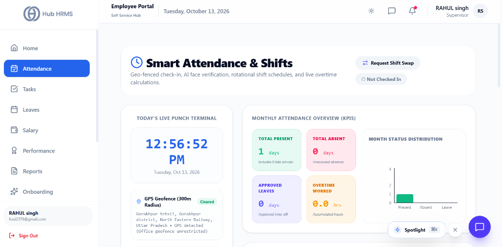
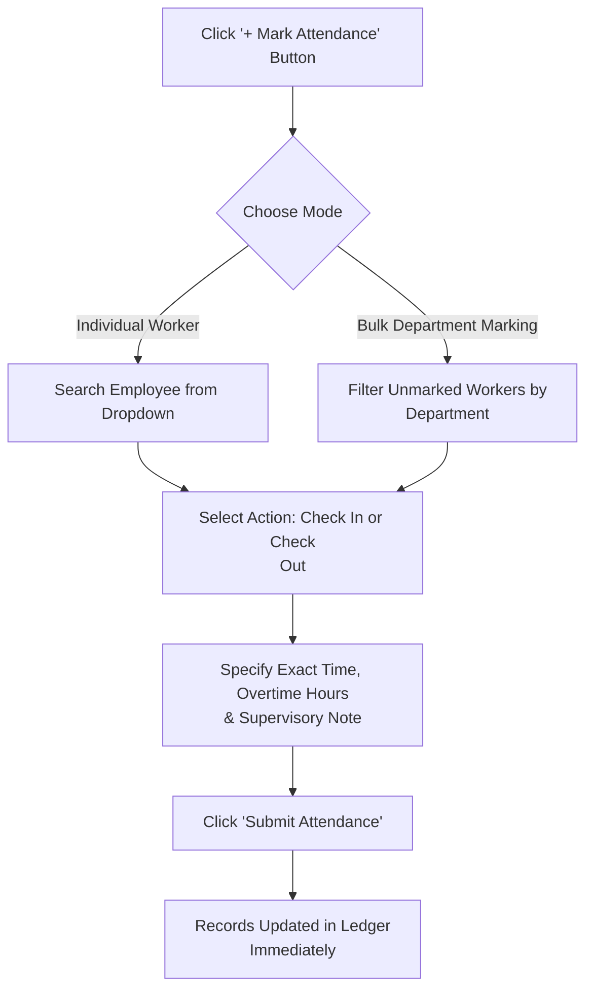

# 05. Floor Attendance & Punches (`/supervisor/attendance`)

The **Floor Attendance & Punches** module serves as the primary operational gateway for auditing, verifying, and regularizing workforce timekeeping. Designed with real-time biometric and GPS geofence tracking, supervisors can inspect exact physical clock-in addresses, perform bulk manual attendance marking, evaluate 7-day attendance trends, and export compliant records for monthly payroll.

---

## 🏛️ Live Interface Overview

Below is the live console layout of the **Supervisor Attendance Audit** console:

---

## 🧭 Page Anatomy & Top Action Controls

The top action bar allows supervisors to audit any specific operational date, mark attendance manually, and export shift ledgers:

| Control / Element | Type | Purpose & Working Behavior |
| :--- | :--- | :--- |
| **Audit Date Picker** | Date Input | Allows toggling between *Today* and any historical date to inspect past punches and late arrivals. |
| **Export Dropdown** | Action Trigger | Downloads attendance records in **CSV**, **Excel**, or **PDF** format (`attendance_YYYY-MM-DD.fmt`) with names, timestamps, and locations. |
| **+ Mark Attendance** | Modal Trigger | Opens the attendance entry modal supporting both single-worker manual punches and **Bulk Department Marking**. |
| **Refresh Button (`🔄`)** | Action Trigger | Re-queries the attendance ledger and syncs live punches without a full browser reload. |

---

## 📸 Supervisor Self Attendance Card

To maintain attendance parity across all staff tiers, the top of the page features a dedicated **Self Attendance Terminal**:

* **Facial & GPS Check-In**: Supervisors mark their own shift punches using device camera biometrics and live reverse-geocoded office perimeter verification.
* **Stopwatch & Break Tracker**: Displays real-time elapsed shift hours, active meal/recess break status, and recorded punch-in time.

---

## 📊 Summary KPI Metric Cards (Interactive Filters)

Four high-visibility summary cards aggregate floor attendance for the selected date. **Clicking any card dynamically filters the table below**:

| Metric Card | Indicator Color | Category Definition | Filter Behavior on Click |
| :--- | :--- | :--- | :--- |
| **Present** | 🟢 Emerald | Total operators clocked in and verified on time. | Filters table to show present workers only. |
| **Late** | 🔵 Blue | Workers who punched in after the grace period (e.g., past 09:05 AM). | Isolates tardy records for punctuality audits. |
| **Absent** | 🔴 Rose | Unaccounted workers with no clock-in recorded for the shift. | Highlights absentees requiring line relief. |
| **On Leave** | 🟣 Purple | Workers covered by pre-approved casual, sick, or earned leaves. | Audits approved time-off. |

---

## 📈 Attendance Analytics & Trend Charts

Directly below the metric cards, two synchronized charts visualize team attendance patterns:

### 1. Daily Status Breakdown (Donut Pie Chart)
* **Proportional Attendance Ratio**: A multi-colored pie chart illustrating the ratio of `Present`, `Late`, `Absent`, and `On Leave` personnel for the chosen date.
* **Centered Summary**: Displays total accounted headcount with clean percentage slices.

### 2. Weekly Attendance Trend (Bar Chart)
* **7-Day Trajectory**: Plots daily attendance counts across Monday through Sunday.
* **Multi-Series Tracking**: Compares `Present` (Emerald bars), `Late` (Blue bars), and `Absent` (Red bars) day by day to spot recurring absenteeism patterns (e.g., Monday or Friday spikes).

---

## 📋 Comprehensive Attendance Data Table

The core audit table provides granular transparency into every individual punch event:

| Table Column | Data Rendered | Description & Visual Treatment |
| :--- | :--- | :--- |
| **Employee Name** | Photo + Name + ID | Employee avatar, full legal name, and unique employee ID number. |
| **Department & Role** | Dual Badges | Identifies assigned operational unit and job level. |
| **Status** | State Pill | Color-coded status badge (`Present`, `Late`, `Absent`, `In Office`, `On Leave`, `Weekend`). |
| **Check-In Time & GPS** | Timestamp + Address | 12-hour formatted punch time (e.g., `09:14 AM`) with reverse-geocoded physical street location. |
| **Check-Out Time & GPS** | Timestamp + Address | Shift departure time and closing location coordinates. |
| **Total Hours** | Formatted Duration | Effective productive duration (e.g., `8h 25m`) excluding meal breaks. |
| **Actions** | Context Buttons | • `View Details` (`👁️`) • `Edit Record` (`✏️`) • `Delete Record` (`🗑️`) |

---

## ⚙️ Step-by-Step Supervisory Workflows

### 1. Inspecting Punch Details & Biometric Evidence (`View Details`)
Clicking any row or the **View** button opens the **Attendance Detail Inspector**:

1. **Biometric Face Capture**: Displays the live camera snapshot taken by the worker during clock-in.
2. **Reverse-Geocoded Physical Address**: Converts raw GPS coordinates into human-readable building and street addresses.
3. **Office Geofence Compliance**: Confirms whether the punch occurred within the authorized branch perimeter (e.g., *Within Office Radius — 45m*).
4. **Device & IP Metadata**: Displays browser user-agent and LAN/WAN IP address to detect proxy check-ins.

---

### 2. Manual & Bulk Attendance Marking (`+ Mark Attendance`)
When workers forget their device or experience connectivity dropouts:

1. **Individual Mode**:
   * Search employee by name or ID.
   * Select punch type (`CHECK_IN` or `CHECK_OUT`).
   * Set punch time and add an explanatory supervisory note (e.g., *"LAN connectivity failure at Gate 4 terminal"*).
2. **Bulk Department Mode**:
   * Lists all operators whose attendance has not yet been marked today.
   * Select multiple or all unmarked workers with one click.
   * Apply uniform shift start times to mark the entire crew present simultaneously.

---

### 3. Editing or Deleting Punch Records
* **Editing a Record**: Click **Edit Record** (`✏️`) to adjust mistyped clock-in/out hours or credit missing overtime.
* **Deleting a Record**: Click **Delete Record** (`🗑️`) to remove duplicate or erroneous test punches (requires confirmation prompt).

---

## 💡 Best Practices for Operations Supervisors

!!! tip "Auditing Late Arrival Justifications"
    Check the **Late** filter card within 30 minutes of shift start. If delayed arrivals were caused by verified company transport delays, edit the record note to prevent automated payroll deduction penalties.

!!! warning "Bulk Punch Discipline"
    Reserve the **Bulk Mark Attendance** tool for verified group arrivals or network outages. Always verify physical floor presence before marking un-clocked workers as present.

!!! note "Reverse Geocoding Accuracy"
    The system automatically converts latitude and longitude into street names asynchronously. Allow 1-2 seconds after opening the record inspector for the reverse geocoding lookup to complete.

