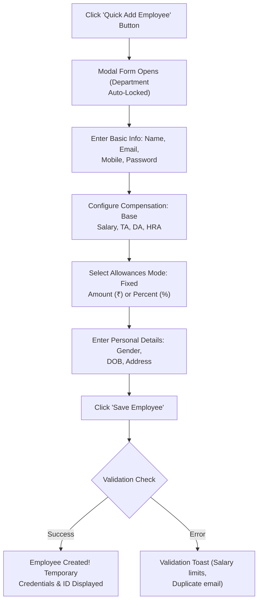

# 02. Supervisor Live Dashboard (`/supervisor/dashboard`)

The **Operations Supervisor Dashboard** is the daily floor command console in Hub HRMS. Engineered specifically for operational leads and line supervisors, it merges personal biometric clock-in, real-time team headcount, leave and attendance approval queues, workload distribution charts, and department-level employee onboarding into a unified, high-density interface.

---

## 🏛️ Live Interface Overview

Below is the live console layout of the **Operations Supervisor Command Dashboard**:

---

## 🧭 Page Anatomy & Header Controls

The top header delivers instant departmental context, dynamic time filters, and fast operational triggers:

| Control / Element | Type | Purpose & Working Behavior |
| :--- | :--- | :--- |
| **Supervisor Greeting** | Header Title | Dynamic time-based greeting (*Good Morning / Afternoon / Evening*) displaying your name and profile avatar. |
| **Live Clock** | Real-Time Badge | Pulsing real-time digital clock displaying live Indian Standard Time (IST) down to the second (`Clock` icon). |
| **Department Badge** | Informational Pill | Displays your assigned operational unit (e.g., `Engineering`, `Operations`, `Field Logistics`). |
| **Time Period Tabs** | Filter Switcher | Quick period selectors: `Today`, `Weekly`, `Monthly`, and `Quarterly` to adjust telemetry charts. |
| **Custom Date Pickers** | Date Range Input | Start and End calendar pickers (`customStart` and `customEnd`) for customized historical audits. |
| **Refresh Button (`🔄`)** | Action Trigger | Re-fetches live attendance logs, team rosters, and approval queues without a browser reload. |
| **Notification Bell (`🔔`)** | Interactive Flyout | Features an unread red counter dot. Clicking toggles a flyout panel listing recent team check-ins, shift swap requests, and memos. |

### Header Quick Action Buttons
Directly underneath the greeting, quick navigation pills provide immediate access to supervisory workflows:
* **View Team (`👁️`)**: Opens `/supervisor/team` to inspect complete crew rosters and contact cards.
* **Approvals (`📝`)**: Smooth-scrolls to the `#approvals` queue with a dynamic pending count badge (e.g., `3 Pending`).
* **Attendance (`📅`)**: Opens `/supervisor/attendance` for real-time floor punch monitoring.
* **View Tasks (`📋`)**: Opens `/supervisor/tasks` for read-only sprint delivery tracking.
* **Quick Add Employee (`👤+`)**: Opens the dedicated modal to onboard new staff directly into your department.
* **Locked Features (`🔒 Reports`)**: Greyed-out indicator indicating executive reporting requires Manager or Admin authorization.

---

## 📸 Supervisor Self Attendance Card

To maintain attendance parity across all staff tiers, the dashboard features a built-in **Self Attendance Terminal**:

* **Biometric & GPS Validation**: Allows supervisors to mark their personal shift check-in directly from the dashboard using the device camera and reverse-geocoded GPS radius verification.
* **Live Stopwatch & Status**: Displays your active shift duration, lunch break status, and recorded punch-in timestamp.
* **One-Click Check-Out**: Facilitates quick shift wrap-up when completing daily floor operations.

---

## 📊 Summary KPI Metric Cards (Interactive Filters)

Eight high-visibility KPI cards summarize active floor telemetry. **Clicking any card dynamically filters the chart layers below**:

| KPI Metric Card | Target Route / Anchor | Telemetry Tracked | Click Action / Filter Behavior |
| :--- | :--- | :--- | :--- |
| **Team Size** | `/supervisor/team` | Total active members assigned to your department. | Highlights team roster and workload charts. |
| **Present Today** | `/supervisor/attendance` | Number of crew members clocked in and verified. | Filters Weekly Attendance Trend to show present ratios. |
| **Absent Today** | `/supervisor/attendance` | Unaccounted crew members missing from the floor. | Flags unexcused absences requiring standby coverage. |
| **Late Today** | `/supervisor/attendance` | Crew members clocked in after the branch grace period. | Highlights punctuality trends. |
| **Pending Approvals** | `#approvals` | Outstanding leave and attendance correction requests. | Isolates the Approvals Queue and review actions. |
| **Active Tasks** | `/supervisor/tasks` | Sprint deliverables currently underway across your team. | Highlights the Performance Trends area chart. |
| **Tasks Done** | `/supervisor/tasks` | Deliverables signed off and completed during the active cycle. | Visualizes completion velocity. |
| **Overdue** | `/supervisor/tasks` | Deliverables past their designated deadline cutoff. | Flags bottlenecked tasks requiring managerial escalation. |

---

## 📈 Performance Trends & AI Coaching Intelligence

### 1. Performance Trends (Area Chart)
* **Comparative Trajectory**: Plots **Assigned Tasks** (indigo filled curve) against **Completed Deliverables** (emerald filled curve) across days of the week.
* **Team Member Filter Dropdown**: Allows toggling between aggregate view (`All Members`) and individual operator tracking to inspect isolated delivery rates.
* **Read-Only Telemetry**: Reflects real-time task progress without granting supervisors direct permission to alter master sprint schedules.

### 2. AI Insights Card
* **Floor Intelligence Sensor**: Continuously scans crew attendance anomalies, overtime spikes, and task delivery pace.
* **Actionable Coaching Advice**: Generates automated recommendations (e.g., *"Teams that review KPIs weekly outperform monthly reviewers by 23%. Review task backlog before Friday shift handover"*).
* **View Team Shortcut**: One-click link to jump straight to the personnel directory.

---

## 📝 Approvals Queue, Top Performers & Team Productivity

### 1. Approvals Queue (Leave & Attendance Corrections)
Supervisors hold targeted frontline authorization powers to resolve day-to-day worker requests:

* **Category Filter Pills**: Toggle between `All`, `Leave` (Casual/Sick leave applications), and `Attendance` (Missed punch corrections).
* **Sorting**: Toggle between `Sort: Date` and `Sort: Name`.
* **Request Cards**:
  * Displays employee name, request type badge, duration in days, and requested dates.
  * **View Details**: Opens the request inspector displaying employee justification notes and uploaded doctor/travel proofs.
  * **Approve (`👍`)**: One-click green button to authorize the request; triggers an immediate ledger update.
  * **Reject (`👎`)**: One-click red button to decline the request with an explanatory note.
* **View All Approvals**: Bottom navigation button linking to `/supervisor/leaves`.
* **Manager-Restricted Notices**: Explains why certain actions (e.g., *Task Reassignments*, *Overtime Approvals*, *Shift Rotations*) are greyed out and routed to senior department managers.

### 2. Top Performer & Needs Support
* **MVP Card (`TrendingUp`)**: Highlights the highest-performing team member based on closed deliverables and consistent on-time attendance.
* **Needs Support Card (`TrendingDown`)**: Proactively flags operators with falling task completion rates or repeated tardiness for supportive check-ins.
* **Locked Feature Badge**: Indicates full 360-degree appraisal reports require Manager permissions.

### 3. Team Productivity Donut Chart
* **Aggregate Efficiency Gauge**: Central percentage gauge displaying overall crew output (e.g., `85% Team`).
* **4-Stat Telemetry Matrix**:
  * 🔵 **Active Tasks**: Ongoing work orders.
  * 🟢 **Done Tasks**: Closed milestones.
  * 🔴 **Overdue Tasks**: High-risk deliverables.
  * 🟡 **Absent Workers**: Floor absences impacting velocity.

---

## 📅 Weekly Attendance, Member Workload & Role Permissions

### 1. Weekly Attendance Trend (3 Mini Bar Charts)
Side-by-side comparative bar charts plotting daily patterns over Monday through Friday:
* 🟢 **Present Chart**: Daily verified clock-in counts.
* 🔵 **Late Chart**: Daily delayed arrivals past shift grace periods.
* 🔴 **Absent Chart**: Daily unexcused absences.
* Includes a direct **Full View →** shortcut to `/supervisor/attendance`.

### 2. Member Workload Bar Chart
* **Week Selector Dropdown**: Toggle across `Week 1`, `Week 2`, `Week 3`, and `Week 4` of the active billing cycle.
* **Horizontal Stacked Bars**: Displays individual team members along the vertical axis, comparing **Total Tasks Assigned** (indigo) against **Completed Tasks** (emerald) to identify overloaded or idle operators.

### 3. Your Permissions Matrix (Supervisor RBAC Overview)
A dedicated transparency widget detailing exactly what permissions are enabled for the Operations Supervisor role:

| Operational Permission | Status | Access Level |
| :--- | :---: | :--- |
| **View Team Members** | 🟢 Allowed | Read-only directory access for all department personnel. |
| **View Task Status** | 🟢 Allowed | Real-time tracking of sprint deliverables and milestones. |
| **Monitor Attendance** | 🟢 Allowed | Live floor clock-in and punctuality telemetry. |
| **Approve Leave Requests** | 🟢 Allowed | Frontline sign-off for basic casual and sick leaves. |
| **Approve Attendance Fixes** | 🟢 Allowed | Verification of missed punch regularization forms. |
| **Create / Assign Tasks** | 🔴 Restricted | Reserved for Department Managers and Project Leads. |
| **Create Supervisors** | 🔴 Restricted | Reserved for Company Administrators. |
| **View Executive Reports** | 🔴 Restricted | High-level company financials and compliance auditing. |
| **Change System Settings** | 🔴 Restricted | Branch policy, IP whitelist, and geofence configuration. |
| **Approve Overtime Payouts** | 🔴 Restricted | Requires Department Manager and Finance review. |

---

## 👤 Quick Add Employee Modal

Supervisors have the operational autonomy to rapidly register new operators directly into their own assigned department:

### Detailed Modal Form Fields:
1. **Basic Credentials**:
   * **Full Name** & **Work Email**: Mandatory credentials for identity generation.
   * **Mobile Number**: Contact line for SMS emergency alerts and dispatch.
   * **Initial Password**: Optional manual password; if left blank, the system provisions a secure temporary passkey.
2. **Compensation Structure**:
   * **Base Salary**: Monthly base compensation (validated between ₹0 and ₹10,000,000).
   * **Travelling Allowance (TA)**: Toggle between **Amount (₹)** or **Percent (%)** of base pay.
   * **Dearness Allowance (DA)**: Toggle between **Amount (₹)** or **Percent (%)** of base pay.
   * **House Rent Allowance (HRA)**: Monthly rental subsidy amount.
3. **Personal Attributes**:
   * **Gender Dropdown**, **Date of Birth (DOB)** calendar picker, and **Residential Address**.
4. **Instant Credential Summary**:
   * Upon successful creation, the modal renders a confirmation screen showing the newly generated **Employee ID**, registered email, and temporary password with a 1-click copy button to share with the onboarded worker.

---

## 💡 Best Practices for Operations Supervisors

!!! tip "Daily Morning T+15 Floor Audit"
    Within 15 minutes of shift launch, inspect the **Absent Today** and **Late Today** KPI cards. If critical assembly or service stations lack certified workers, reallocate idle operators using the **Member Workload** chart.

!!! warning "Manager Escalations"
    If an employee submits an overtime claim or requests a shift rotation beyond basic leave corrections, remind them that final approval rests with the Department Manager due to company payroll policies.

!!! note "Self Check-In Protocol"
    Always mark your personal attendance using the **Self Attendance Card** upon arrival to ensure your operational hours are tracked accurately in the central payroll ledger.
