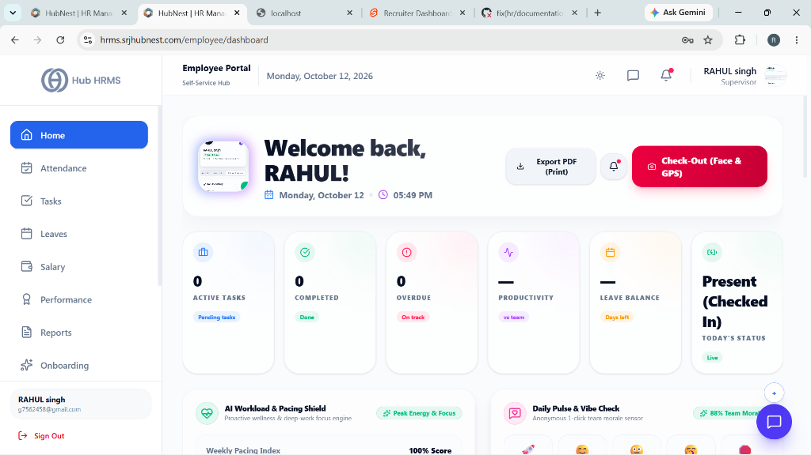
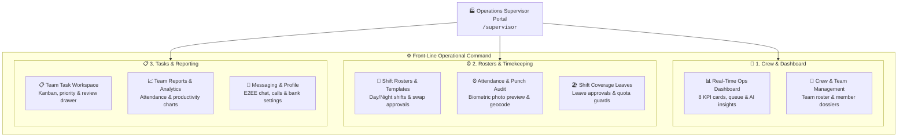
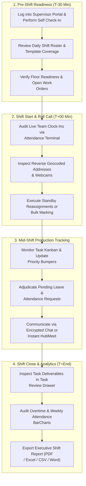

# 🏭 Operations Supervisor Comprehensive Guide

The **Operations Supervisor Portal** (`/supervisor/*`) is the mission-critical operational command center designed specifically for frontline shift leads, department supervisors, and unit coordinators in Hub HRMS. Acting as the operational linchpin between senior department management and frontline execution, supervisors maintain real-time oversight over team headcount, biometric punch audits, rotational shift assignments, task distribution, leave adjudication, and team analytics.

---

## 🏛️ Live Interface Overview

Below is the live console layout of the **Operations Supervisor Command Console**:

---

## 🎯 Role Purpose & Operational Scope

An Operations Supervisor is responsible for ensuring continuous, safe, compliant, and productive operations across designated teams and production units:

* **Real-Time Staffing & Attendance**: Monitoring live clock-ins, verifying facial snapshots, geofence radius checks, and auditing physical terminal punches.
* **Shift Roster Management**: Administering multi-tier rotational shift templates, assigning custom employee overrides, and approving peer-to-peer shift swaps.
* **Team Task Distribution**: Assigning line tasks, tracking deliverable lifecycle stages across List, Kanban, and Calendar layouts, and reviewing deliverables in the Task Review Drawer.
* **Leave & Exception Adjudication**: Approving pending leave requests, enforcing mandatory rejection notes, and managing minimum shift coverage.
* **Department Analytics & Exports**: Evaluating team payroll spend, attendance rates, and task completion metrics, and exporting comprehensive reports in PDF, CSV, Excel, and Word.

---

## 🧭 Daily Operational Cycle of a Supervisor

A standard shift lifecycle for an Operations Supervisor consists of four structured operational milestones:

---

## 🗂️ Supervisor Portal Navigation Directory

| Module # | Chapter Title | Route Path | Core Operational Function |
| :--- | :--- | :--- | :--- |
| **01** | [Operations Dashboard](dashboard.md) | `/supervisor/dashboard` | Live floor staffing headcount, active shift status, urgent alerts, and operational KPIs. |
| **02** | [Crew & Team Management](team.md) | `/supervisor/team` | Worker profiles, station assignments, skill certifications, and team contact lists. |
| **03** | [Shift Rosters & Rotations](shifts.md) | `/supervisor/shifts` | Planning rotational rosters, multi-shift scheduling, and managing peer shift swaps. |
| **04** | [Attendance & Punch Verification](attendance.md) | `/supervisor/attendance` | Verifying biometric punches, approving missed clock-ins, and auditing overtime hours. |
| **05** | [Work Orders & Task Pipeline](tasks.md) | `/supervisor/tasks` | Floor assignment, pipeline stages, throughput tracking, and deliverable sign-offs. |
| **06** | [Shift Coverage Leave Approvals](leaves.md) | `/supervisor/leaves` | Evaluating time-off requests against minimum floor staffing requirements. |
| **07** | [Team Reports & Analytics](reports.md) | `/supervisor/reports` | Shift throughput metrics, machine downtime analysis, and digital shift logs. |
| **08** | [Real-Time Messages & Collaboration](messages.md) | `/supervisor/messages` | Instant shift announcements, team channels, and direct supervisor chat. |
| **09** | [Help & Support Desk](support.md) | `/supervisor/support` | Logging safety tickets, facilities issues, and machine maintenance requests. |
| **10** | [Supervisor Profile & Settings](profile.md) | `/supervisor/profile` | Personal account credentials, emergency contacts, and plant certifications. |

---

## 🔒 Supervisor Role-Based Permissions Summary (RBAC)

Hub HRMS explicitly enforces frontline authority boundaries for the Supervisor role:

| Operational Scope | Supervisor Authorization | Scope Boundaries & Governance |
| :--- | :--- | :--- |
| **Self Profile & Banking** | ✅ **Full Authority** | Edit personal contact details, configure primary/secondary bank accounts, manage 2FA. |
| **Team Roster & Dossiers** | ✅ **Authorized** | View team members, monitor skill efficiency, trigger Quick Add Employee within own department. |
| **Shift Management** | ✅ **Authorized** | Define shift templates (Day/Night), reassign daily rosters, approve/reject shift swaps. |
| **Attendance Verification** | ✅ **Authorized** | Review geofencing and photos, perform single/bulk manual marking, edit/delete logs. |
| **Task Pipeline** | ✅ **Authorized** | Create and assign team tasks, change Kanban states, review deliverables via drawer. |
| **Leave Adjudication** | ✅ **Authorized** | Approve pending team leaves, enforce mandatory rejection notes, inspect leave history. |
| **Department Reports** | ✅ **Authorized** | View team stats, analyze payroll distributions, export in PDF, CSV, Excel, and Word. |
| **Company Settings** | 🔒 **Restricted** | Modifying enterprise-wide configuration requires Manager or Admin privileges. |
| **Supervisor Creation** | 🔒 **Restricted** | Creating or provisioning new supervisors requires Department Manager authorization. |
| **Executive Reports** | 🔒 **Restricted** | Accessing company-wide balance sheets or bank payout files requires Finance/Admin roles. |
