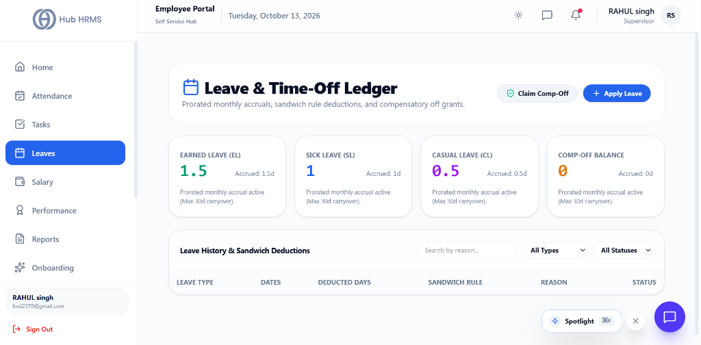

# 07. Shift Leave Approvals (`/supervisor/leaves`)

The **Shift Leave Approvals** module empowers Operations Supervisors to adjudicate, track, and balance time-off requests submitted by personnel within their assigned department. Acting as the primary frontline approval checkpoint, supervisors can inspect employee justifications, evaluate leave categories, grant instant approvals, or record formal rejection rationales while maintaining statutory labor compliance.

---

## 🏛️ Live Interface Overview

Below is the live console layout of the **Supervisor Leave Adjudication** console:

---

## 🧭 Page Anatomy & Header Summary Cards

The top section provides immediate department-level context and aggregates pending workload:

| Control / Element | Type | Purpose & Working Behavior |
| :--- | :--- | :--- |
| **Department Title** | Header Text | Displays `Team Leave Requests` tailored to your logged-in operational unit (e.g., `Engineering`, `Operations`, `General`). |
| **Pending Approvals Card** | Amber Metric Card | Displays the active count of outstanding leave requests requiring supervisory decision. |
| **Approved Leaves Card** | Emerald Metric Card | Cumulative count of authorized leaves for the active cycle. |
| **Rejected Requests Card** | Rose Metric Card | Total count of declined applications with recorded justification notes. |

---

## 📈 Leave Distribution Analytics & Donut Charts

Directly below the summary cards, two synchronized charts visualize departmental leave trends:

### 1. Leave Status Distribution (Donut Pie Chart)
* **Status Proportions**: Illustrates the proportional ratio of `Pending` (amber), `Approved` (emerald), and `Rejected` (rose) applications across your team.
* **Interactive Tooltip**: Hovering over any slice reveals exact application counts.

### 2. Leaves by Type (Donut Pie Chart)
* **Category Breakdown**: Analyzes employee time-off requests categorized by statutory leave buckets:
  * 🟡 **Casual Leave (CL)**: Planned personal affairs.
  * 🟢 **Sick Leave (SL)**: Medical recuperation.
  * 🔵 **Earned Leave (EL)**: Accrued annual paid vacations.
* **Centered Legend**: Bottom color legend providing instant recognition of predominant leave types.

---

## 🔍 Search, Filter & Multi-Format Export Toolbar

A dedicated control toolbar positioned above the request table allows supervisors to isolate specific records rapidly:

* **Instant Search Input**: Query records in real-time by employee name or corporate email address.
* **Status Filter Dropdown**: Filter across `ALL`, `Pending`, `Approved`, or `Rejected`.
* **Type Filter Dropdown**: Filter across `ALL`, `Sick Leave`, `Casual Leave`, or `Earned Leave`.
* **Sort Dropdown**: Toggle chronological order between `Newest First` (latest submission date) and `Oldest First`.
* **Export Dropdown**: Downloads the filtered dataset as a comprehensive spreadsheet (**CSV**, **Excel**, or **JSON**) formatted with Employee Name, Email, Leave Type, Dates, Total Days, Status, Approver Name, and Reason notes.

---

## 📋 Comprehensive Leave Request Log Table

The central table renders all departmental leave applications with complete auditing context:

| Table Column | Data Rendered | Description & Visual Treatment |
| :--- | :--- | :--- |
| **Employee** | Avatar + Name + Email | Displays profile photo (or initials badge), employee legal name, and email. |
| **Leave Type** | Category Text | Identifies the requested leave bucket (e.g., `Sick Leave`, `Casual Leave`). |
| **Duration** | Date Range + Total Days | Start date to end date (e.g., `2026-10-14 to 2026-10-16 • 3 Days`). |
| **Reason** | Text String | Employee justification note explaining the absence request. |
| **Status & Approver** | State Pill + Attribution | Badge indicator (`Approved`, `Rejected`, or `Pending`) along with the supervisor's name who reviewed the ticket. |
| **Actions** | Interactive Buttons | Contextual decision triggers based on active status. |

---

## ⚙️ Step-by-Step Supervisory Workflows

### 1. Approving a Pending Leave Request
1. Locate the employee entry flagged with the yellow `Pending` badge.
2. Review the requested dates and reason note.
3. Click the green **Approve (`✓`)** button.
4. The system updates the record to `Approved`, stamps your name as the reviewing supervisor, syncs the shift roster to `ON LEAVE`, and dispatches an automated notification to the employee.

---

### 2. Rejecting a Leave Request with Mandatory Justification
When business requirements or critical shift coverage prevent granting time off:
1. Click the red **Reject (`✕`)** button next to the pending request.
2. The **Decline Leave Modal** opens automatically.
3. Enter a clear operational justification (e.g., *"Critical client release on Oct 15; please coordinate alternate dates"*).
4. Click **Confirm Rejection**.
5. The request updates to `Rejected`, the consumed quota is restored to the employee's active balance, and the rejection note is logged for HR auditing.

---

### 3. Inspecting Supporting Documents (`View Details`)
1. Click on the employee row or the eye (`👁️`) icon.
2. The **Leave Details Modal** renders full application metadata:
   * **Emergency Contact Phone**
   * **Project Handover Notes**
   * **Medical Fitness Certificate / Doctor Note Preview** (if submitted for Sick Leave $> 2$ days).

---

## 💡 Best Practices for Operations Supervisors

!!! tip "Prompt 24-Hour Review Turnaround"
    Strive to resolve all `Pending` leave requests within 24 hours of submission. Prompt adjudication enables employees to plan personal affairs and allows shift planners to organize relief rosters.

!!! warning "Documenting Rejection Reasons"
    Always provide a constructive, objective reason when declining a leave request. Generic rejection notes are flagged during quarterly HR compliance audits.

!!! note "Automated Quota Restoration"
    Rejecting a request automatically credits the provisional leave days back into the employee's available LMS bucket without requiring manual HR intervention.

