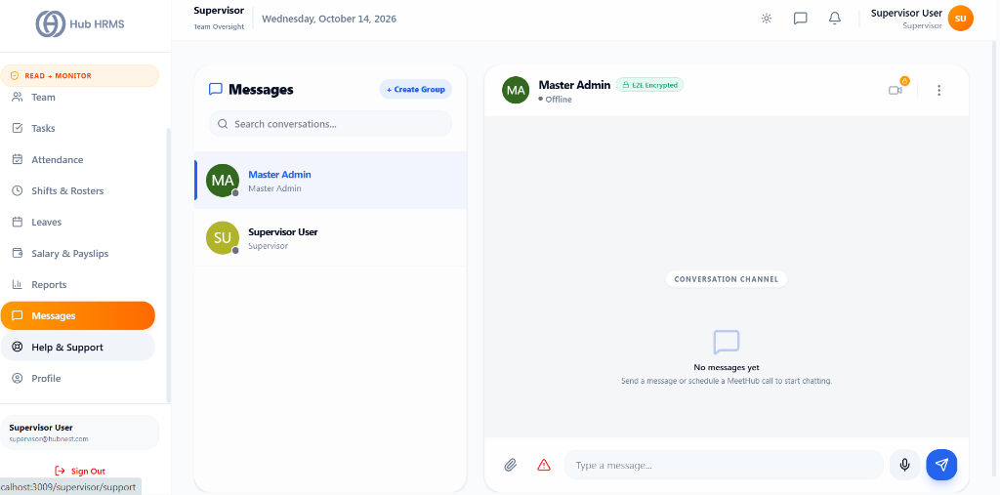
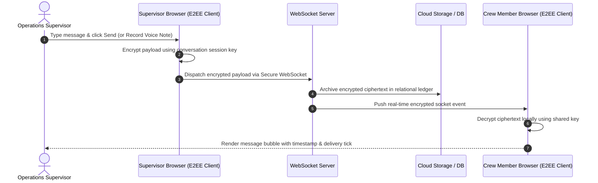

# 08. Real-Time Messages & Collaboration (`/supervisor/messages`)

The **Messages & Collaboration** module connects Operations Supervisors directly with floor operators, technicians, department managers, and peer leads. Featuring end-to-end encryption (E2EE), WebSocket live delivery, custom departmental group creation, audio voice messaging, file attachments, and one-click **HubMeet** virtual huddles, this console ensures that mission-critical operational directives are communicated without delay.

---

## 🏛️ Live Interface Overview

Below is the live console layout of the **Supervisor Messages & HubMeet Hub**:

---

## 🧭 Page Anatomy & Interactive Controls

The table below catalogs every button, input, drawer, modal, and communication trigger available in the Messages workspace:

| UI Component / Control | Visual Location | Functional Behavior & Impact |
| :--- | :--- | :--- |
| **Search Contacts & Groups** | Left Sidebar Top | Live search filter to find colleagues by name, role, or group name. |
| **New Group Button (`+`)** | Left Sidebar Top Right | Opens the **Create New Group Modal** to establish custom departmental or project-based communication channels. |
| **Direct Contacts List** | Left Sidebar Upper | Displays department personnel with live online/offline presence indicators, role badges, last message preview, and unread notification counters. |
| **Groups Channel List** | Left Sidebar Lower | Displays custom created groups (e.g., *Shift A Leads*, *Maintenance Crew*) with member counts and recent activity timestamps. |
| **Active Chat Header** | Main Chat Pane Top | Displays active contact avatar, full name, role title, and live encryption security status badge (`End-to-End Encrypted`). |
| **Instant Audio Call Button** | Main Header Right (Phone Icon) | Initiates an instant audio bridge via HubMeet with automatic SSO authentication. Pops a scheduled meeting card in chat for the recipient. |
| **Instant Video Call Button** | Main Header Right (Video Icon) | Initiates a high-definition video huddle via HubMeet. If integration is unconfigured, displays the **HubMeet Locked Modal**. |
| **Schedule Meeting Button** | Main Header Right (Calendar Icon) | Opens the **MeetHub Schedule Modal** to plan a future virtual briefing with customizable title, date, time, and participant list. |
| **3-Dot Chat Menu (`⋮`)** | Main Header Right | Opens context options: **View Contact Details**, **Clear Chat History**, or **Delete Group** (if group admin). |
| **Chat Message Feed** | Center Chat Canvas | Scrollable message stream with date separators, message timestamps, sender names, delivery ticks, and automated scroll-to-bottom bumper. |
| **Right-Click Context Menu** | On any Chat Bubble | Allows message authors to **Edit Message** (inline edit) or **Delete Message** for everyone. |
| **File Attachment Trigger (Paperclip)** | Message Input Bar Left | Triggers local file picker to upload PDFs, images, technical drawings, or spreadsheets directly to the conversation. |
| **Voice Note Record Button (Mic)** | Message Input Bar Center | Toggles live audio recorder with timer. Clicking the red square stops recording and immediately dispatches the voice note. Includes a cancel option (`✕`). |
| **Message Input Textarea** | Message Input Bar Center | Multi-line text input supporting standard emojis and keyboard shortcut (`Enter` to send, `Shift+Enter` for new line). |
| **Send Message Button** | Message Input Bar Right | Dispatches the encrypted message payload through the WebSocket connection to the recipient. |
| **Create New Group Modal** | Center Screen Overlay | Dialog prompting for **Group Name** and a multi-select checklist of team members to enroll in the new channel. |
| **HubMeet Locked Modal** | Center Screen Overlay | Informational dialog warning that HubMeet API keys must be configured by an administrator in Settings before launching video calls. |

---

## 🔒 End-to-End Encryption & Real-Time Telemetry Flow

The diagram below details how messages and audio notes are encrypted and transmitted across the workforce:

---

## ⚙️ Step-by-Step Communication Workflows

### 1. Initiating a Direct 1-on-1 Conversation
1. In the left sidebar, click the **Contacts** tab or use the search bar to locate an employee by name.
2. Select the colleague to load their chat history.
3. Type your instructions in the message box at the bottom and press **Enter** or click the **Send** button.
4. If you need to revise a sent message, **right-click** on your message bubble and select **Edit Message**, make your changes, and save.

### 2. Recording and Sending a Floor Voice Note
In noisy industrial or fast-paced plant floor environments where typing is impractical:
1. Open the target contact or group chat.
2. Click the **Microphone (Mic)** icon in the message toolbar.
3. Speak your directive into your workstation microphone. A live recording timer (`00:05`, `00:10`...) displays active recording.
4. Click the **Red Square** button to immediately finish and dispatch the voice note, or click the **✕** button to cancel and discard the audio clip.

### 3. Launching an Instant HubMeet Video Huddle
1. With your team member or group selected, click the **Video Camera** icon in the top header.
2. The system generates a dedicated room code (e.g., `call-a8x9-4k2m`) and dispatches a meeting invitation card directly into the chat stream with an interactive **Join Meeting** button.
3. Hub HRMS automatically opens the HubMeet room in a new browser tab with your single sign-on (SSO) credentials, enabling immediate face-to-face troubleshooting.
4. *Note:* If your organization has not linked HubMeet credentials, the system prompts the **HubMeet Locked Modal**, instructing you to contact your IT administrator.

### 4. Creating a Departmental Project Group
1. In the left sidebar header, click the **`+` (New Group)** button.
2. Enter a clear title (e.g., *Shift A Machine Operators* or *Safety Audit Committee*).
3. Use the multi-select checkboxes to enroll the desired team members from your department.
4. Click **Create Group**. The group appears immediately in the **Groups** panel for all enrolled members.

---

## 💡 Best Practices for Supervisors

> [!TIP] **Use Voice Notes for Machine Handover Notes**  
> Rather than typing lengthy machinery observations at shift transitions, record a 30-second voice note detailing machine calibration, belt tension, or temperature variations.

> [!NOTE] **Automatic File Previews**  
> Technical blueprints, SOP documents, and photos uploaded via the Paperclip icon render inline previews directly in the chat feed, allowing operators to verify instructions without external apps.

> [!IMPORTANT] **Group Moderation Authority**  
> As the creator of a group, you possess administrative privileges to add new members, remove members, or delete the group when a project phase concludes.

---

## ❓ Frequently Asked Questions (FAQs)

??? question "Can supervisors view chat messages between other employees?"
    No. All private conversations are strictly end-to-end encrypted (E2EE) between the two interacting parties. Supervisors can only view conversations in which they are a direct participant or an enrolled group member.

??? question "What is the maximum file size for chat attachments?"
    Hub HRMS supports attachments up to 25 MB per file, including PDF documents, Word files, spreadsheets, and high-resolution JPEG/PNG photographs.

??? question "Can I recover a message that was deleted?"
    No. Deleting a message removes the ciphertext permanently from the server and local caches across all participants' sessions to protect privacy and compliance.
