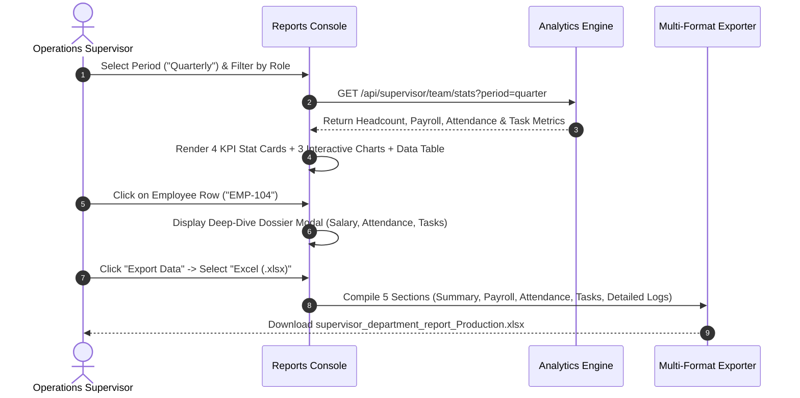

# 07. Team Reports & Analytics (`/supervisor/reports`)

The **Team Reports & Analytics** module delivers comprehensive, data-driven operational intelligence for department supervisors. Operating within departmental RBAC boundaries, this console aggregates real-time workforce telemetry—including live team headcount, base payroll burn, 7-day attendance compliance trends, and task lifecycle distributions—empowering supervisors to spot operational bottlenecks, optimize resource allocation, and export formal executive dossiers.

---

## 🏛️ Live Interface Overview

Below is the live console layout of the **Supervisor Team Reports & Analytics** dashboard:

<!-- UI SCREENSHOT PLACEHOLDER: supervisor_reports.png (Width 100%) - To be added at the end -->
> 📸 **[UI Screenshot: Supervisor Team Reports & Analytics Console]**  
> *Target Asset Location:* `docs/assets/images/HRMS/Supervisor_/reports.png`  
> *(To be added at the end with live screenshots)*

---

## 🧭 Page Anatomy & Interactive Controls

The table below catalogs every interactive button, dropdown selector, export trigger, data table, and drill-down modal available on the Supervisor Reports page:

| UI Component / Control | Visual Location | Functional Behavior & Impact |
| :--- | :--- | :--- |
| **Department Title Header** | Top Left | Displays `Team Reports & Analytics` along with your active department tag (e.g., *Production*, *Quality Assurance*, or *General*). |
| **Reporting Period Selector** | Top Right | Dropdown selector with options: `Weekly`, `Monthly`, and `Quarterly`. Re-queries backend analytics across the specified timeframe. |
| **Export Data Button** | Top Right | Toggles a floating export menu offering 4 formats: **Export PDF** (Red icon), **Export CSV** (Green icon), **Export Excel (.xlsx)** (Emerald icon), and **Export Word (.doc)** (Blue icon). Compiles all 5 telemetry sections and embedded charts. |
| **Team Size Stat Card** | Top KPI Grid (Card 1) | Shows total filtered headcount (e.g., `18 Employees`) with a blue user badge icon. |
| **Payroll Spend Stat Card** | Top KPI Grid (Card 2) | Shows cumulative base salary spend formatted in Indian Currency notation (`₹14.25 L` or `₹1.20 Cr`) with an emerald currency icon. |
| **Attendance Rate Stat Card** | Top KPI Grid (Card 3) | Shows average percentage attendance across the filtered roster (e.g., `94.2% Average`) with an indigo calendar check icon. |
| **Task Completion Stat Card** | Top KPI Grid (Card 4) | Shows percentage of tasks successfully delivered (e.g., `88.5% Completion`) with a purple check icon. |
| **AI Department Insight Banner** | Full-width Ribbon | An automated analytical summary highlighting department trends, attendance outliers, and workload risks generated from the AI analytics engine. |
| **Monthly Payroll Trend Chart** | Mid Left (Chart 1) | Recharts interactive Bar Chart displaying month-over-month expenditure with an embedded summary table showing monthly cost and percentage growth (`+X.X%`). Empty state shows fallback prompt if no payroll run has occurred. |
| **Weekly Attendance Trend Chart** | Mid Center (Chart 2) | Tri-color stacked Recharts Bar Chart illustrating **Present** (Emerald), **Late** (Blue), and **Absent** (Rose) headcount per day, paired with a daily compliance table. |
| **Task Status Distribution Chart** | Mid Right (Chart 3) | Donut/Pie Chart categorizing team tasks into **Completed** (Green), **Active** (Blue), and **Overdue** (Red), paired with an exact task count and share percentage breakdown. |
| **Search Input Bar** | Table Toolbar Left | Real-time text filter allowing supervisors to search team members by name or employee ID. |
| **Department Filter Dropdown** | Table Toolbar Right | Filters team members by sub-department or unit. Dynamically populated from active team data. |
| **Role Filter Dropdown** | Table Toolbar Right | Filters team members by designation (e.g., *Technician*, *Operator*, *Senior Quality Inspector*). |
| **Clear Filters Button** | Table Toolbar Right | Appears automatically when active search or dropdown filters are applied; resets filters to default with one click. |
| **Sortable Table Headers** | Table Header Row | Clicking any header column (**Employee**, **Role**, **Department**, **Salary (INR)**, **Attendance Rate**, **Tasks Completed/Total**, **Status**) toggles ascending/descending sort. |
| **Employee Performance Rows** | Data Table Body | Interactive rows displaying employee badge, ID, designation, base salary, color-coded attendance progress bar (≥90% Green, ≥75% Amber, <75% Red), task throughput, and status badge. Clicking any row opens the **Employee Detail Modal**. |
| **Employee Detail Modal** | Center Screen Overlay | Deep-dive dossier displaying employee name, ID, Department, Role, Base Salary, Attendance Rate %, Completed Tasks, and Total Tasks Assigned. Includes a clean `Close` button and top `✕` trigger. |

---

## 📈 Analytical Telemetry & Lifecycle Architecture

The sequence diagram below illustrates how telemetry streams from daily shift logs into executive reports and multi-format exports:



---

## 📊 Core Report Sections & Export Catalogs

When you click **Export Data**, Hub HRMS packages five structured data catalogs into your chosen file format:

```
┌────────────────────────────────────────────────────────────────────────┐
│                      TEAM EXECUTIVE SUMMARY                            │
├──────────────────────────┬─────────────────────────────────────────────┤
│ Total Headcount          │ 18 Employees                                │
│ Total Payroll Cost       │ ₹14,25,000                                  │
│ Average Attendance Rate  │ 94.2%                                       │
│ Task Completion Rate     │ 88.5%                                       │
└──────────────────────────┴─────────────────────────────────────────────┘
                                  │
                                  ▼
┌────────────────────────────────────────────────────────────────────────┐
│                     MONTHLY PAYROLL DISTRIBUTION                       │
│ Month               Cost (INR)              Growth (%)                 │
│ June 2026           ₹13,80,000              —                          │
│ July 2026           ₹14,10,000              +2.1%                      │
│ August 2026         ₹14,25,000              +1.0%                      │
└────────────────────────────────────────────────────────────────────────┘
                                  │
                                  ▼
┌────────────────────────────────────────────────────────────────────────┐
│                    WEEKLY ATTENDANCE DISTRIBUTION                      │
│ Day         Present        Late          Absent         Compliance Rate│
│ Mon         17             1             0              100%           │
│ Tue         16             2             0              100%           │
│ Wed         15             1             2              88%            │
│ Thu         17             0             1              94%            │
│ Fri         18             0             0              100%           │
└────────────────────────────────────────────────────────────────────────┘
                                  │
                                  ▼
┌────────────────────────────────────────────────────────────────────────┐
│                       TASK STATUS BREAKDOWN                            │
│ Status                 Task Count                  Percentage Share    │
│ Completed              142                         78%                 │
│ Active                 28                          16%                 │
│ Overdue                11                          6%                  │
└────────────────────────────────────────────────────────────────────────┘
                                  │
                                  ▼
┌────────────────────────────────────────────────────────────────────────┐
│                    DETAILED TEAM PERFORMANCE LOGS                      │
│ ID       Name         Role        Salary       Attendance  Tasks   Stat│
│ EMP-001  Rahul S.     Operator    ₹45,000      96%         14/15   ACT │
│ EMP-002  Priya M.     Technician  ₹52,000      92%         18/20   ACT │
│ EMP-003  Amit K.      Inspector   ₹60,000      84%         9/12    ACT │
└────────────────────────────────────────────────────────────────────────┘
```

---

## ⚙️ Step-by-Step Reporting Workflows

### 1. Generating a Departmental Performance Review
1. Navigate to **Supervisor Portal > Reports & Analytics** (`/supervisor/reports`).
2. Select your timeframe from the top-right dropdown:
   - **Weekly:** Best for weekly operational sprint reviews and attendance audits.
   - **Monthly:** Best for monthly performance assessments and labor cost reconciliation.
   - **Quarterly:** Recommended for executive reviews, capacity planning, and trend forecasting.
3. Review the **AI Department Insight** banner at the top of the analytics section for machine-generated warnings (e.g., elevated absenteeism on Fridays or overdue task clusters).

### 2. Auditing Shift Attendance Compliance
1. Scroll down to the **Weekly Attendance Trend** chart.
2. Review the color-coded bar chart showing daily volume for **Present** (Green), **Late** (Blue), and **Absent** (Red).
3. Inspect the accompanying data table below the chart to verify the daily **Compliance Rate %**. Days showing dips below 90% highlight potential shift scheduling shortages.

### 3. Drilling Down into Individual Employee Dossiers
1. Use the **Search Input Bar** to filter by name or employee ID, or use the **Department** and **Role** dropdowns to isolate specific worker cadres.
2. Click any employee row in the **Detailed Team Performance Logs** table.
3. The **Employee Detail Modal** appears with:
   - Official Employee ID & Department designation
   - Current Base Compensation in INR
   - Real-time Attendance Rate with threshold health indicator
   - Task completion ratio (Completed vs. Total Assigned)
4. Click **Close** or the top `✕` button to return to the roster.

### 4. Exporting Formal Reports for Executive Management
1. Click the blue **Export Data** button in the top right header.
2. Select your required format from the dropdown:
   - **Export PDF:** Ideal for printing, boardroom presentations, and formal email distribution.
   - **Export Excel (.xlsx):** Generates structured multi-tab spreadsheets for advanced financial modeling and pivot analysis.
   - **Export CSV:** Raw tabular export suitable for importing into external business intelligence tools.
   - **Export Word (.doc):** Editable narrative document format for compiling periodic departmental reviews.
3. The system compiles all 5 data sections and automatically triggers browser download with a filename reflecting your department and date stamp (e.g., `supervisor_department_report_Production.pdf`).

---

## 🔒 Supervisor RBAC Boundaries in Analytics

To protect corporate governance and payroll confidentiality, the Supervisor Reports module enforces strict role-based access boundaries:

| Permitted Operations (Supervisor Role) | Restricted Operations (Manager / Admin Role Required) |
| :--- | :--- |
| ✅ View departmental team headcount and roster | ❌ Access company-wide executive financial statements |
| ✅ Review departmental base payroll spend and distribution | ❌ Modify employee base salaries or compensation bands |
| ✅ Monitor team attendance percentages and lateness trends | ❌ Overwrite approved biometric attendance logs |
| ✅ Inspect task throughput, completion rates, and bottlenecks | ❌ Reconfigure master organizational KPIs or benchmarks |
| ✅ Export departmental performance reports (PDF, Excel, CSV, Word) | ❌ Access executive payroll bank disbursement files |

---

## 💡 Best Practices for Supervisors

> [!TIP] **Export Ahead of Sprint Reviews**  
> Export an **Excel (.xlsx)** report at the close of every Friday shift. This captures weekly attendance variances and overdue work orders before the next shift roster commences.

> [!NOTE] **Dynamic Indian Currency Formatting**  
> All monetary metrics automatically adapt using Indian numbering conventions: figures exceeding ₹1,00,000 display in **Lakhs (₹X.XX L)** and figures exceeding ₹1,00,00,000 display in **Crores (₹X.XX Cr)**.

> [!WARNING] **Empty Payroll Chart State**  
> If your Monthly Payroll Trend chart displays *"No payroll history recorded yet for this team"*, no payroll cycle has been processed for your department yet. The chart will automatically render once the Finance department executes the initial disbursement.

---

## ❓ Frequently Asked Questions (FAQs)

??? question "Can I view payroll reports for employees in other departments?"
    No. Hub HRMS enforces strict organizational segregation. The Supervisor Reports console is scoped strictly to your designated department (e.g., Production or QA). Only Department Managers, Finance Controllers, and Master Admins can view cross-departmental analytics.

??? question "Why does the Task Completion Rate differ from individual employee tasks?"
    The top KPI card displays the aggregate average completion rate across all active team members in your department. If certain members have overdue items, the overall percentage will reflect the cumulative weighted average.

??? question "Does the Export PDF button include the embedded charts?"
    Yes. The multi-format export engine captures both the tabular telemetry and high-resolution chart snapshots, delivering a complete presentation-ready executive dossier.
