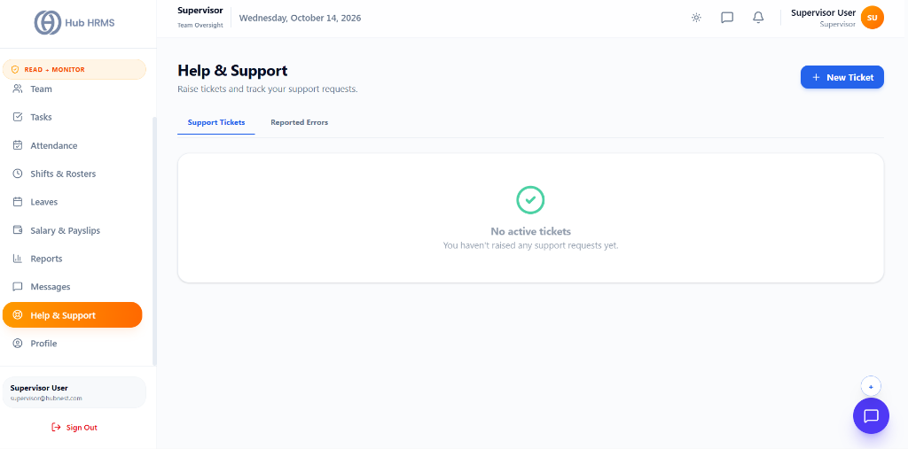
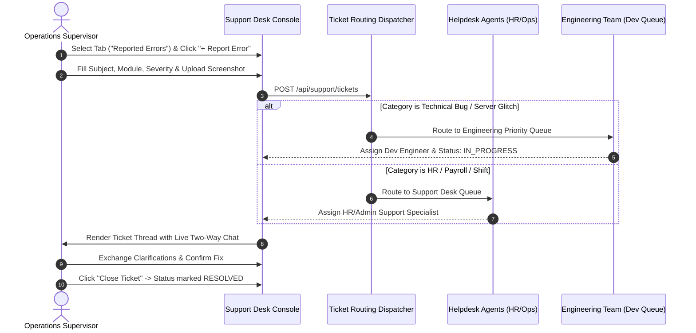

# 09. Help & Support Desk (`/supervisor/support`)

The **Help & Support Desk** connects Operations Supervisors directly with the enterprise helpdesk and engineering support teams. Whether resolving departmental payroll questions, submitting attendance and leave inquiries, or reporting platform glitches and calculation discrepancies to the **Engineering Priority Queue**, this integrated console guarantees rapid ticket resolution and continuous operational continuity.

---

## 🏛️ Live Interface Overview

Below is the live console layout of the **Supervisor Help & Support Desk**:

---

## 🧭 Page Anatomy & Interactive Controls

The table below catalogs every button, tab, input, modal, and conversation control in the Support module:

| UI Component / Control | Visual Location | Functional Behavior & Impact |
| :--- | :--- | :--- |
| **New Ticket / Report Error Button** | Top Right Header | Dynamic trigger that changes label based on active tab: displays `+ New Ticket` on Support tab, and `+ Report Error` on Error tab. Opens the creation modal. |
| **Support Tickets Tab** | Tab Bar Left | Filters the view to standard HR, administrative, payroll, and workstation inquiries routed to the Helpdesk Queue. |
| **Reported Errors Tab** | Tab Bar Right | Filters the view to technical glitches, database timeouts, and calculation discrepancies routed directly to the **Engineering Priority Queue**. |
| **Ticket List Canvas** | Center Area (When browsing) | Cards displaying ticket number (e.g., `#TICK-802`), subject title, category/module tag, priority badge (`LOW`, `MEDIUM`, `HIGH`, `URGENT`), status indicator (`OPEN`, `IN_PROGRESS`, `RESOLVED`), and timestamp. |
| **Create Ticket Form Modal** | Top Overlay / Inline Form | Clean submission card featuring: Category/Module selector, Subject line input, Detailed Description textarea, Priority dropdown, Attachment upload trigger with progress indicator, and Submit/Cancel buttons. |
| **Category / Module Dropdown** | Form Modal Field | Options adapt dynamically: on Support tab shows *General Support*, *Payroll & Salary Query*, *Attendance / Leave Request*; on Error tab shows *System Error (Technical Bug)*, *Server / Database Error*, *Report / Calculation Discrepancy*, *UI & Display Glitch*, *Authentication & Login Issue*. |
| **Priority Level Selector** | Form Modal Field | Dropdown selector with options: `LOW`, `MEDIUM`, `HIGH`, and `URGENT`. Sets SLA response priority in the backend queue. |
| **File Attachment Trigger (Paperclip)** | Form Modal Field | Allows uploading error screenshots, PDF logs, or diagnostic files up to 25 MB. Displays uploaded file name and clear trigger (`✕`). |
| **Ticket Conversation View** | Screen Replacement (When ticket selected) | Replaces the list view with a dedicated two-way messaging stream between the supervisor and assigned support agents. |
| **Back to Tickets Button (`←`)** | Conversation Header Left | Exits conversation view and returns to the main ticket registry. |
| **Close Ticket Button** | Conversation Header Right | Visible when ticket is in `OPEN` or `IN_PROGRESS` status. Allows supervisor to mark the issue as permanently resolved (`RESOLVED`). |
| **Original Issue Description Card** | Conversation Stream Top | Pinned card containing the original problem statement and clickable attachment download link (`View Attachment`). |
| **Message Thread** | Conversation Stream Middle | Chronological message bubbles showing agent/supervisor names, formatted timestamps, and reply content. |
| **Reply Message Input** | Conversation Bottom Bar | Text input with `Enter` key shortcut and primary **Send** button to reply to support technicians in real time. |

---

## 🎟️ Ticket Dispatch & Resolution Architecture

The sequence diagram below illustrates how tickets flow to helpdesk agents or engineering specialists:

---

## ⚙️ Step-by-Step Ticketing Workflows

### 1. Submitting a General HR or Payroll Ticket
1. In the top tab bar, ensure the **Support Tickets** tab is active.
2. Click the blue **+ New Ticket** button in the top right.
3. Select your category:
   - **General Support:** General workplace policies, equipment questions.
   - **Payroll & Salary Query:** Base salary discrepancies, overtime calculations, or bank account issues.
   - **Attendance / Leave Request:** Inquiries regarding balance accruals or biometric sync questions.
4. Enter a concise **Subject** and detailed **Description**.
5. Choose your priority (`MEDIUM` by default, or `HIGH` for urgent payroll cycle cutoffs).
6. Click **Create Ticket**. Your inquiry is dispatched to the helpdesk.

### 2. Reporting a Technical Bug to the Engineering Queue
If you encounter a software bug, chart display issue, or biometric geofencing glitch:
1. Click the **Reported Errors** tab.
2. Click the **+ Report Error** button. Notice the alert ribbon confirms: *"This ticket is routed directly to the technical dev team for rapid bug investigation."*
3. Select the technical module:
   - *System Error (Technical Bug)*
   - *Server / Database Error*
   - *Report / Calculation Discrepancy*
   - *UI & Display Glitch*
   - *Authentication & Login Issue*
4. Click **Attach File** to upload a screenshot of the error message or console state.
5. Set priority to `HIGH` or `URGENT` if it impacts line operations.
6. Click **Submit**. The ticket bypasses general helpdesk tiers and lands directly in the engineering triage board.

### 3. Communicating with Support Technicians & Closing
1. In your ticket list, click on any active ticket card to open the **Conversation View**.
2. Review updates from the support technician or developer in the message stream.
3. Type any additional diagnostic details in the message box at the bottom and press **Enter** or click **Send**.
4. Once the issue has been resolved to your satisfaction, click the emerald **Close Ticket** button in the top right header to archive the ticket.

---

## 💡 Best Practices for Supervisors

> [!TIP] **Attach Screenshots for Faster Resolution**  
> When reporting UI or calculation discrepancies, taking a quick screenshot and attaching it via the file uploader reduces troubleshooting turnaround time by over 60%.

> [!IMPORTANT] **Use the Error Tab for System Bugs**  
> Always file software glitches under the **Reported Errors** tab rather than General Support. This flags the issue directly for developer investigation and ensures SLA compliance.

---

## ❓ Frequently Asked Questions (FAQs)

??? question "Can I reopen a ticket once it has been closed?"
    Once marked `RESOLVED`, tickets are archived into audit history. If the issue reoccurs, submit a new ticket and reference the previous ticket number in the description.

??? question "Who receives notifications when support replies to my ticket?"
    You receive an instant notification badge in your supervisor navigation bar and an unread alert counter. Opening the ticket clears the unread badge.
