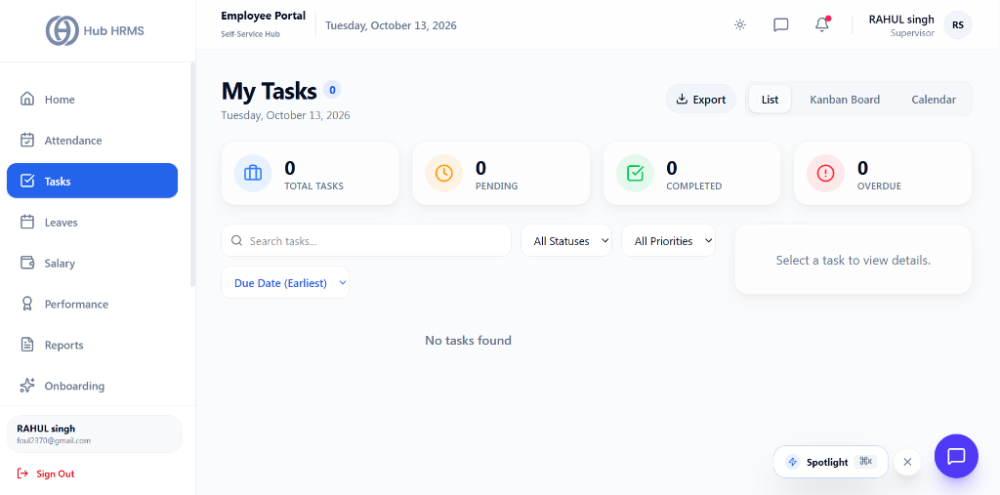

# 04. Work Orders & Task Pipeline (`/supervisor/tasks`)

The **Work Orders & Team Tasks** module provides Operations Supervisors with an interactive command surface to assign, track, and balance sprint deliverables across their department. Featuring multi-view perspective tabs (List, Monthly Calendar, Kanban Board, and Real-time Attendance sync) along with visual status and priority telemetry charts, supervisors can eliminate bottlenecks and guarantee on-time project milestones.

---

## 🏛️ Live Interface Overview

Below is the live console layout of the **Supervisor Team Tasks Management** console:

---

## 🧭 Page Anatomy & Top Action Controls

The top section provides immediate workload context, rapid task provisioning, and data export options:

| Control / Element | Type | Purpose & Working Behavior |
| :--- | :--- | :--- |
| **Back Navigation Link (`←`)** | Navigation Button | Quick return shortcut to the Operations Dashboard (`/supervisor/dashboard`). |
| **Module Title & Subtitle** | Header Information | Displays `Team Tasks` with real-time operational descriptor (*Manage and assign tasks to your team*). |
| **Export Dropdown** | Action Button | Exports filtered tasks to a structured **CSV** file (`Tasks.csv`) containing Title, Description, Assignee Name, Priority, Status, Deadline, and Creation Timestamps. |
| **+ Assign New Task** | Modal Trigger | High-visibility cyan action button opening the modal to provision and delegate a new sprint deliverable. |

---

## 📊 Summary KPI Metric Cards (Interactive Filters)

Four summary cards calculate active deliverables across your team. **Clicking any card acts as an instant filter toggle**:

| Metric Card | Value Displayed | Indicator Color | Filter Behavior on Click |
| :--- | :--- | :--- | :--- |
| **Total** | Cumulative tasks assigned to department queue. | Foreground / Neutral | Shows all deliverables across all statuses. |
| **Active** | Deliverables currently in `In Progress` or `Pending` status. | 🔵 Blue Text | Filters for active work orders underway. |
| **Done** | Deliverables marked `Completed`. | 🟢 Emerald Text | Filters for closed and signed-off tasks. |
| **Overdue** | Deliverables that have crossed their designated deadline date. | 🔴 Rose Text | Isolates overdue deliverables requiring immediate supervisor escalation. |

---

## 📈 Workload Telemetry & Analytical Charts

Directly below the metric cards, two synchronized charts visualize workload distribution:

### 1. Tasks by Status (Bar Chart)
* **Cyan Column Graph**: Plots the count of tasks across four primary lifecycle states: `Pending`, `In Progress`, `Completed`, and `Overdue`.
* **Zero-State Resilience**: Hides zero-count categories to maintain clean analytical focus.
* **Interactive Tooltip**: Hovering over any bar reveals exact task counts and completion ratios.

### 2. Tasks by Priority (Donut Pie Chart)
* **Urgency Distribution**: A multi-colored concentric donut chart breaking down deliverables by priority urgency:
  * 🔴 **High Priority**: Blocker or critical sprint milestones.
  * 🟡 **Medium Priority**: Standard operational tasks.
  * 🟢 **Low Priority**: Flexible maintenance backlog.
* **Visual Legend**: Centered bottom legend displaying color-coded badges with dynamic percentages.

---

## 🗂️ Four Multi-Perspective View Modes

Supervisors can alternate between four distinct presentation tabs:

### 1. 📋 List View
* **Full Data Table Toolbar**: Features real-time text search (by task title or assignee name), Status filter dropdown, Priority filter dropdown, and multi-column sorting (Task Title, Assignee, Due Date, Priority, Status).
* **Column Anatomy**: Task title, assignee name, due date with clock icon, priority badge (High/Medium/Low), status pill (Pending, In Progress, Completed, Overdue), and a direct **View** button.
* **Pagination Controls**: Adjust items per page (10 per page default) and browse multi-page sprint backlogs.

### 2. 📅 Calendar View (`SupCalendarTab`)
* **Monthly Schedule Grid**: Plots all assigned team tasks onto their respective calendar due dates.
* **Holiday Synchronization**: Automatically overlays gazetted company holidays and branch non-working days.
* **Click-to-Inspect**: Clicking any task pill on a date cell opens the full **Task Review Drawer**.

### 3. 🗃️ Kanban Board (`SupKanbanTab`)
* **Visual Drag-and-Drop Columns**: Organizes deliverables into four workflow stages:
  1. `Pending / Backlog`
  2. `In Progress`
  3. `Completed`
  4. `Overdue`
* **Card Quick Moves**: Drag cards across lanes or use the card dropdown to update task state in real-time.

### 4. ⚡ Attendance Integration Tab (`SupAttendanceTab`)
* **Task-to-Shift Correlation**: Displays the real-time clock-in status of operators currently assigned to active deliverables, ensuring tasks aren't assigned to workers who are absent or on approved leave.

---

## ⚙️ Step-by-Step Supervisory Workflows

### 1. Creating and Assigning a New Task (`+ Assign New Task`)
1. Click **+ Assign New Task** in the top action bar.
2. In the modal:
   * **Task Title**: Clear deliverable heading (e.g., *Frontend API Integration for Payroll v2*).
   * **Description**: Scope of work, technical guidelines, or acceptance criteria.
   * **Assignee**: Select an active department member from the team dropdown.
   * **Priority**: Choose *Low*, *Medium*, or *High*.
   * **Deadline**: Select the target completion date using the date picker.
   * **Estimated Hours / Points**: Optional effort estimation for sprint capacity planning.
3. Click **Create & Assign Task**. The worker's dashboard and mobile notifications update immediately.

---

### 2. Inspecting and Reviewing a Task (`TaskReviewDrawer`)
Clicking any task row in List view or any card on the Kanban board opens the **Task Review Drawer**:

1. **Header Details**: Task title, creator attribution, and creation date.
2. **Current Status & Priority Badges**: Interactive badges allowing supervisors to adjust urgency or mark tasks as completed.
3. **Subtask Acceptance Checklist**: Review checklist items ticked off by the assignee.
4. **Activity & Notes Thread**: Review timestamped progress updates, developer questions, or blocker reports.
5. **Attachments & Links**: Inspect uploaded proof documents, test logs, or repository pull requests.

---

## 💡 Best Practices for Task Supervision

!!! tip "Daily Morning Kanban Review"
    At the start of your shift, review the **Overdue** and **Pending** Kanban lanes. Reassign overdue items to available operators before noon to maintain department SLA targets.

!!! warning "Attendance Cross-Check"
    Before assigning urgent high-priority tasks, switch to the **Attendance Tab** to verify that the target assignee has actively clocked in and is not marked *Absent* or *On Leave*.

!!! note "One-Click CSV Backups"
    Export task reports at the end of each sprint cycle via the **Export Dropdown** to maintain historical performance archives for annual employee appraisals.

