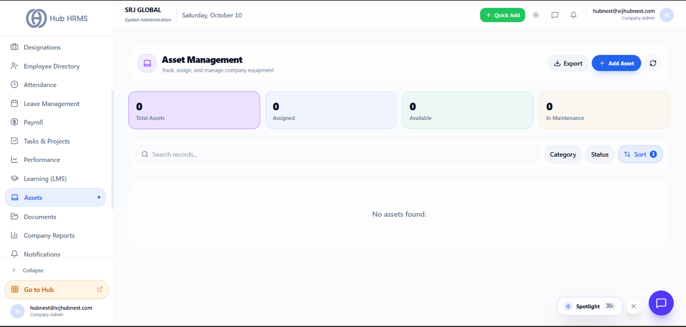
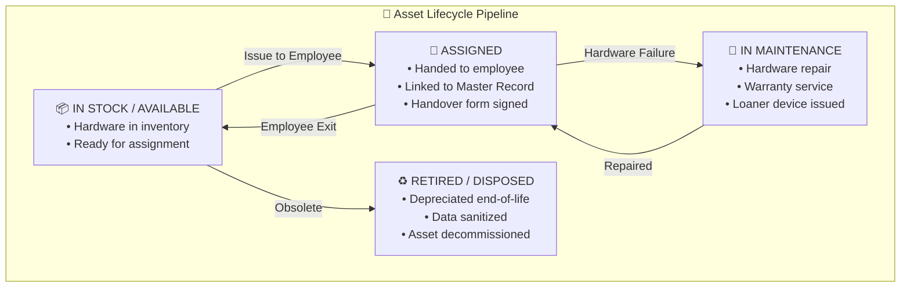

# Asset Management & Hardware Inventory

Modern organizations allocate significant capital toward employee equipment—including high-end laptops, dual monitors, mobile devices, access cards, and specialty tools. The **Assets** module (`/admin/assets`) in **Hub HRMS** delivers an end-to-end asset lifecycle system that tracks company property from purchase to retirement.

Every physical asset is assigned a unique tracking tag, linked directly to an employee's master record, and monitored through routine maintenance and offboarding returns.

---

## 💻 Live Interface Overview

Below is the live production console of the **Asset Management** workspace:

{ width="100%" }

---

## 🧭 System Architecture & Asset Lifecycle

Every physical asset transitions through four standardized operational states:

---

## 📊 Dashboard Metric Cards Explained

At the top of the `/admin/assets` screen, four real-time metric cards summarize your physical inventory:

| Metric Card | Definition & Logic | Operational Significance |
| :--- | :--- | :--- |
| **📦 Total Assets** | Cumulative count of all company-owned physical hardware items registered. | Represents total fixed-asset inventory recorded in the organization. |
| **👤 Assigned** | Assets currently in custody of active team members. | Verifies equipment actively deployed in daily business operations. |
| **✅ Available** | Unassigned hardware held in local branch IT inventory lockers. | Informs IT procurement whether new hire laptop purchases are required. |
| **🔧 In Maintenance** | Devices currently undergoing warranty repair, screen replacement, or servicing. | Tracks hardware temporarily out of circulation. |

---

## 🛠️ Step-by-Step Asset Administration

### 1. Adding a New Asset (`+ Add Asset`)
1. Click the blue **+ Add Asset** button in the upper-right corner.
2. Complete the asset specification form:
   * **Asset Name**: Descriptive title (e.g., *MacBook Pro 16" M3 Max*).
   * **Asset Tag / Code**: Unique company identifier (e.g., *AST-BLR-0284*).
   * **Category**: Choose from *Laptops & Desktops*, *Monitors & Displays*, *Mobile Phones*, *Office Furniture*, or *Access Badges*.
   * **Serial Number**: Manufacturer serial number (for warranty verification).
   * **Purchase Date & Cost**: Acquisition date and purchase price (for depreciation tracking).
   * **Warranty Expiry**: End date of manufacturer AppleCare / OEM coverage.
   * **Status**: Set to `AVAILABLE` (in stock) or assign immediately.
3. Click **Save Asset**.

### 2. Issuing an Asset to an Employee
1. Open the asset details drawer and select **Assign to Employee**.
2. Search for the employee by name or ID.
3. System logs the assignment timestamp and auto-generates a digital **Asset Handover Acceptance Form** sent to the employee’s portal for electronic acknowledgement.

### 3. Offboarding & Equipment Returns
When an employee resigns or is terminated (`/admin/offboarding`):
* The offboarding checklist automatically retrieves all assets tagged to the employee’s profile.
* IT technicians verify hardware condition, perform cryptographic drive sanitization, and click **Acknowledge Return**.
* The asset status automatically returns to `AVAILABLE`, and final HR exit clearance is unlocked.

---

## 💡 Best Practices & Common FAQs

> [!TIP]
> **Use QR / Barcode Asset Tags:** Affix physical waterproof QR codes to all hardware matching the system’s **Asset Code**. Technicians can scan the QR code with any smartphone camera to pull up the assigned owner and warranty record immediately.

### Frequently Asked Questions

#### Q1: What happens if an assigned asset is lost or stolen?
Mark the asset as `LOST / STOLEN` in the asset action menu. This records an incident log, alerts corporate security to trigger remote device locks (MDM), and notifies HR if deductible deductions apply.

#### Q2: Can multiple assets be assigned to a single employee?
Yes. An employee can hold multiple assets simultaneously (e.g., a primary laptop, two 27-inch monitors, and an office RFID keycard).
