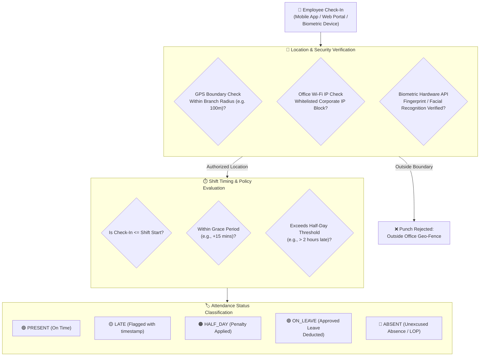

# Attendance, Geo-Fencing & Shift Management

Accurate time and attendance tracking is the operational heartbeat of an enterprise. The **Attendance** module (`/admin/attendance`) in **Hub HRMS** delivers real-time, tamper-proof tracking of employee work hours across all office branches, remote workers, and rotating shifts.

Powered by **GPS Geo-Fencing**, Wi-Fi IP validation, biometric device integration, and automated shift policies, Hub HRMS ensures complete operational visibility while eliminating buddy punching and manual timesheet errors.

---

## ⏰ Live Interface Overview

Below is the live production console of the **Attendance Management** dashboard:

{ width="100%" }

---

## 🧭 System Architecture & Attendance Validation Engine

When an employee logs their daily attendance, Hub HRMS runs a multi-layered verification check before validating the punch:

---

## 📊 Dashboard KPI Cards & Real-Time Analytics

At the top of the `/admin/attendance` screen, six live operational metric cards summarize today’s workforce attendance in real time:

| Metric Card | Definition & Logic | Operational Significance |
| :--- | :--- | :--- |
| **🟢 Present** | Number of team members who successfully checked in today. | Demonstrates active on-duty operational capacity. |
| **🔴 Absent** | Staff who have not logged a check-in and have no approved leave on file. | Highlights potential unplanned absences for team leads to follow up. |
| **🔵 Late** | Employees who punched in after the shift start time and grace window. | Identifies punctuality trends and triggers automated grace period warnings. |
| **☕ On Leave** | Employees currently on approved Casual, Sick, Maternity, or Annual leave. | Synchronized automatically with the **Leave Management** module. |
| **⏱️ Avg Hours** | Average productive work hours logged across all active employees today. | Reflects real-time team workload and productivity. |
| **⚡ Overtime** | Total cumulative overtime hours accumulated across all staff today. | Feeds monthly payroll overtime multipliers and comp-off accruals. |

---

## 📈 Visual Trend Charts

* **Weekly Attendance Trend (Bar Chart)**: Compares daily Present, Absent, and Late percentages from Monday through Sunday, helping HR detect recurring Monday absenteeism or end-of-week drop-offs.
* **Today's Split (Summary Panel)**: Displays an instantaneous percentage distribution of the entire workforce across all status categories.

---

## 🛠️ Step-by-Step Attendance Workflows

### 1. How Regular Employees Punch In & Out

Employees record their daily attendance through two primary channels:

#### Method A: Hub HRMS Web Portal
1. Log in to the Hub HRMS dashboard (`/employee/dashboard`).
2. Click the **Check In** button on the quick-action panel.
3. If geo-fencing is active, the browser prompts for location permission (`Allow Location Access`).
4. Upon validation, the timer begins, displaying elapsed work hours and an optional break timer.
5. At the end of the day, click **Check Out** to finalize total working duration.

#### Method B: Mobile GPS Check-In
1. Open the Hub HRMS mobile app on Android or iOS.
2. Tap **Punch In**.
3. The app records precise GPS coordinates, verifies that the user is physically within the office building perimeter, and logs the check-in timestamp.

---

### 2. Manual Attendance Override (`-> Mark Attendance`)

When an employee encounters hardware issues, loses phone battery, or travels on client duty, HR Administrators and Managers can log attendance manually:

1. Click the blue **-> Mark Attendance** button on the top toolbar.
2. Select the target **Employee** from the searchable dropdown.
3. Choose the **Action Type**:
   * `CHECK_IN`: Log an initial arrival time.
   * `CHECK_OUT`: Log departure time.
   * `FULL_DAY`: Mark both in/out times simultaneously.
4. Specify the **Date** and exact **Time**.
5. Add any **Overtime Hours** if applicable.
6. Provide an **Audit Note** (e.g., *Client on-site meeting at customer premises*).
7. Click **Confirm Attendance**. The record updates instantly, and an audit trail is preserved.

---

### 3. Grace Periods & Late Arrival Rules

To accommodate public transit delays and traffic:

* **Shift Start Time**: Standard shift start (e.g., `09:30 AM`).
* **Grace Period**: Typically configured as **15 minutes**. Any check-in between `09:31 AM` and `09:45 AM` is marked as **Present (Within Grace)**.
* **Late Mark**: Check-ins logged after `09:45 AM` are flagged as **LATE**.
* **3 Late Marks Rule**: In company policy, accumulating three late marks in a single calendar month can automatically deduct **0.5 days** of Casual Leave or trigger a loss-of-pay penalty during payroll calculation.

---

### 4. Attendance Regularization Workflow (Missed Punches)

If an employee forgets to clock out at the end of the day:

1. **Employee Submission**: The employee submits an **Attendance Regularization Request** from their dashboard, specifying the missed clock-out time and reason.
2. **Manager Review**: The request appears on the reporting manager’s dashboard.
3. **Approval & Recalculation**: Upon manager approval, the system recalculates total work hours for that day, removing any pending absent penalties before the monthly payroll lock.

---

### 5. Overtime (OT) Tracking & Payroll Integration

Hub HRMS eliminates manual timesheet calculations at month-end:

$$\text{Total Hours} = \text{Check-Out Time} - \text{Check-In Time} - \text{Break Deductions}$$

$$\text{Overtime Hours} = \max(0, \text{Total Hours} - \text{Standard Shift Duration})$$

* Verified overtime hours flow directly into the **Payroll** module (`/admin/payroll`), where they are calculated at standard or 1.5x/2.0x overtime rates.
* Unexcused absences automatically generate **Loss of Pay (LOP)** deductions in the salary slip.

---

### 6. AI Insights & Anomaly Detection

Built into the attendance engine, automated pattern analysis continuously audits records for operational flags:
* **Habitual Tardiness**: Alerts supervisors if an employee logs late arrivals more than 4 times in a two-week window.
* **Burnout Warning**: Detects employees working over 55 hours per week across consecutive cycles.
* **Missing Punch Alerts**: Automatically reminds employees at 8:00 PM if they have a check-in record without a corresponding check-out.

---

## 💡 Best Practices & Common FAQs

> [!TIP]
> **Biometric Machine Sync:** If your office uses physical fingerprint or face scanners at turnstiles, Hub HRMS integrates via standard REST API / webhook listeners. Swipes at physical turnstiles synchronize directly into this attendance dashboard every 60 seconds.

### Frequently Asked Questions

#### Q1: What should an employee do if GPS shows them outside the office while inside?
Weak GPS signals inside dense concrete structures or basements can cause location drift. Ensure the employee connects to the **Authorized Office Wi-Fi Network**. When IP validation is enabled, a verified office IP address overrides weak GPS signals.

#### Q2: How does Hub HRMS handle night shifts spanning past midnight?
Night shifts (e.g., `10:00 PM to 06:30 AM`) are recognized as unified continuous shifts. The clock-out on the following morning is attached to the shift's starting date, preventing false "Absent" flags.

#### Q3: How do I export monthly attendance for compliance or payroll auditing?
Select the desired month and branch from the filter dropdowns, then click **Export → CSV** or **Export → PDF**. The generated report includes daily punch timestamps, total hours, late counts, and leave adjustments.
