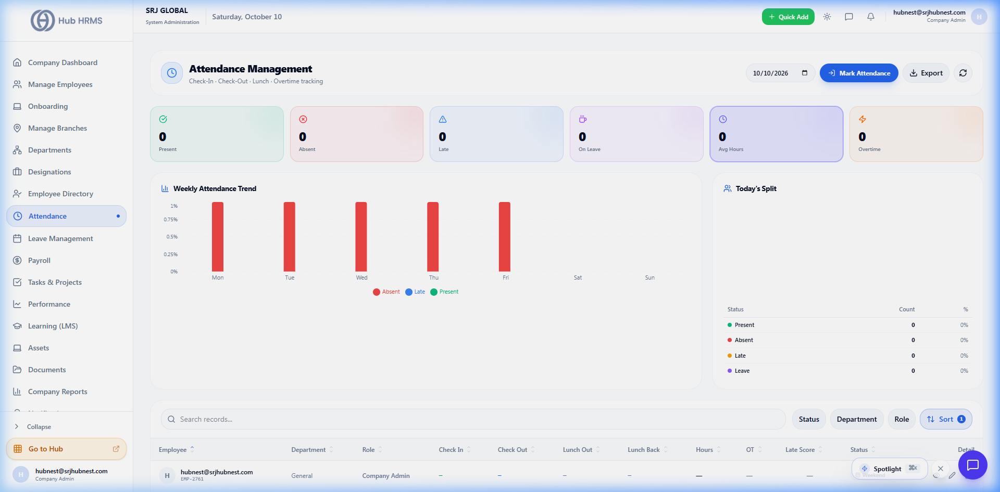
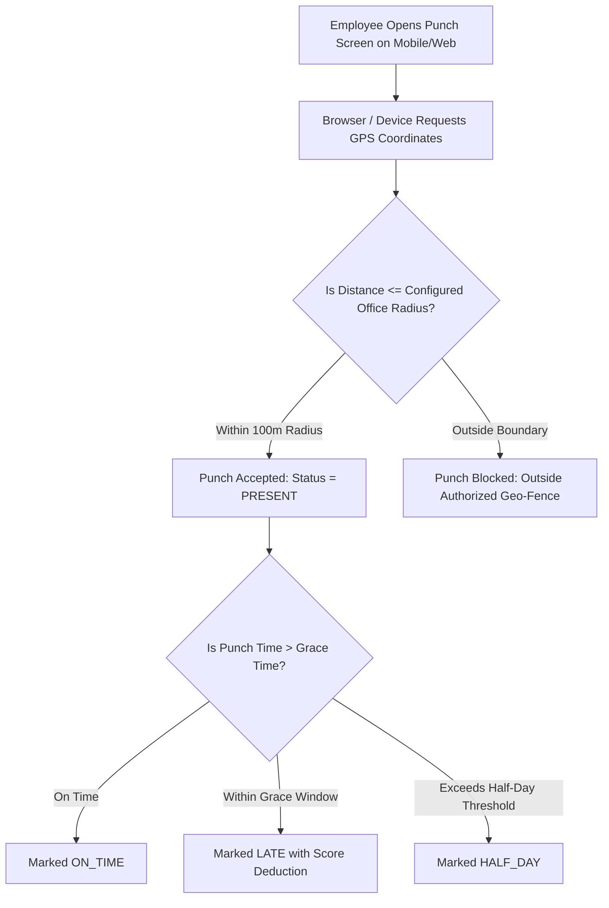

# Attendance, Geo-Fencing & Shift Management

The **Attendance** module (`/admin/attendance`) provides accurate, tamper-proof tracking of employee work hours across all company branches. Powered by **GPS Geo-Fencing**, biometric machine synchronization, and configurable grace period rules, Hub HRMS ensures real-time operational visibility while eliminating buddy punching.

---

## ⏰ Live Attendance Management Console

Below is the live production interface of the **Attendance & Work Hours** console:

{ width="100%" }

---

## 📍 GPS Geo-Fencing & Punch Enforcement

To support modern hybrid and multi-branch workplaces, Hub HRMS enforces location-aware punch boundaries:

### Key Geo-Fencing Parameters (Configured in `/admin/settings`)
* **Office Coordinates**: Specific Latitude & Longitude mapped to each company branch.
* **Allowed Radius**: Boundary perimeter in meters (typically `50m` to `150m`).
* **IP Whitelisting**: Optional restriction allowing punches only through company office Wi-Fi or VPN networks.

---

## ⏱️ Work Shifts & Roster Scheduling (`/admin/shifts`)

Hub HRMS supports flexible work schedules tailored to corporate, retail, support, and manufacturing teams:

| Shift Type | Typical Hours | Description & Best Use Case |
| :--- | :--- | :--- |
| **General Shift** | `09:30 AM – 06:30 PM` | Standard daytime schedule for corporate and administrative teams. |
| **Morning Shift** | `06:00 AM – 02:30 PM` | Operations, production, and morning customer support shifts. |
| **Evening / US Shift** | `02:00 PM – 10:30 PM` | Overseas sales, international recruitment, and technical assistance. |
| **Night Shift** | `10:00 PM – 06:30 AM` | 24/7 IT infrastructure monitoring and mission-critical support. |
| **Rotational Roster** | Variable Cycles | Automated cyclical shift rotation (e.g. 4 days on, 2 days off). |

---

## 🔄 Shift Swap Request Workflow

When employees need to trade assigned shifts:
1. **Employee Request**: Employee A selects an upcoming shift and requests a swap with Employee B.
2. **Peer Confirmation**: Employee B receives an in-app and email notification to accept or decline the swap.
3. **Manager Approval**: Upon peer acceptance, the request routes to the Department Manager's dashboard for final operational sign-off.
4. **Automated Roster Update**: Once approved, the master attendance calendar updates automatically without administrative overhead.

---

## 📝 Attendance Regularization & Missed Punches

If an employee forgets to clock out or works on-site with a client:
* The employee submits an **Attendance Regularization Request** through their self-service portal, providing actual in/out times and a justification reason.
* The request alerts the assigned reporting supervisor.
* Upon supervisor approval, the system recalculates total working hours and updates the employee's payroll attendance score automatically.
