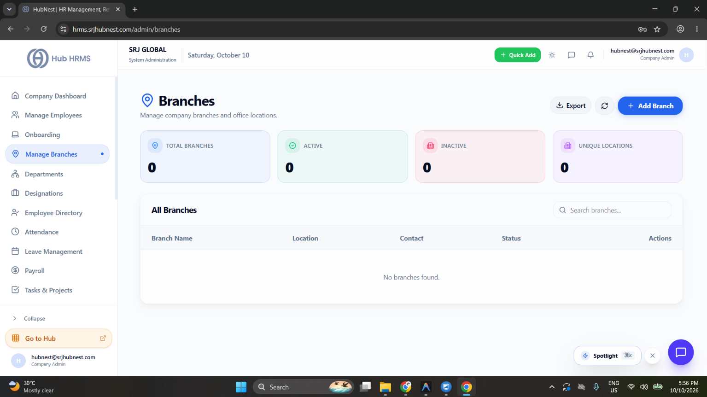
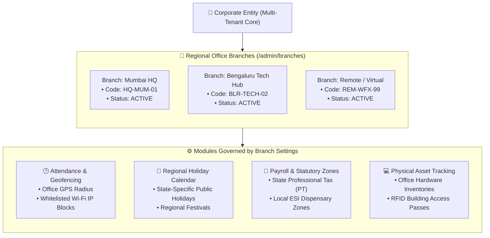
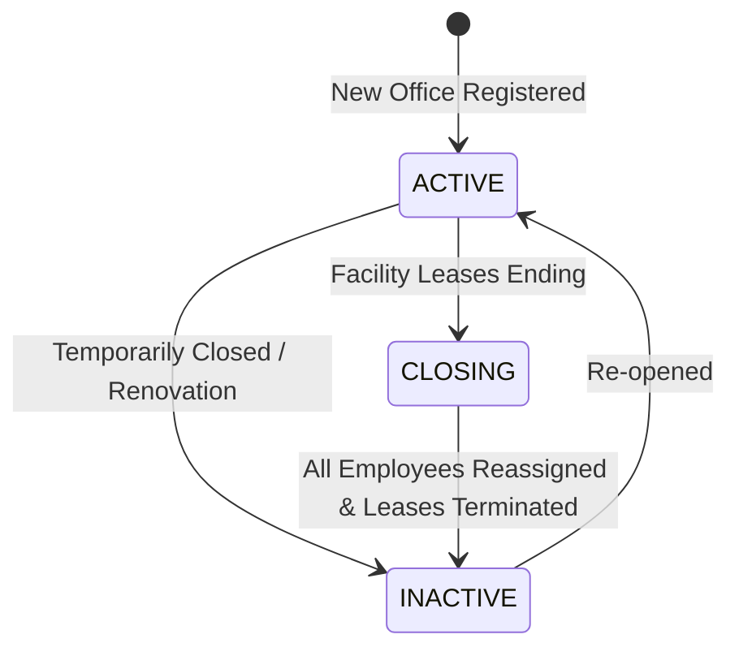

# Manage Branches & Multi-Location Setup

In modern distributed enterprises, organizations operate across multiple corporate headquarters, tech hubs, regional sales branches, and satellite offices. The **Manage Branches** module (`/admin/branches`) serves as the foundation for geographic workforce organization in **Hub HRMS**.

Every employee, biometric punch device, physical asset, and regional holiday calendar is anchored to a specific branch entity.

---

## 🏢 Live Interface Overview

Below is the live production console of the **Manage Branches** management interface:

{ width="100%" }

---

## 🧭 System Architecture & How Branches Work

A **Branch** is not merely an address label; it is an active operational container in the Hub HRMS engine that influences multiple modules:

---

## 📊 Dashboard KPI Cards Explained

At the top of the `/admin/branches` page, four live metric cards summarize your enterprise office footprint:

| Metric Card | Description | Operational Significance |
| :--- | :--- | :--- |
| **Total Branches** | Total count of all office branches configured in the system. | Displays overall enterprise footprint across domestic and global territories. |
| **Active** | Count of branches actively operating and accepting employee assignments. | Active branches appear in dropdown menus across onboarding, job postings, and attendance logs. |
| **Inactive** | Count of archived, merged, or temporarily decommissioned office locations. | Inactive branches retain historical records for audit compliance but prevent new staff assignments. |
| **Unique Locations** | Distinct cities and territories covered by your organization. | Helps executive leadership evaluate regional presence and expansion milestones. |

---

## 🛠️ Step-by-Step Branch Administration

### 1. Adding a New Office Branch (`+ Add Branch`)

To register a new office building or virtual workplace:

1. Navigate to **Manage Branches** (`/admin/branches`) from the sidebar.
2. Click the blue **+ Add Branch** button in the upper-right corner.
3. Fill in the required fields in the modal form:
   * **Branch Name** *(Required)*: The official workplace name (e.g., `Bengaluru Tech Park - Phase 2`).
   * **Branch Code** *(Required)*: A short, unique alphanumeric identifier (e.g., `BLR-TP-02`). This code prefixes asset tags, employee ID series, and departmental invoices.
   * **Location** *(Required)*: The geographical city, state, and country (e.g., `Bengaluru, Karnataka, India`).
   * **Contact Email** *(Required)*: The official branch administrative or facility management inbox (e.g., `facilities.blr@yourcompany.com`).
   * **Contact Phone** *(Required)*: The local office reception, landline, or emergency security desk number.
   * **Status**: Set to `ACTIVE` (default for operational sites) or `INACTIVE` (for pending leases or sites undergoing fit-out).
4. Click **Save / Create Branch**. The system validates email formats and code uniqueness, committing the branch in real time.

---

### 2. Editing an Existing Branch

As companies expand, relocate, or update facility contact lines:

1. Locate the target branch in the **All Branches** table.
2. Click the **Edit (Pencil)** icon in the **Actions** column.
3. Modify the location address, contact numbers, or operational status.
4. Click **Update Branch**. Changes take effect immediately across all employee directories.

---

### 3. Understanding Branch Statuses (`ACTIVE` vs `INACTIVE` vs `CLOSING`)

Hub HRMS manages office life-cycles through three distinct status states:

* **`ACTIVE`**: The office is fully operational. Employees punch attendance here, new hires can be provisioned to this location, and assets can be checked in/out.
* **`INACTIVE`**: The branch is mothballed or retired. Historical attendance, payroll slips, and audit logs remain intact, but the branch disappears from onboarding dropdowns.
* **`CLOSING`**: An operational transition state alerting HR and Facility managers that active team members must be migrated to alternative branches before final decommission.

---

### 4. Deleting a Branch & Safety Guards

To permanently remove a branch:

1. Click the **Delete (Trash)** icon in the **Actions** column.
2. A confirmation prompt prevents accidental deletion.
3. **Safety Protection**: If any active employees, pending job requisitions, or assigned company assets are currently linked to this branch, the backend validator blocks deletion with an explanatory error notice. You must first reassign those staff members to an active branch.

---

### 5. Searching, Filtering & Exporting Branch Records

* **Live Search**: Use the search bar (`Search branches...`) to instantly filter the table by branch name, code, or city without page reloading.
* **Exporting**: Click the **Export** button in the header toolbar to download the current branch master directory in **CSV** or **PDF** format for external board presentations or compliance audits.
* **Refresh**: Click the **Refresh (↻)** button to sync state with recent background updates.

---

## 🔗 How Branches Integrate with Other HRMS Modules

### 📍 Attendance & Mobile Geofencing
When employees check in using the mobile app or web portal:
* The system evaluates their GPS coordinates against the configured geofence radius of their assigned branch.
* If IP-based attendance is enabled, check-ins are restricted to the static internet IP address blocks assigned to that specific branch office.

### 🏖️ Regional Holiday Calendars
Different Indian states and global countries observe different official public holidays:
* A team member assigned to the **Mumbai Branch** automatically receives holidays for *Maharashtra Day* and *Ganesh Chaturthi*.
* A team member assigned to the **Bengaluru Branch** receives holidays for *Kannada Rajyotsava*.
* The centralized HR team avoids manual holiday tracking by attaching calendar rules to branch tags.

### 💼 Professional Tax (PT) & Statutory Compliance
In India, Professional Tax deduction slabs vary by state (e.g., Karnataka vs Maharashtra vs Delhi):
* When payroll calculates gross-to-net salary slips at month-end, it inspects the employee's **Branch Location** to apply the accurate statutory PT slab.

---

## 💡 Best Practices & Common FAQs

> [!TIP]
> **Virtual "Work From Home" Branch:** If your organization employs 100% remote employees who never visit a physical office, create a dedicated branch named `Remote / WFH` with code `REM-01`. Set its geofence to "Global / IP-exempt" so remote workers can punch attendance freely while keeping your physical office headcounts accurate.

### Frequently Asked Questions

#### Q1: Can an employee be assigned to more than one branch simultaneously?
Each employee has one **Primary Home Branch** in their master profile for tax, holiday calendar, and asset delivery purposes. However, if they temporarily work from another regional office, they can request guest punch permissions through the Attendance Regularization workflow.

#### Q2: What happens to employees if our company moves to a new building?
Edit the existing branch's name, address, and GPS coordinates directly. All existing employees, attendance histories, and asset records remain linked without needing to manually update each worker's profile.

#### Q3: How should we name our branch codes?
Follow a consistent 3-part syntax: `[CITY]-[FUNCTION]-[SERIES]` (for example: `DEL-CORP-01`, `MUM-SALES-02`, `PUN-TECH-01`). This ensures smooth integration with ERP systems and hardware asset tags.
