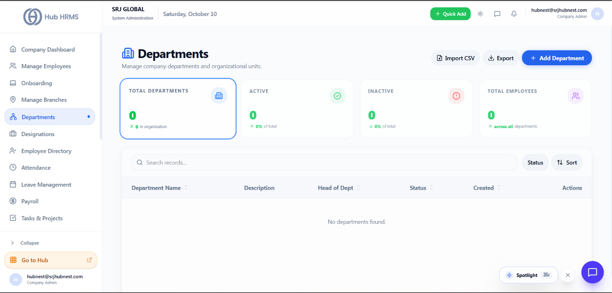

# Departments Management

The **Departments** module (`/admin/departments`) organizes your human capital into clear functional divisions, establishing reporting hierarchies and operational accountability.

{ width="100%" }

---

## 🏛️ Key Features
* **Functional Divisions**: Create and manage divisions such as Engineering, Sales, Marketing, Human Resources, and Finance.
* **Department Head Assignment**: Designate leaders responsible for team performance and operational approvals.
* **Departmental Analytics**: Enables department-wise attendance metrics, overtime analysis, and payroll allocation.
