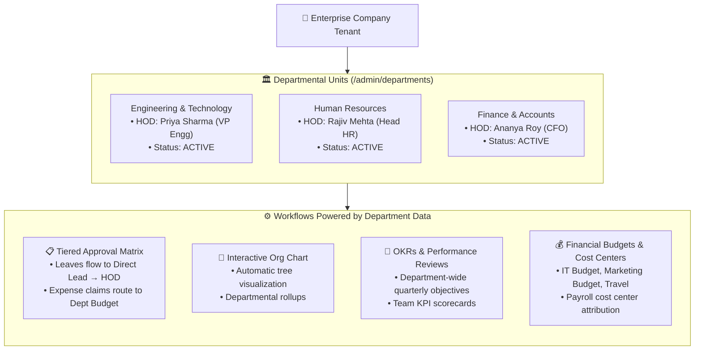
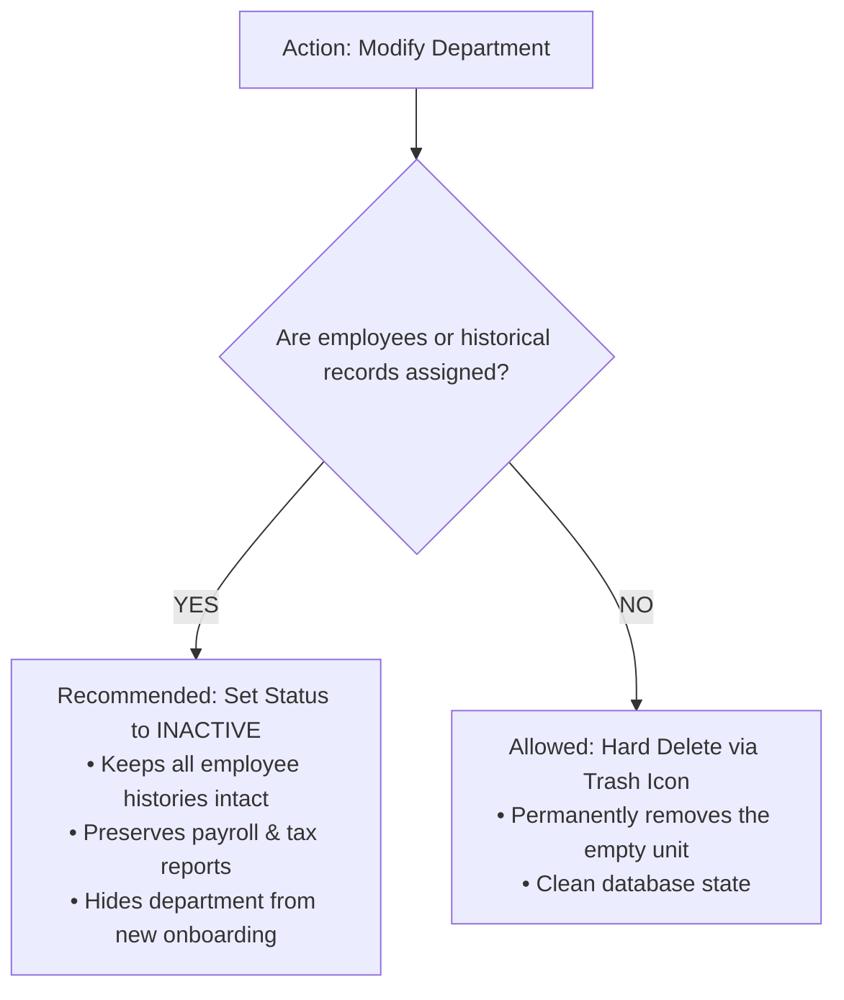

# Departments Management & Organizational Units

A well-structured corporate hierarchy requires clear functional boundaries. The **Departments** module (`/admin/departments`) in **Hub HRMS** divides human capital into distinct operational business units—such as **Engineering, Marketing, Human Resources, Finance, Sales, and Customer Operations**.

Each department acts as an organizational container that anchors reporting lines, leave approval hierarchies, performance review cycles, and departmental budget tracking.

---

## 🏛️ Live Interface Overview

Below is the live production console of the **Departments Management** dashboard:

{ width="100%" }

---

## 🧩 System Architecture & Departmental Workflows

In Hub HRMS, a **Department** connects organizational leadership directly to individual team members, governing approval matrixes and cost allocation:



---

## 📊 Dashboard KPI Cards Explained

At the top of the `/admin/departments` screen, four real-time metric cards provide an immediate operational health check:

| KPI Card | Description | Practical Interpretation |
| :--- | :--- | :--- |
| **Total Departments** | The total number of registered functional departments in your organization. | Represents the breadth of your corporate structural specialization. |
| **Active** | Count and percentage of departments actively operating and holding assigned staff. | Only active departments appear in new employee creation and job requisition forms. |
| **Inactive** | Count and percentage of archived, merged, or retired business units. | Retains historical payroll, project records, and audit logs without cluttering active workflows. |
| **Total Employees** | Total workforce headcount distributed across all active departments. | Gives administrators instant visibility into overall departmental staffing coverage. |

---

## 🛠️ Step-by-Step Department Administration

### 1. Adding a Single Department (`+ Add Department`)

To register a new functional division:

1. Navigate to **Departments** (`/admin/departments`) from the sidebar.
2. Click the blue **+ Add Department** button in the upper-right corner.
3. Complete the modal form fields:
   * **Department Name** *(Required)*: The official title of the division (e.g., `Product Design & UX`, `Enterprise Sales`).
   * **Description**: A summary of the department's core responsibilities and operational mandate.
   * **Head of Department (HOD)**: Select a designated senior leader or manager responsible for team accountability.
   * **Status**: Set to `ACTIVE` (default) or `INACTIVE` (for planned future divisions not yet staffing).
4. Click **Create Department**. The department is instantly provisioned and made available across the entire HRMS ecosystem.

---

### 2. Designating or Changing the Head of Department (HOD)

The **Head of Department (HOD)** holds significant operational authority in Hub HRMS:

* **Approval Fallbacks**: When an employee's direct reporting manager is on leave or unavailable, pending leave requests and attendance regularizations automatically escalate to the HOD.
* **Appraisal Sign-offs**: Annual performance reviews and 360-degree feedback cycles require final approval from the department head before HR review.
* **Budget Oversight**: Department-level expense claims (e.g., client dinners, team equipment purchases) require HOD sign-off.

To reassign an HOD:
1. Locate the department in the table and click the **Edit (Pencil)** icon.
2. Select the new leader from the **Head of Department** selector.
3. Click **Save Changes**. All active workflows reroute instantly without orphaned tasks.

---

### 3. Bulk Importing Departments via CSV (`📄 Import CSV`)

For rapidly scaling organizations or enterprise migrations:

1. Click the **Import CSV** button on the top toolbar.
2. Prepare your CSV file using standard UTF-8 encoding with the following header row:
   ```csv
   name,description,headOfDepartment,status
   Engineering,"Software development, QA, and cloud architecture","Priya Sharma",ACTIVE
   Marketing,"Brand awareness, demand generation, and social media","Amit Verma",ACTIVE
   Finance,"Accounting, taxation, compliance, and auditing","Ananya Roy",ACTIVE
   Customer Success,"Client onboarding, technical support, and retention","Karan Patel",ACTIVE
   ```
3. Upload the file. The batch processor validates row structure, verifies that names are unique, and displays a summary toast confirming imported records and highlighting any invalid rows.

---

### 4. Editing, Searching & Multi-Column Sorting

* **Instant Search**: Type keywords into the `Search records...` input bar to filter by department name, description, or HOD name in real time.
* **Status Multi-Select Filter**: Click the **Status** filter dropdown to isolate `ACTIVE` or `INACTIVE` units.
* **Multi-Column Sorting (`⇅ Sort`)**: Click the column headers (**Department Name**, **Head of Dept**, **Status**, **Created Date**) to sort in ascending or descending order.

---

### 5. Deactivating vs. Deleting Departments

Hub HRMS protects your organizational data integrity with two-tier removal options:



* **Deactivate (Set to `INACTIVE`)**: Always use this method when restructuring existing departments. Employees previously tagged to this division maintain their past payslips and appraisal history without database corruption.
* **Delete (Trash Icon)**: Permitted only for newly created, empty departments with zero assigned team members and no financial audit entries.

---

### 6. Exporting Department Directories (`📥 Export`)

Need to share departmental rosters with external auditors, board members, or financial controllers?
* Click the **Export** dropdown button.
* Select **Export CSV** for spreadsheet analysis in Microsoft Excel or Google Sheets.
* Select **Export PDF** for presentation-ready, formatted documentation.

---

## 🔗 How Departments Connect Across Hub HRMS

### 🌳 Automatic Organizational Chart Generation
When employees are created, their designated **Department** and **Reporting Manager** feed the interactive company org chart (`/employee/org-chart`), visually grouping teams under their respective HODs.

### 📝 Multi-Tier Leave & Attendance Approvals
The Hub HRMS approval engine enforces strict departmental routing:
$$\text{Employee} \longrightarrow \text{Direct Team Lead} \longrightarrow \text{Head of Department (HOD)} \longrightarrow \text{HR Operations}$$

### 💰 Corporate Budget & Cost Center Allocation
Under `/admin/company-budget`, corporate finance administrators map annual and monthly budgets across distinct departmental cost centers:
* **IT & Infrastructure Budget**: Allocated to the Engineering department.
* **Marketing Budget**: Allocated to Demand Generation and Brand teams.
* **Travel & Office Budget**: Allocated proportionally across sales and executive teams.

---

## 💡 Best Practices & Common FAQs

> [!TIP]
> **Sub-Teams & Functional Pods:** If your company has sub-teams (e.g. *Frontend Team*, *Backend Team*, *DevOps Team* within Engineering), keep the top-level **Department** as `Engineering` and use the **Designations** module (`/admin/designations`) to differentiate specific technical roles. This keeps reporting trees and approval matrices clean and maintainable.

### Frequently Asked Questions

#### Q1: What happens if the Head of Department (HOD) leaves the company?
If an HOD resigns or is offboarded, their departments remain active. A notification badge alerts the Company Administrator to assign an interim or permanent successor, ensuring no approvals are left unattended.

#### Q2: Can an employee belong to multiple departments?
In standard corporate governance, each employee holds one **Primary Department** for payroll cost-center accounting. For cross-functional collaboration, employees can be assigned to secondary cross-departmental projects within the **Tasks & Projects** module (`/admin/tasks`).

#### Q3: Can department names be changed later without breaking employee records?
Yes! Hub HRMS uses persistent internal UUID identifiers. When you rename `HR` to `People & Culture`, all linked employee master records update dynamically across all active screens.
