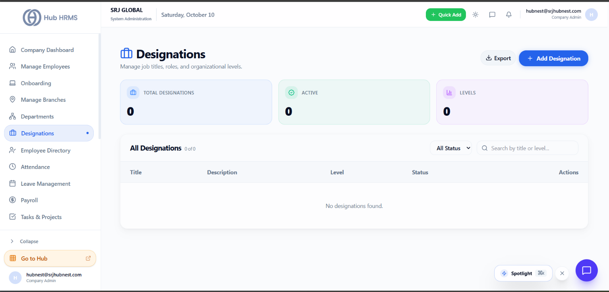
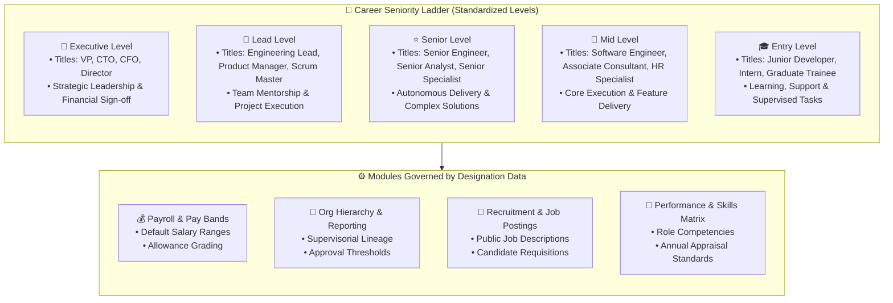

# Designations & Career Hierarchy Levels

In a structured organization, job titles define an employee’s professional identity, operational expectations, and seniority. The **Designations** module (`/admin/designations`) in **Hub HRMS** standardizes job titles across all business units—ensuring clarity in career progression, recruitment job descriptions, compensation benchmarking, and approval authority.

---

## 💼 Live Interface Overview

Below is the live production console of the **Designations** management interface:

{ width="100%" }

---

## 🧭 System Architecture & Career Level Ladder

A **Designation** represents a standardized role and seniority tier within the corporate structure. While a **Department** defines *where* someone works (e.g., *Engineering*), a **Designation** defines *what* they do and *how senior* they are (e.g., *Senior Cloud Architect*).

---

## 📊 Dashboard Metric Cards Explained

At the top of the `/admin/designations` page, three real-time metric cards provide an immediate summary of your job architecture:

| Metric Card | Description | Practical Interpretation |
| :--- | :--- | :--- |
| **Total Designations** | The total number of distinct job titles configured across the entire enterprise. | Reflects the operational diversity and specialization of your company roles. |
| **Active** | Count of titles currently active and eligible to be assigned to team members. | Inactive titles are retired from recruitment and employee onboarding dropdowns. |
| **Levels** | Number of unique seniority tiers currently in active use (`Entry`, `Mid`, `Senior`, `Lead`, `Executive`). | Confirms your career progression framework is balanced and structured. |

---

## 🛠️ Step-by-Step Designation Administration

### 1. Adding a New Designation (`+ Add Designation`)

To create a new job role in the system:

1. Navigate to **Designations** (`/admin/designations`) from the sidebar.
2. Click the blue **+ Add Designation** button in the upper-right corner.
3. Complete the modal form:
   * **Job Title** *(Required)*: The official business title (e.g., `Senior DevOps Engineer`, `Customer Success Specialist`).
   * **Seniority Level** *(Required)*: Select the tier from the standardized level selector:
     * `Entry`: Fresh graduates, interns, apprentices.
     * `Mid`: Individual contributors with 2–4 years of experience.
     * `Senior`: Experienced contributors capable of independent technical execution.
     * `Lead`: Team leads, tech leads, and functional supervisors.
     * `Executive`: Department heads, vice presidents, and C-level officers.
   * **Description** *(Required)*: Detail the core responsibilities, key performance indicators (KPIs), and mandatory qualifications for the role.
   * **Status**: Set to `ACTIVE` (default) or `INACTIVE` (for planned future positions).
4. Click **Create Designation**. The new title is instantly available across onboarding, employee profiles, and recruitment requisitions.

---

### 2. Promoting an Employee to a New Designation

When an employee earns a promotion or undergoes a lateral title change:

1. Open **Manage Employees** (`/admin/employees`) or the **Employee Directory** (`/admin/employees-list`).
2. Search for the employee and click **Edit Profile**.
3. In the **Designation** dropdown, select their new title (e.g., upgrading from *Software Engineer* to *Senior Software Engineer*).
4. Save the profile. The system updates their digital badge, organizational chart position, and linked compensation tier automatically.

---

### 3. Seniority Distribution & Level Analytics

Under the metric cards, an interactive **Seniority Level Distribution** chart visually breaks down your workforce across all five tiers:

* Visualizes whether your organization has a healthy pyramid structure (healthy balance of Mid and Senior team members vs. Executive leadership).
* Identifies staffing gaps in mid-level leadership or succession planning pipelines.

---

### 4. Editing, Deactivating & Deleting Designations

* **Edit (Pencil Icon)**: Update job descriptions, adjust seniority classifications, or refine titles as industry standards evolve.
* **Deactivate (Set to `INACTIVE`)**: Retire outdated titles (e.g., *Flash Animator*) without breaking historical records of former staff who held that title.
* **Delete (Trash Icon)**: Permitted only for newly created, unassigned designations. If any active or inactive employee record currently references this title, the system enforces referential integrity and prompts you to reassign those employees first.

---

### 5. Exporting Designation Registers (`📥 Export`)

Need to audit job architectures or submit title rosters to external compensation benchmarking firms?
* Click the **Export** button in the header toolbar.
* Choose **CSV** or **PDF** format.
* The exported document includes Title, Seniority Level, Description, Status, and Creation Date.

---

## 🔗 How Designations Integrate Across Hub HRMS

### 💼 Payroll Salary Bands & Compensation Grids
Under the **Payroll** module (`/admin/payroll`), compensation bands are often tied directly to designations:
* An `Entry` engineer receives default junior salary band allowances.
* A `Senior` engineer automatically inherits senior tax allowance allowances and higher expense claim limits.

### 🌳 Automatic Hierarchy Placement
When rendering the interactive **Org Chart**, Hub HRMS uses the employee's **Designation Level** to structure visual hierarchy trees—placing `Executive` and `Lead` designations above individual contributors.

### 🎯 Role Competencies & Annual Reviews
Under **Performance** (`/admin/performance`), appraisal templates are customized by designation level:
* Junior roles are evaluated on execution speed and technical learning.
* Senior and Lead roles are evaluated on system design, architecture quality, and team mentorship.

---

## 💡 Best Practices & Common FAQs

> [!TIP]
> **Avoid Title Inflation:** Maintain a clean, streamlined catalog of designations. Rather than creating five separate titles like *Developer I, Developer II, Junior Developer, Associate Developer*, establish clear milestones using standard levels: `Software Engineer (Entry)`, `Software Engineer (Mid)`, and `Senior Software Engineer (Senior)`.

### Frequently Asked Questions

#### Q1: Can one designation exist in multiple departments?
Yes! A designation like `Project Manager` or `Quality Assurance Specialist` can be held by employees working in different departments (e.g. Engineering, Operations, or Product).

#### Q2: What happens if an employee holds dual responsibilities?
In standard corporate governance, an employee holds one primary **Official Designation** for contracts and payroll. Any secondary operational roles (such as *Safety Warden* or *Hiring Committee Member*) can be tagged in their employee bio notes.

#### Q3: Does changing a designation title modify past payslips?
No. Past finalized payroll runs store immutable historical snapshots of the employee's title and salary at that specific pay period, preserving full audit compliance.
