# Employee Directory & Workforce Roster

A connected enterprise relies on rapid, frictionless communication. The **Employee Directory** module (`/admin/employees-list`) in **Hub HRMS** serves as your company’s centralized digital phonebook and master workforce roster.

Whether a new hire needs to identify their team members, a project manager needs to locate a technical specialist in another department, or HR needs to verify reporting structures, the directory provides instant, searchable visibility across the entire organization.

---

## 🪪 Live Interface Overview

Below is the live production console of the **Employee Directory** dashboard:

{ width="100%" }

---

## 🧭 System Architecture & Directory Features

The Employee Directory synchronizes with multiple core engines in real time, delivering a 360-degree view of every team member:

```mermaid
graph TB
    DirectoryEngine["🗂️ Central Workforce Directory<br/>(/admin/employees-list)"]

    subgraph SearchFilters["🔍 Multi-Vector Search & Filters"]
        direction TB
        F1["Instant Search: Name, Email, Emp<br/>ID"]
        F2["Department Filter: Engineering,<br/>HR, Sales..."]
        F3["Role / Title Filter: Manager,<br/>Specialist, Intern..."]
        F4["Employment Status: ACTIVE vs<br/>INACTIVE"]
    end

    subgraph ProfileCard["👤 Interactive Employee Profile<br/>Card"]
        direction TB
        P1["📸 High-Res Avatar & Legal Name"]
        P2["📧 Work Email & Direct Phone Number"]
        P3["🏢 Assigned Branch & Department"]
        P4["💼 Official Designation & Seniority"]
        P5["👔 Reporting Manager & Supervisor"]
        P6["📅 Date of Joining & Tenure"]
    end

    subgraph ActionsToolbar["⚡ Quick Action Shortcuts"]
        direction TB
        A1["👁️ View Full Profile Drawer"]
        A2["✏️ Edit Contact & Role Data"]
        A3["🔄 Status Toggle: Active /<br/>Deactivate"]
        A4["📥 Export to CSV / PDF"]
        A5["📄 Bulk Import via CSV"]
    end

    DirectoryEngine --> SearchFilters
    DirectoryEngine --> ProfileCard
    DirectoryEngine --> ActionsToolbar
```

---

## 📊 Dashboard Metric Cards & Visual Analytics

At the top of the `/admin/employees-list` screen, administrators and managers are greeted with real-time workforce health metrics and charts:

### 1. Key Metric Cards
* **Total**: Total count of all employee profiles recorded in the organization database.
* **Active**: Count of currently employed, working staff with active login privileges.
* **Inactive**: Count of offboarded employees or personnel on sabbatical leave (records preserved for statutory and tax audit compliance).
* **Departments**: Total number of functional company departments represented across the workforce.

### 2. Embedded Visual Analytics
* **Employees by Department (Bar Chart)**: Visualizes headcount distribution across business units, highlighting team size comparisons and departmental growth.
* **Active vs. Inactive Ratio (Pie Chart)**: Provides a quick snapshot of overall workforce operational status.

---

## 🔍 How to Search & Locate Colleagues

The Employee Directory features multi-vector filtering designed for instant results:

### 1. Global Search Bar (`Search by name, ID, or email...`)
Type any keyword in the search box to filter results in real time:
* Type a **First Name** or **Last Name** (e.g., `Priya`).
* Type an **Employee ID** (e.g., `EMP-1042`).
* Type a **Corporate Email Address** (e.g., `rahul.verma@company.com`).

### 2. Multi-Select Filters
Combine dropdown filters to find specific cross-functional teams:
* **All Roles**: Filter specifically by corporate roles (e.g., *Company Admin*, *HR Specialist*, *Manager*, *Employee*).
* **All Depts**: Filter staff by departmental division (e.g., isolate all members of *Engineering* or *Finance*).
* **All Status**: Switch between active staff and alumni/inactive records.

---

## 👤 Inspecting Full Employee Profiles (View Drawer)

Clicking the **View (Eye)** icon on any employee row opens a slide-over details panel displaying complete operational data:

| Information Block | Displayed Information & Purpose |
| :--- | :--- |
| **Personal Profile** | High-definition profile photo, full legal name, work email address, and direct phone number. |
| **Placement** | Office Branch (e.g., *Bengaluru Tech Hub*), Functional Department, and Official Designation. |
| **Hierarchy** | Direct Reporting Manager with a one-click shortcut to inspect the manager's profile. |
| **Employment Terms** | Date of Joining, Tenure duration, Employment Type (Full-Time, Contract, Intern). |
| **Compensation (Admin Only)** | Base compensation and pay frequency (strictly hidden from standard employees via RBAC). |
| **Status Badge** | Clear visual badge indicating whether the profile is `ACTIVE` or `INACTIVE`. |

---

## 🛠️ Administrative Actions in the Directory

### 1. Adding a Single Employee (`+ Add Employee`)
Click **+ Add Employee** to launch the comprehensive new hire creation modal, allowing HR to provision basic details, assign branches, departments, reporting lines, and trigger an automated email invitation.

### 2. Bulk Importing Staff via CSV (`📄 Import CSV`)
When onboarding dozens of employees at once:
1. Click **Import CSV** in the top action bar.
2. Download the standard CSV template.
3. Populate mandatory columns (`name`, `email`, `phone`, `dept`, `designation`, `reportingToId`, `salary`, `date_of_joining`).
4. Upload the completed sheet. The automated validator flags duplicate emails or missing fields before committing valid records.

### 3. Updating Profile Photos (`📸 Camera Icon`)
High-quality profile photos build a human, approachable company culture:
* Administrators or employees can upload standard image formats (`JPG`, `PNG`, `WebP`).
* Photos are securely stored and optimized across the chat softphone, org chart, and directory cards.

### 4. Activating or Deactivating Staff (Status Toggle)
When an employee begins a long sabbatical or departs the organization:
* Click the **Toggle Status** icon or edit the profile.
* Set status to `INACTIVE`.
* The account is instantly deactivated, revoking login tokens while preserving historical attendance, leave balance, and tax records for legal compliance.

---

## 🔒 Privacy & Role-Based Access Control (RBAC)

The Employee Directory automatically adapts its visible fields depending on the viewer's security credentials:

* **Regular Employees**: Can view coworker names, profile photos, job titles, departments, work email, phone numbers, and reporting managers. Sensitive information—such as **Salary, PAN/Aadhaar numbers, and Bank Accounts**—is completely hidden.
* **Team Managers**: Can additionally view direct reports' leave balances, attendance logs, and performance goal status.
* **Company Admins & HR**: Maintain unrestricted access to all fields, including compensation structures, statutory documents, and edit controls.

---

## 💡 Best Practices & Common FAQs

> [!TIP]
> **Keep Reporting Managers Updated:** An accurate Employee Directory ensures automated workflows run smoothly. When every employee has their direct reporting manager assigned, leave requests, shift swaps, and performance reviews route to the correct inbox automatically without HR intervention.

### Frequently Asked Questions

#### Q1: What is the difference between "Manage Employees" and "Employee Directory"?
* **Manage Employees** (`/admin/employees`) is an administrative management center focused on legal contracts, salary structure configuration, document verification (BGV), and compliance.
* **Employee Directory** (`/admin/employees-list`) is an interactive operational directory designed for all staff to search colleagues, look up contact information, and navigate company hierarchy.

#### Q2: Can employees update their own phone number or profile photo?
Yes! Employees can update their personal mobile number and profile picture directly from their self-service profile page (`/employee/profile`), which updates the directory immediately.

#### Q3: Can I export a list of only active employees in a specific department?
Yes. First, select the desired department from the **All Depts** dropdown and set status to **Active**. Then click **Export → CSV** to download only the filtered subset.
