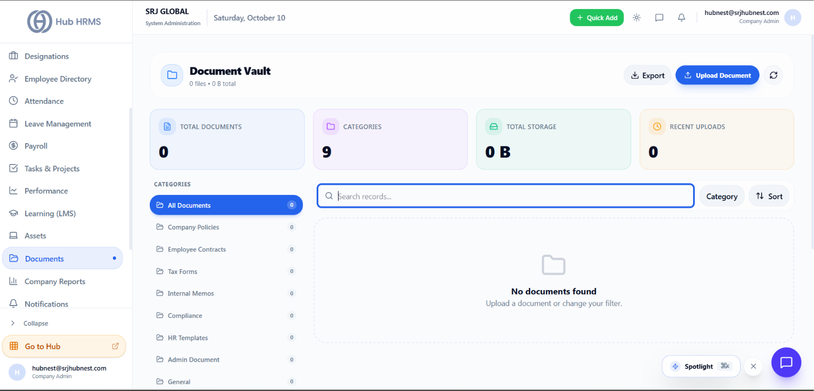

# Documents Vault & Policy Repository

The **Documents** module (`/admin/documents`) serves as the organization's secure cloud repository for official policies, legal agreements, and corporate documentation.

{ width="100%" }

---

## 📂 Key Features
* **Company Policy Distribution**: Publish employee handbooks, leave policies, and code of conduct manuals.
* **Role-Based Access Controls**: Restrict sensitive documents to authorized executive tiers or departments.
* **Audit-Proof Storage**: All files are stored with end-to-end encryption and version control history.
