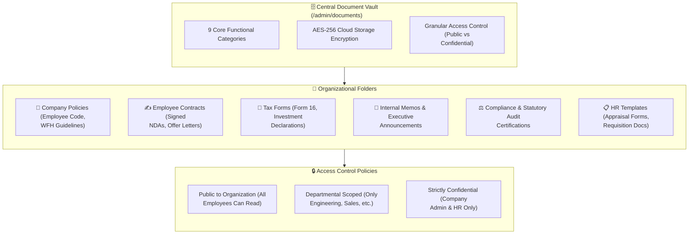

# Document Vault & Digital Asset Repository

Modern regulatory compliance requires airtight document archiving. The **Documents** module (`/admin/documents`) in **Hub HRMS** functions as your enterprise **Digital Document Vault**—providing a secure, encrypted repository for corporate handbook policies, employee contracts, signed NDAs, statutory tax certificates, and standard operational templates.

---

## 📁 Live Interface Overview

Below is the live production console of the **Document Vault** workspace:

{ width="100%" }

---

## 🧭 System Architecture & Document Security Layers

The Document Vault manages corporate records through encrypted storage and role-based access controls:

---

## 📊 Dashboard Metric Cards Explained

At the top of the `/admin/documents` screen, four operational metric cards summarize your digital repository:

| Metric Card | Definition & Logic | Operational Significance |
| :--- | :--- | :--- |
| **📄 Total Documents** | Cumulative count of all files stored across all corporate folders. | Reflects organizational knowledge base volume. |
| **📁 Categories** | Pre-structured organizational filing categories (9 active system folders). | Enforces clean taxonomic structure across diverse document types. |
| **💾 Total Storage** | Aggregate storage volume consumed by uploaded assets (KB, MB, GB). | Monitors cloud storage utilization against tenant quotas. |
| **🕒 Recent Uploads** | Files uploaded or updated within the last 7 calendar days. | Alerts administrators to newly published policies and revisions. |

---

## 🗂️ Standard Corporate Categories

The Document Vault groups enterprise records into nine dedicated functional folders:

1. **Company Policies**: Official employee handbooks, leave rules, travel expense reimbursement guidelines, and anti-harassment (POSH) charters. Accessible to all staff.
2. **Employee Contracts**: Signed employment agreements, non-disclosure agreements (NDAs), intellectual property assignments, and probation confirmation letters.
3. **Tax Forms**: Annual Form 16 statements, investment declaration proofs, and statutory tax remittance receipts.
4. **Internal Memos**: Executive directives, quarterly all-hands slides, and organizational restructuring notices.
5. **Compliance**: ISO certifications, SOC-2 audit reports, fire safety inspections, and labor compliance registrations.
6. **HR Templates**: Standard requisition forms, exit interview questionnaires, and internship evaluation rubrics.
7. **Admin Document**: Office lease agreements, utility vendor contracts, and facility insurance binders.
8. **General**: Miscellaneous corporate files, brand logos, and presentation decks.

---

## 🛠️ Step-by-Step Document Administration

### 1. Uploading a Document (`⬆ Upload Document`)
1. Click the blue **⬆ Upload Document** button in the upper-right corner.
2. Complete the file metadata form:
   * **Document Title**: Clear, descriptive name (e.g., *HubNest Enterprise Remote Work Policy v2.4*).
   * **Category**: Select the appropriate category from the 9 system folders.
   * **Access Visibility**:
     * `All Employees`: Appears in self-service document libraries for all staff.
     * `Department Restricted`: Visible only to selected departments.
     * `Confidential`: Restricted strictly to Company Administrators and HR Specialists.
   * **File Attachment**: Upload standard formats (`PDF`, `DOCX`, `XLSX`, `PNG`, `ZIP`).
3. Click **Upload & Publish**. The document is instantly indexed and searchable.

### 2. Searching & Filtering
* **Category Sidebar**: Click any folder in the left sidebar to isolate specific collections.
* **Instant Search (`Search records...`)**: Search by filename, tag, or description.
* **Sorting (`⇅ Sort`)**: Order documents by file size, upload date, or alphabetical title.

---

## 💡 Best Practices & Common FAQs

> [!TIP]
> **Use Version Numbers in Policy Filenames:** Whenever corporate policies update, append the version suffix (e.g., `Travel_Policy_2026_v1.2.pdf`). This ensures staff and auditors always reference the latest authorized guideline.

### Frequently Asked Questions

#### Q1: Can employees edit or delete documents in the vault?
No. Standard employees hold read-only permissions for public policies. Only authorized HR Specialists and Company Admins can upload, replace, or delete files.

#### Q2: Can individual confidential files be shared with specific employees?
Yes. During digital onboarding or disciplinary actions, individual contracts can be mapped directly to an employee’s private vault, visible only to that individual and HR.
