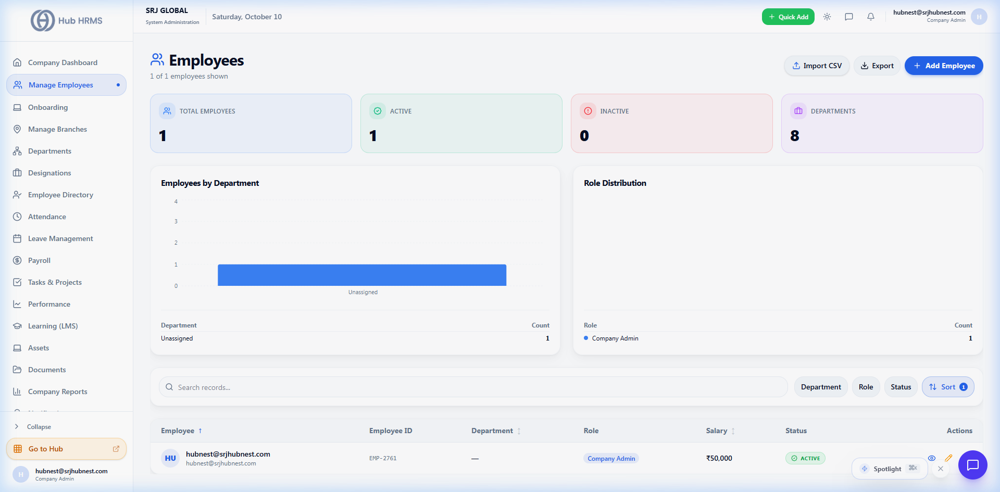
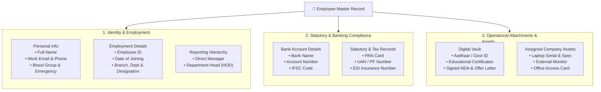
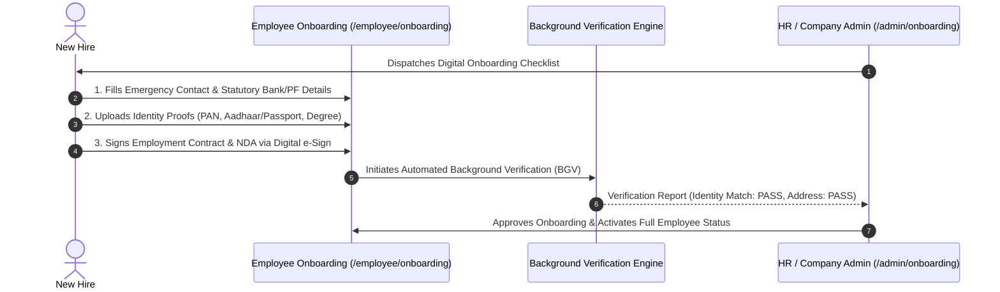

# Employee Management, Onboarding & Directory

Managing your company's workforce in Hub HRMS is centered around the **Manage Employees** module (`/admin/employees`) and the searchable **Employee Directory** (`/admin/employees-list`). Every team member maintains a single, comprehensive digital record connecting attendance, leaves, payroll, assets, and performance evaluations.

---

## 👥 Live Manage Employees Interface

Below is the live production screen of the **Manage Employees** management console:

{ width="100%" }

---

## 🗂️ Employee Master Record Anatomy

Each employee profile in Hub HRMS contains six synchronized operational sections:

---

## ➕ Adding New Employees

Company Administrators and HR Specialists can add employees using two methods:

### 1. Manual Form Entry (`+ Add Employee`)
Click the **+ Add Employee** button in the top right to open the interactive creation modal:
1. **Basic Details**: Enter legal first name, last name, corporate email, and phone number.
2. **Organizational Placement**: Select Office Branch, Department, and Designation from your configured company dropdowns.
3. **Reporting Manager**: Assign a designated supervisor. This links their leave approval and attendance regularization workflows automatically.
4. **Compensation Tier**: Assign default salary structure (Basic, HRA, Allowances).
5. **Auto-Invite**: The system automatically dispatches an account activation invite via the SMTP notification engine with secure first-time login instructions.

### 2. Bulk Import via CSV / Excel (`Import Employees`)
For companies onboarding dozens or hundreds of employees at once:
* Download the standard **Hub HRMS Employee Import Template (.csv)**.
* Populate mandatory fields (`employee_id`, `first_name`, `last_name`, `email`, `department`, `designation`, `date_of_joining`).
* Upload the file. The batch processor validates emails, prevents duplicate entries, and provisions accounts in a single transaction.

---

## 🚀 Digital Onboarding, BGV & e-Sign (`/admin/onboarding`)

New hires complete digital onboarding through the self-service onboarding portal:

* **Checklist Automation**: Track joining prerequisites (Laptop allocation, email generation, security badge creation).
* **Background Verification (BGV)**: Automated verification flags discrepancies in identity documents or past employment tenure.
* **Digital e-Sign**: Legally binding contract execution without paper printing or scanning.

---

## 🏛️ Searchable Employee Directory (`/admin/employees-list`)

The **Employee Directory** provides an interactive directory view accessible to administrators, managers, and staff:
* **Instant Filtering**: Search by name, department, designation, or branch location.
* **Live Status Badges**: Quickly see who is currently `Active`, `On Probation`, or `On Leave Today`.
* **Quick Actions**: One-click shortcuts to initiate a WebSocket chat message, view full profile, or send an email.

---

## 🚪 Offboarding & Exit Management

When an employee departs the organization:
1. **Notice Period Tracking**: Automated calculation of final working day based on company policy.
2. **Asset Recovery**: Generates a checklist of all assigned company property (laptops, keys, corporate cards) that must be returned to IT/Facilities.
3. **Full & Final Settlement (FnF)**: Automatically calculates unavailed leave encashment, pending reimbursements, and notice period adjustments before releasing final payslips.
4. **Access Revocation**: One-click account deactivation instantly terminates active sessions across the web portal, mobile apps, and desktop client.
