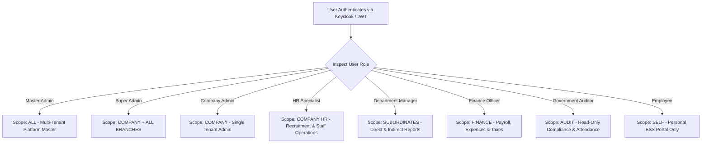
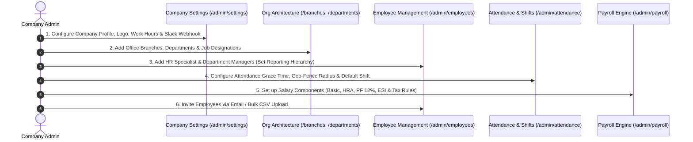

# Hub HRMS Overview & Company Admin Guide

**Hub HRMS** (Human Resource Management System) is an enterprise-grade, multi-tenant workforce management platform designed to automate the entire employee lifecycle — from initial recruitment and biometric onboarding to daily attendance, geo-fenced shifts, automated tax payroll, and performance appraisals.

{ width="220" }

---

## 🏛️ Hub HRMS Architecture at a Glance

Hub HRMS is built on a **layered, multi-tenant microservices architecture**:
* **Frontend**: Next.js 16 (React 19, TypeScript, Tailwind CSS, Lucide icons).
* **Backend API Gateway & Core Logic**: Spring Boot 3 on Java 21 with Spring Security 6 (`HS512` JWT + Redis token blacklist).
* **AI & Intelligence Engine**: Dedicated Python FastAPI microservice (LangChain + PGVector for RAG document search and natural language SQL telemetry).
* **Database & Persistence**: PostgreSQL 16 with row-level tenant isolation by `company_id`.
* **Real-Time Communication**: WebSocket message broker (STOMP / SockJS over `/ws/chat`).

---

## 🧭 Company Admin Sidebar & Navigation

When logging in as a **Company Admin** (`ROLE_COMPANY_ADMIN` or `ROLE_SUPER_ADMIN`), the left-hand navigation rail opens the complete **21-Module Enterprise Administration Suite**:

{ width="100%" style="max-width: 480px; margin: 0 auto; display: block;" }

---

### Detailed Breakdown of the 21 Admin Modules

The Company Admin Sidebar is organized into **5 operational groups**:

#### 1. Core Workspace & People
| Module Name | Route | Purpose & Key Capabilities |
| :--- | :--- | :--- |
| **Company Dashboard** | `/admin/dashboard` | Central executive cockpit displaying live employee headcount, today's attendance count, upcoming leaves, pending approvals, and department-wise attrition metrics. |
| **Manage Employees** | `/admin/employees` | Complete CRUD employee master record. Add new employees, assign managers, update statutory banking/PAN/PF details, edit employment types, or deactivate accounts. |
| **Onboarding** | `/admin/onboarding` | Digital joiner workflows: Background Verification (BGV) tracking, identity document verification, e-Sign contract signing, and IT asset assignment checklists. |
| **Employee Directory** | `/admin/employees-list` | Searchable directory cards with employee avatars, email, department, designation, branch location, and direct messaging shortcuts. |

#### 2. Organization Architecture
| Module Name | Route | Purpose & Key Capabilities |
| :--- | :--- | :--- |
| **Manage Branches** | `/admin/branches` | Multi-office location setup (e.g. Mumbai HQ, Delhi Branch, Bengaluru Tech Hub). Allows setting branch-specific timezone and holiday calendars. |
| **Departments** | `/admin/departments` | Create and structure organization divisions (Engineering, Sales, Marketing, Customer Support, Human Resources, Finance). |
| **Designations** | `/admin/designations` | Standardized job titles, salary bands, and hierarchy levels (Software Engineer, Senior Consultant, VP of Sales, HR Director). |

#### 3. Operations & Payroll
| Module Name | Route | Purpose & Key Capabilities |
| :--- | :--- | :--- |
| **Attendance & Geo-Fence** | `/admin/attendance` | Real-time daily punch logs, biometric machine sync, GPS geo-fence radius validation, grace period policies, half-day triggers, and late penalty scores. |
| **Leave Management** | `/admin/leaves` | Annual leave quotas configuration (Casual Leave, Sick Leave, Earned Leave), multi-level approval rules, and balance audit adjustments. |
| **Payroll Engine** | `/admin/payroll` | Automated monthly payroll execution. Computes Basic salary, HRA, allowances, PF (12%), ESI, Professional Tax (PT), and TDS deductions with one-click bulk payslip generation. *(Growth & Enterprise Tier)* |
| **Tasks & Projects** | `/admin/tasks` | Cross-functional task boards with Kanban status (To Do, In Progress, Review, Completed), milestones, priority flags, and deadline tracking. |

#### 4. Growth, Talent & Assets
| Module Name | Route | Purpose & Key Capabilities |
| :--- | :--- | :--- |
| **Performance** | `/admin/performance` | 360-degree appraisal cycles, manager evaluation forms, self-appraisals, and company Objectives & Key Results (OKRs). *(Growth & Enterprise Tier)* |
| **Learning (LMS)** | `/admin/lms` | In-house training academy. Create training courses, assign compliance video modules, track quiz scores, and issue digital completion certificates. *(Growth & Enterprise Tier)* |
| **Asset Management** | `/admin/assets` | Hardware inventory tracking (laptops, monitors, access keys, SIM cards) with serial numbers, assignment dates, and return condition checklists. *(Growth & Enterprise Tier)* |
| **Documents Vault** | `/admin/documents` | Secure repository for organization-wide policies, employee handbooks, non-disclosure agreements (NDAs), and statutory compliance letters. *(Growth & Enterprise Tier)* |

#### 5. Analytics, Governance & System
| Module Name | Route | Purpose & Key Capabilities |
| :--- | :--- | :--- |
| **Company Reports** | `/admin/reports` | Exportable visual reports (PDF/Excel/CSV) covering attendance trends, overtime hours, payroll disbursement sheets, and gender diversity ratios. |
| **Notifications** | `/admin/notifications` | Company-wide broadcast announcements, critical system alerts, and notification audit logs. |
| **Team Chat** | `/admin/messages` | High-speed, secure internal messaging over WebSocket (STOMP/SockJS) for real-time collaboration with teams and individuals. |
| **Help & Support** | `/admin/support` | Internal employee helpdesk ticketing center. Track IT, HR, and facilities tickets from submission to resolution. |
| **Company Settings** | `/admin/settings` | General company profile, official work shifts, IP restriction rules, Slack integration webhooks, and SMTP email server credentials. |
| **Admin Profile** | `/admin/profile` | Personal administrative credentials, avatar upload, and two-factor authentication (2FA) settings. |

---

## 🛡️ Role-Based Access Control (RBAC) Architecture

Hub HRMS strictly enforces **Row-Level Tenancy** and **Scope-Based Role Access** in both the Next.js middleware and Spring Security `@PreAuthorize` annotations:

### RBAC Permission Matrix

| Feature / Action | Master Admin | Company Admin | HR Specialist | Dept Manager | Finance Officer | Employee |
| :--- | :---: | :---: | :---: | :---: | :---: | :---: |
| **Create/Edit Company & Branches** | ✅ | ✅ | ❌ | ❌ | ❌ | ❌ |
| **Add / Terminate Employees** | ✅ | ✅ | ✅ | ❌ | ❌ | ❌ |
| **Approve Subordinate Leaves** | ✅ | ✅ | ✅ | ✅ *(Team)* | ❌ | ❌ |
| **Apply for Personal Leave** | ✅ | ✅ | ✅ | ✅ | ✅ | ✅ |
| **Configure Salary Structures** | ✅ | ✅ | ❌ | ❌ | ✅ | ❌ |
| **Execute Monthly Payroll** | ✅ | ✅ | ❌ | ❌ | ✅ | ❌ |
| **Download Personal Payslip** | ✅ | ✅ | ✅ | ✅ | ✅ | ✅ |
| **Publish Job Postings & Hire** | ✅ | ✅ | ✅ | ❌ | ❌ | ❌ |
| **Conduct Performance Appraisals** | ✅ | ✅ | ✅ | ✅ *(Team)* | ❌ | ❌ |
| **Configure Geo-Fencing & Shifts** | ✅ | ✅ | ✅ | ❌ | ❌ | ❌ |
| **Daily Attendance Punch In/Out** | ✅ | ✅ | ✅ | ✅ | ✅ | ✅ |
| **Company Settings & Webhooks** | ✅ | ✅ | ❌ | ❌ | ❌ | ❌ |

---

## 🚀 First-Time Setup Checklist for Company Admins

If you are setting up your company workspace on Hub HRMS for the first time, follow this ordered workflow:

1. **Step 1: Company Profile & Shift Timings** (`/admin/settings`):
   Set your corporate legal name, primary office hours (e.g., 9:30 AM to 6:30 PM), weekly off days (Saturday/Sunday), and connect your Slack notification webhook.
2. **Step 2: Define Branches & Departments** (`/admin/branches` & `/admin/departments`):
   Add your primary office branch and corporate departments so employee records can be categorized cleanly.
3. **Step 3: Setup Designations & Roles** (`/admin/designations`):
   Map standard job titles and hierarchy levels.
4. **Step 4: Configure Attendance & Geo-Fencing** (`/admin/attendance`):
   Define the latitude/longitude of your office building and set the allowed GPS radius (e.g., `100 meters`) to enforce geo-fenced mobile punches.
5. **Step 5: Setup Salary Structures** (`/admin/payroll`):
   Define standard salary components (Basic Pay, HRA, Medical, PF rate, and Professional Tax).
6. **Step 6: Import Employees & Send Welcome Invites** (`/admin/employees`):
   Use the **Import Employees** modal to upload a CSV sheet or manually add employees. Welcome credentials will be dispatched automatically via the notification engine.

---

## ⚡ Next Steps
* Learn how to manage the complete employee lifecycle, directory, and recruitment in [Employee Lifecycle & Onboarding](employees.md).
* Configure daily punches, shift rosters, and GPS boundaries in [Attendance, Geo-Fencing & Shifts](attendance.md).
* Master leave policies and multi-level approvals in [Leave Management & Approvals](leaves.md).
* Run automated monthly salaries and export payslips in [Payroll Engine & Payslips](payroll.md).
