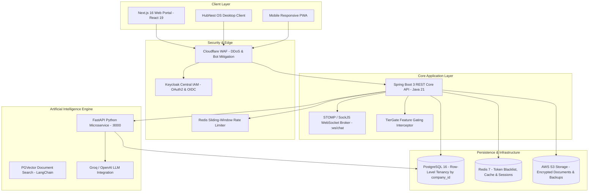
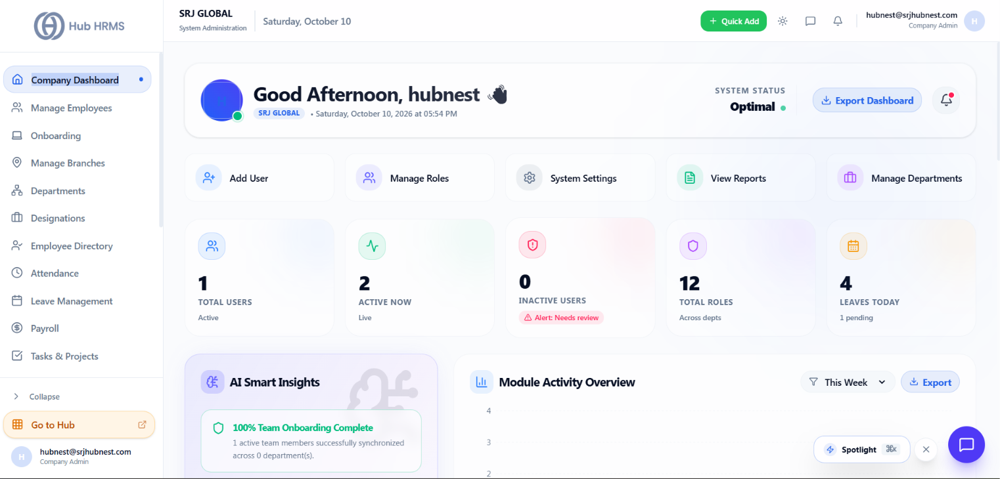
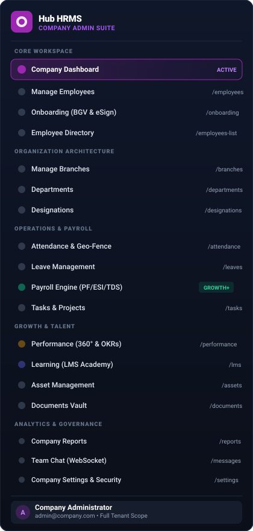
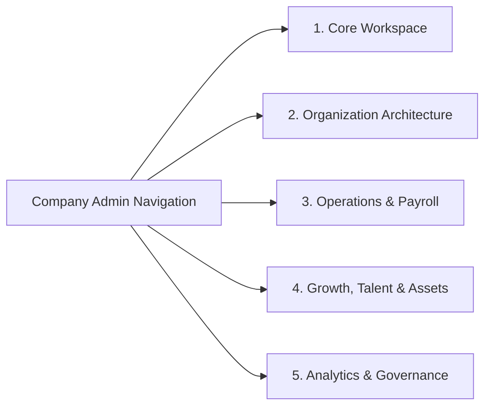
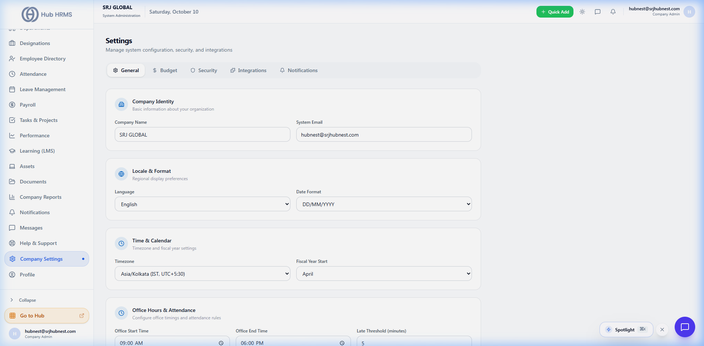
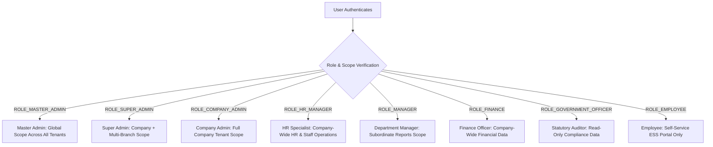
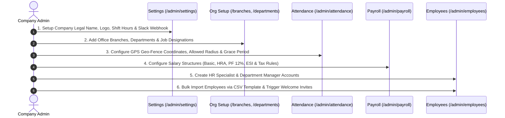

# Hub HRMS Complete Overview & User Manual

**Hub HRMS** (Human Resource Management System) is an enterprise-grade, cloud-native workforce operations suite built to automate every stage of the employee lifecycle — from job posting, AI resume screening, and biometric onboarding to daily geo-fenced attendance, shift rosters, automated statutory tax payroll, performance appraisals, and offboarding settlements.

{ width="240" }

---

## 🌟 What Problem Does Hub HRMS Solve?

Traditional businesses face severe operational bottlenecks managing human capital across disconnected spreadsheets, paper punch cards, biometric hardware logs, and manual payroll math. 

Hub HRMS eliminates these inefficiencies:

* 🚫 **No More Proxy Attendance**: Enforces **GPS Geo-Fencing** and biometric validation, ensuring staff can only punch in from authorized office perimeters or registered client locations.
* 🚫 **No More Payroll Math Errors**: Automatically calculates **Basic, HRA, Provident Fund (PF 12%), ESI, Professional Tax (PT), and TDS Income Tax**, adjusting for approved leaves and unpaid absences in seconds.
* 🚫 **No More Lost Physical Files**: Secure digital vaults for contracts, KYC identity proofs, tax investment declarations, and company policies with built-in digital **e-Sign**.
* 🚫 **No More Communication Silos**: Automated **3-tier notifications** dispatch instant alerts across In-App bells, corporate Slack channels, and SMTP emails.

---

## 🏛️ System Architecture & Technology Stack

Hub HRMS operates on a robust, multi-tenant microservices architecture designed for security, high concurrency, and low latency:

### Core Architecture Highlights
1. **Row-Level Tenant Isolation**: Every database table (`users`, `attendance`, `leave_requests`, `payroll`, `shifts`) enforces a strict `company_id` foreign key. One company can never access another company's records.
2. **Stateless JWT Security with Instant Blacklist**: Tokens use cryptographic `HS512` signing. When a user logs out, their token is immediately pushed to a Redis blacklist to prevent token replay attacks.
3. **AI-Powered HR Assistant**: Built-in LangChain pipeline translates natural language questions into database queries (e.g. *"Show me all engineers on leave this week"*) and answers policy questions from uploaded company handbooks.

---

## 🖥️ Company Dashboard Deep Dive (`/admin/dashboard`)

The **Company Dashboard** is the command cockpit for executive administrators and business owners. It aggregates real-time workforce telemetry, automated compliance audits, and instant management shortcuts into a unified, high-performance interface.

{ width="100%" }

---

### In-Depth Anatomy of the Company Dashboard

The dashboard is structured into six functional operating zones:

#### 1. Executive Welcome & System Telemetry Card
* **Personalized Greeting**: Greets the administrator dynamically (`Good Afternoon, hubnest 👋`) with avatar online status.
* **Company Context & Real-Time Clock**: Confirms the active tenant organization (**SRJ GLOBAL**) alongside a live server-synchronized date and time ticker (`Saturday, October 10, 2026 at 05:54 PM`).
* **System Status Health Indicator (`Optimal 🟢`)**: Continuously monitors backend microservices (Spring Boot API, PostgreSQL database connection pool, Redis cache, and WebSocket gateway). When all services operate within nominal thresholds (`< 300ms` latency), it displays **Optimal**.
* **Export Dashboard Action**: One-click download button (`Export Dashboard`) that generates an executive executive summary report (PDF/Excel) summarizing current workforce availability and pending items.
* **Notification Bell**: Direct access to high-priority system alerts and pending operational requests.

#### 2. Quick Action Shortcuts Bar
Directly beneath the hero card, five high-velocity buttons allow administrators to perform common administrative workflows without navigating through nested menus:
1. **Add User (`+ Add User`)**: Launches the quick employee onboarding modal to provision new staff profiles.
2. **Manage Roles (`Manage Roles`)**: Direct jump to the Role-Based Access Control (RBAC) permissions matrix to configure department scopes.
3. **System Settings (`System Settings`)**: Instant link to office hours, GPS geo-fence perimeter coordinates, Slack webhooks, and SMTP email credentials.
4. **View Reports (`View Reports`)**: Opens the analytics suite for instant attendance summaries, overtime audits, and payroll payout sheets.
5. **Manage Departments (`Manage Departments`)**: Rapid shortcut to add or restructure business divisions (Engineering, Sales, HR, Finance).

#### 3. Real-Time Telemetry KPI Cards
Five live diagnostic counters provide an immediate pulse on the organization:
* **TOTAL USERS (1 Active)**: Displays the total registered employee master records currently provisioned in your organization tenant.
* **ACTIVE NOW (2 Live 🟢)**: Real-time active WebSocket sessions across web browsers, desktop clients, and mobile apps. Enables administrators to know who is actively working right now.
* **INACTIVE USERS (0 • `⚠️ Alert: Needs review`)**: Tracks deactivated, resigned, or suspended accounts. If an unverified account remains in the system, an alert prompt notifies administrators to perform security audits.
* **TOTAL ROLES (12 Across depts)**: Active authorization tiers defined across the company, ensuring proper principle-of-least-privilege boundaries.
* **LEAVES TODAY (4 Total • 1 Pending)**: Immediate workforce availability indicator. Displays how many employees are currently on approved leave today and highlights outstanding requests awaiting managerial sign-off.

#### 4. AI Smart Insights & Onboarding Health
Powered by the background analytics microservice, the **AI Smart Insights** card continuously audits team health:
* **100% Team Onboarding Complete**: Scans employee profiles for missing mandatory statutory items (PAN, Aadhaar/Passport, Bank Details, and Signed e-Contracts).
* **Department Sync Status**: Reports active synchronization status across business units to prevent data discrepancies.

#### 5. Module Activity Overview & Analytical Charts
* **Interactive Activity Chart**: Live visualization tracking daily attendance punches, task progress milestones, and system transactions.
* **Timeframe Filter (`This Week ▾`)**: Toggle analytics between *Today*, *This Week*, *This Month*, or *Custom Date Range*.
* **Spotlight Global Search (`⚡ Spotlight ⌘K`)**: Built-in keyboard shortcut trigger for instant hub navigation.

#### 6. Header Bar & Floating Live Collaboration
* **`+ Quick Add` (Green Header Button)**: Global modal accessible anywhere in the application to add employees, tasks, or announcements.
* **Theme Switcher**: Instant toggle between Light Mode and High-Contrast Dark Mode.
* **Floating Team Chat**: Live WebSocket communication widget in the bottom-right corner for direct messaging.

---

## 🧭 Complete Walkthrough of the 21 Admin Modules

When logged in as a **Company Admin**, the left navigation rail provides access to **21 specialized modules**:

{ width="100%" style="max-width: 480px; margin: 0 auto; display: block;" }

---

### Detailed Operational Breakdown

#### 1. Core Workspace & People
* **Company Dashboard (`/admin/dashboard`)**: The operational cockpit displaying live attendance counters, upcoming holidays, and department analytics.
* **Manage Employees (`/admin/employees`)**: The employee master database. Add, edit, filter, promote, or deactivate staff members. Assign reporting managers and define statutory details (PAN, Aadhaar, Bank Details, UAN).
* **Onboarding (`/admin/onboarding`)**: Digital new hire portal. Track background verification (BGV), identity checks, e-Sign contract signing, and IT hardware allocation checklists.
* **Employee Directory (`/admin/employees-list`)**: Searchable employee cards with profile photos, job titles, direct contact links, and active online presence badges.

#### 2. Organization Architecture
* **Manage Branches (`/admin/branches`)**: Setup and maintain multiple office locations (e.g. Mumbai HQ, Delhi Branch, Bengaluru Tech Center). Each branch can have its own holiday calendar and timezone.
* **Departments (`/admin/departments`)**: Group staff into operational units (Engineering, Product, Sales, Accounts, Customer Success). Enables department-level reporting and budget tracking.
* **Designations (`/admin/designations`)**: Standardize corporate job titles, seniority levels, and salary compensation bands (e.g. Associate, Senior, Lead, Manager, Director).

#### 3. Operations & Payroll
* **Attendance & Geo-Fence (`/admin/attendance`)**: Live daily punch monitoring, GPS geo-fence radius verification, grace periods, overtime hours, and half-day penalty rules.
* **Leave Management (`/admin/leaves`)**: Annual quota allocations (Casual Leave, Sick Leave, Paid Leave), holiday calendars, sandwich rule enforcement, and multi-tier approval logs.
* **Payroll Engine (`/admin/payroll`)**: End-to-end automated salary processing. Computes Basic, HRA, Allowances, PF (12%), ESI, Professional Tax, and TDS with 1-click bulk payslip distribution. *(Growth & Enterprise Tier)*
* **Tasks & Projects (`/admin/tasks`)**: Cross-department task management board with Kanban status (To Do, In Progress, Review, Completed), assignees, milestones, and deadlines.

#### 4. Growth, Talent & Assets
* **Performance (`/admin/performance`)**: Conduct 360-degree appraisal cycles, configure manager review forms, self-appraisals, and track company Objectives & Key Results (OKRs). *(Growth & Enterprise Tier)*
* **Learning - LMS Academy (`/admin/lms`)**: In-house corporate training portal. Create courses, upload video training materials, assign mandatory compliance modules, and issue certificates. *(Growth & Enterprise Tier)*
* **Asset Management (`/admin/assets`)**: Track company physical property (laptops, monitors, mobile devices, access cards) with serial numbers, warranty dates, and handover receipts. *(Growth & Enterprise Tier)*
* **Documents Vault (`/admin/documents`)**: Centralized repository for company-wide HR policies, employee handbooks, NDA agreements, and statutory compliance files. *(Growth & Enterprise Tier)*

#### 5. Analytics, Governance & System
* **Company Reports (`/admin/reports`)**: Generate and download comprehensive visual reports (PDF/Excel) for payroll sheets, attendance summaries, overtime logs, and attrition trends.
* **Notifications (`/admin/notifications`)**: Publish company-wide announcements and view historical system alert dispatches.
* **Team Chat (`/admin/messages`)**: Real-time WebSocket messaging platform allowing instant communication between employees, departments, and leadership.
* **Help & Support (`/admin/support`)**: Internal ticketing desk where employees can raise IT, HR, or administrative support requests with SLA tracking.
* **Company Settings (`/admin/settings`)**: Configure corporate legal details, office shift hours, IP restrictions, Slack webhooks, and SMTP email credentials.
* **Admin Profile (`/admin/profile`)**: Manage administrative credentials, security keys, and personal contact details.

---

## ⚙️ Live Company Settings & Configuration

Company Administrators configure operational rules through the **Company Settings** portal (`/admin/settings`):

{ width="100%" }

### Critical Settings Overview
1. **General Settings**: Company legal entity name, corporate logo, tax registration number (GSTIN / CIN), and official website.
2. **Attendance & Geo-Fencing**: Define office GPS latitude and longitude, allowed punch radius in meters (e.g. `100m`), and morning grace time window (e.g. `15 minutes`).
3. **Shift Timings**: Set standard office start and end times, lunch break duration, and weekly off days (e.g. Saturday/Sunday).
4. **Integration Webhooks**: Connect your corporate **Slack** workspace via webhook URL to receive instant leave and attendance alerts directly in departmental channels.
5. **SMTP Email Configuration**: Set your corporate email server (Hostinger, Google Workspace, AWS SES) for dispatching onboarding invites and digital payslips.

---

## 🛡️ Complete Role-Based Access Control (RBAC) Specification

Hub HRMS features an advanced **8-Tier Role Hierarchy**. Every user account is bound to a specific operational role and data access scope:

### Role Descriptions & Data Boundaries

#### 1. Master Admin (`ROLE_MASTER_ADMIN`)
* **Scope**: `ALL (Platform Global)`
* **Description**: Platform-level infrastructure administrator. Manages all company tenants, subscription plan provisioning, database health, and global system configurations.

#### 2. Super Admin (`ROLE_SUPER_ADMIN`)
* **Scope**: `COMPANY + MULTI-BRANCH`
* **Description**: Enterprise administrator overseeing an organization with multiple subsidiaries or geographic branches. Has full executive privileges across all locations.

#### 3. Company Admin (`ROLE_COMPANY_ADMIN`)
* **Scope**: `COMPANY (Single Tenant)`
* **Description**: The primary business owner or managing director. Controls all company settings, branches, departments, designations, employee records, payroll, and integrations.

#### 4. HR Manager / HR Specialist (`ROLE_HR_MANAGER`, `ROLE_HR`)
* **Scope**: `COMPANY HR`
* **Description**: Manages end-to-end HR operations: recruitment postings, candidate screening, employee directory, leave audits, attendance regularizations, onboarding checklists, and performance reviews.

#### 5. Department Manager / Supervisor (`ROLE_MANAGER`, `ROLE_SUPERVISOR`)
* **Scope**: `SUBORDINATES (Direct & Indirect Reports)`
* **Description**: Leads a specific department or team. Has authority to approve/reject team leave requests, verify attendance regularizations, assign shift rosters, and conduct performance reviews for their reportees.

#### 6. Finance / Payroll Officer (`ROLE_FINANCE`, `ROLE_PAYROLL`)
* **Scope**: `FINANCE DATA`
* **Description**: Financial administrator responsible for executing monthly payroll, configuring statutory tax rates (PF/ESI/PT/TDS), processing expense reimbursement claims, and managing employee salary advance loans.

#### 7. Government / Compliance Auditor (`ROLE_GOVERNMENT_OFFICER`)
* **Scope**: `AUDIT (Read-Only)`
* **Description**: External statutory inspector or internal compliance auditor. Has read-only access to attendance logs, overtime sheets, statutory deductions, and labor law compliance records.

#### 8. Employee (`ROLE_EMPLOYEE`)
* **Scope**: `SELF ONLY`
* **Description**: Standard workforce member. Accesses the Employee Self-Service (ESS) portal to clock in/out, apply for leaves, view leave balances, download payslips, submit expense receipts, track assigned tasks, and chat with team members.

---

### Master RBAC Permissions Matrix

| Operational Capability | Master Admin | Company Admin | HR Specialist | Dept Manager | Finance Officer | Employee |
| :--- | :---: | :---: | :---: | :---: | :---: | :---: |
| **Configure Company Settings & Branches** | ✅ | ✅ | ❌ | ❌ | ❌ | ❌ |
| **Manage Departments & Designations** | ✅ | ✅ | ✅ | ❌ | ❌ | ❌ |
| **Add / Edit / Terminate Employees** | ✅ | ✅ | ✅ | ❌ | ❌ | ❌ |
| **View Full Employee Directory** | ✅ | ✅ | ✅ | ✅ | ✅ | ✅ |
| **Approve Subordinate Leaves** | ✅ | ✅ | ✅ | ✅ *(Team)* | ❌ | ❌ |
| **Apply for Personal Leaves** | ✅ | ✅ | ✅ | ✅ | ✅ | ✅ |
| **View Company-Wide Attendance Logs** | ✅ | ✅ | ✅ | ❌ | ❌ | ❌ |
| **Verify Team Attendance Regularization** | ✅ | ✅ | ✅ | ✅ *(Team)* | ❌ | ❌ |
| **Clock In / Out (Daily Attendance)** | ✅ | ✅ | ✅ | ✅ | ✅ | ✅ |
| **Configure Salary Structures & Taxes** | ✅ | ✅ | ❌ | ❌ | ✅ | ❌ |
| **Execute Monthly Payroll Runs** | ✅ | ✅ | ❌ | ❌ | ✅ | ❌ |
| **Download Personal Monthly Payslip** | ✅ | ✅ | ✅ | ✅ | ✅ | ✅ |
| **Manage Recruitment & Post Jobs** | ✅ | ✅ | ✅ | ❌ | ❌ | ❌ |
| **Conduct 360° Performance Appraisals** | ✅ | ✅ | ✅ | ✅ *(Team)* | ❌ | ❌ |
| **Assign Corporate Training Courses (LMS)** | ✅ | ✅ | ✅ | ❌ | ❌ | ❌ |
| **Approve Expense Claims & Reimbursements**| ✅ | ✅ | ❌ | ✅ *(Team)* | ✅ | ❌ |
| **Real-Time WebSocket Team Chat** | ✅ | ✅ | ✅ | ✅ | ✅ | ✅ |
| **Generate & Export Audit Reports** | ✅ | ✅ | ✅ | ✅ *(Team)* | ✅ | ❌ |

---

## 💎 Subscription Tier Comparison (TierGate Engine)

Hub HRMS automatically adapts available features based on your company's active subscription plan synced from the HubNest Platform:

| Feature Capability | Starter Tier | Growth Tier | Enterprise Tier |
| :--- | :---: | :---: | :---: |
| **Max Employees Supported** | Up to 25 | Up to 250 | Unlimited |
| **Employee Master Directory** | ✅ | ✅ | ✅ |
| **Daily Attendance & Punch Tracking** | ✅ | ✅ | ✅ |
| **Leave Management & Approvals** | ✅ | ✅ | ✅ |
| **Basic PDF Reports** | ✅ | ✅ | ✅ |
| **Automated Statutory Payroll Engine** | ❌ | ✅ | ✅ |
| **Shift Rostering & Swapping** | ❌ | ✅ | ✅ |
| **Recruitment & Applicant Pipeline** | ❌ | ✅ | ✅ |
| **Performance Reviews & OKRs** | ❌ | ✅ | ✅ |
| **Learning Management System (LMS)** | ❌ | ✅ | ✅ |
| **Asset Management & Tracking** | ❌ | ✅ | ✅ |
| **Multi-Branch Location Management** | ❌ | ✅ | ✅ |
| **AI HR Assistant (LangChain + RAG)** | ❌ | ❌ | ✅ |
| **Automated Background Verification (BGV)**| ❌ | ❌ | ✅ |
| **Digital Contract e-Sign** | ❌ | ❌ | ✅ |
| **Single Sign-On (Keycloak OIDC / SAML)** | ❌ | ❌ | ✅ |
| **Custom IP Whitelisting & Audit Logs** | ❌ | ❌ | ✅ |

---

## 🚀 Step-by-Step Initial Setup Guide for Company Admins

Setting up your Hub HRMS company workspace takes less than 15 minutes. Follow this recommended sequential setup:

1. **Step 1: General Company Profile & Shift Hours** (`/admin/settings`):
   Enter your corporate legal name, upload your high-resolution company logo, specify official working hours (e.g. 09:30 AM to 06:30 PM), and configure weekly offs.
2. **Step 2: Organization Architecture** (`/admin/branches`, `/admin/departments`, `/admin/designations`):
   Add your primary office branch location and create your functional departments (Engineering, HR, Sales, Finance) and designations.
3. **Step 3: Setup GPS Geo-Fencing** (`/admin/settings`):
   Input your office building's exact latitude and longitude coordinates. Set the allowed boundary radius (e.g. `100 meters`) so staff can punch in seamlessly from their phones when they arrive at work.
4. **Step 4: Configure Payroll Components** (`/admin/payroll`):
   Set up standard salary components and verify statutory deduction percentages (Provident Fund 12%, ESI, and state Professional Tax).
5. **Step 5: Appoint Leaders & HR Specialists** (`/admin/employees`):
   Add your HR Managers and Department Leads first. This ensures reporting lines are established before onboarding general employees.
6. **Step 6: Import Workforce & Send Invites** (`/admin/employees`):
   Use the **Import Employees** button to upload your staff roster via CSV. Automated welcome emails will be dispatched containing secure login links.

---

## ⚡ Next Steps & Related Chapters
* [Employee Lifecycle, Directory & Onboarding](employees.md): Learn how to manage the employee master record, run background checks, and handle resignations.
* [Attendance, Geo-Fencing & Shift Management](attendance.md): Master daily punches, grace periods, rotational shift rosters, and regularization approvals.
* [Leave Management & Approvals](leaves.md): Configure leave quotas, carry-forward rules, sandwich logic, and multi-tier manager approval chains.
* [Payroll Processing & Digital Payslips](payroll.md): Execute monthly salary disbursements, compute taxes, and issue digital PDF payslips.
