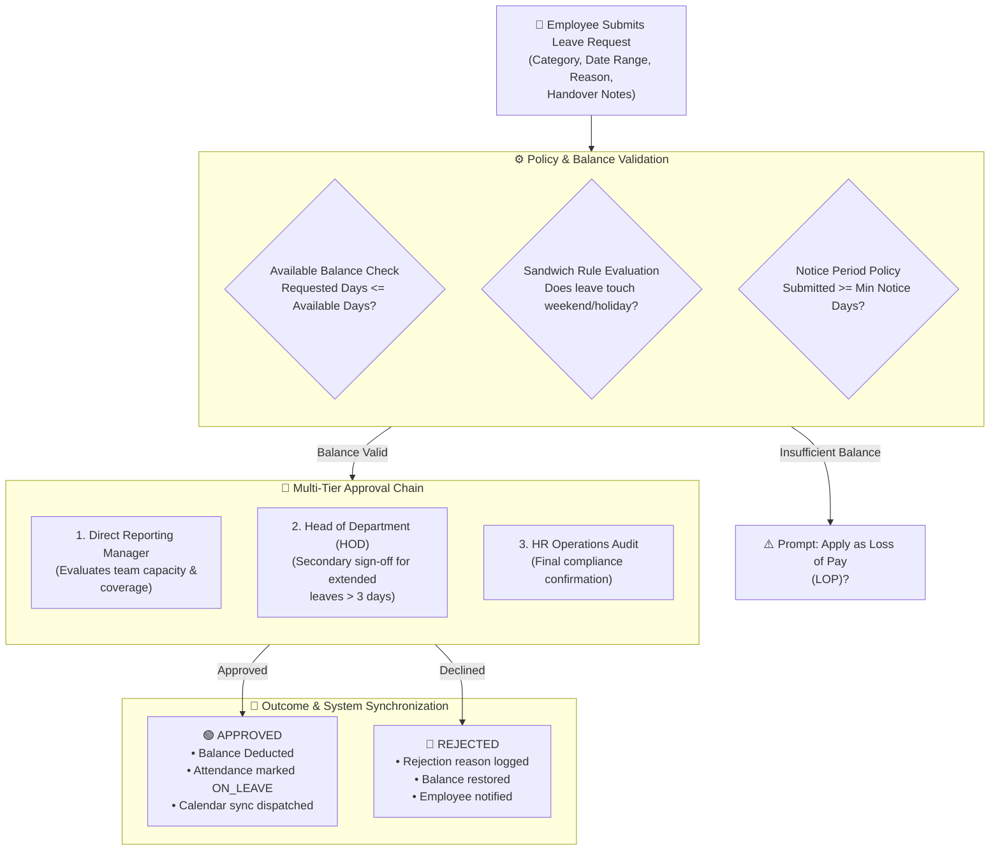

# Leave Management & Multi-Level Approvals

Managing employee time-off fairly while sustaining business continuity requires clear policy automation. The **Leave Management** module (`/admin/leaves`) in **Hub HRMS** replaces manual email chains with automated balance tracking, statutory leave compliance, and an intelligent **multi-tiered approval matrix**.

Every leave application automatically cross-references shift schedules, evaluates available balances, and routes notifications to the appropriate supervisors.

---

## 📅 Live Interface Overview

Below is the live production console of the **Leave Management** workspace:

{ width="100%" }

---

## 🧭 System Architecture & Multi-Level Approval Engine

When an employee submits a time-off request, the leave engine processes the transaction through organizational validation layers:

---

## 📊 Dashboard KPI Cards & Predictive Analytics

At the top of the `/admin/leaves` screen, four operational metric cards and three analytics panels provide instant administrative insight:

### 1. Key Metric Cards
* **Total Requests**: Cumulative count of all time-off applications submitted in the selected date window.
* **Pending**: Requests awaiting supervisory review or HR audit. High pending counts alert managers to take action before shift conflicts arise.
* **Approved**: Sanctioned leave applications officially deducted from employee balances.
* **Rejected**: Applications declined due to operational workload, notice period policy violations, or lack of coverage.

### 2. Live Analytics Panels
* **Leave Distribution by Type (Pie Chart)**: Breaks down leave requests by category (e.g., *Sick Leave*, *Casual Leave*, *Earned Leave*), identifying health-related trends or seasonal surges.
* **Leave Requests This Week (Bar Chart)**: Visualizes day-by-day leave patterns from Monday to Sunday, identifying high-absenteeism days (typically Fridays or Mondays).
* **AI Leave Forecast & Insights (Predictive Curve)**: Analyzes historical seasonality, festive calendars, and weather models to forecast workforce absenteeism for upcoming months (+1, +2, +3 months), allowing resource managers to plan project sprints proactively.

---

## 🏖️ Standard Leave Categories & Statutory Rules

Hub HRMS supports standard enterprise and statutory leave types:

| Leave Category | Code | Standard Entitlement | Accrual & Carryover Rules |
| :--- | :---: | :---: | :--- |
| **Casual Leave** | `CL` | `12 Days / Year` | Accrues at 1 day per completed month. Intended for urgent personal affairs and short unplanned breaks. |
| **Sick Leave** | `SL` | `10 Days / Year` | Credited at start of calendar year. Mandatory doctor’s medical certificate required for $> 2$ consecutive days. |
| **Earned / Privilege Leave** | `PL` | `15–18 Days / Year` | Pro-rated on active attendance. Unused days are eligible for annual carry-forward (up to 30 days cap) or salary encashment. |
| **Maternity Leave** | `ML` | `26 Weeks` | Statutory paid leave for female employees as mandated by labor law compliance. |
| **Paternity Leave** | `PTL` | `5 Days` | Paid leave granted to new fathers within 6 months of child delivery. |
| **Loss of Pay (Unpaid)** | `LOP` | Discretionary | Taken when all paid leave balances are exhausted. Automatically feeds the payroll engine to deduct day-rate compensation. |

---

## 🛠️ Step-by-Step Leave Administration

### 1. Recording a Leave Directly (`+ Record Leave`)
Administrators can record leaves on behalf of employees who are incapacitated or on emergency duty:
1. Click the blue **+ Record Leave** button on the top toolbar.
2. Select the **Employee** from the dropdown.
3. Select the **Leave Type** (`CL`, `SL`, `PL`, `LOP`, etc.).
4. Choose the **Start Date** and **End Date** (with half-day morning/afternoon toggles).
5. Enter the **Reason** and upload any supporting medical certificates.
6. Click **Confirm Record**. The leave is marked as approved and immediately updates attendance and payroll records.

### 2. Reviewing & Acting on Pending Requests
1. Filter the records table by **Status: PENDING**.
2. Click on a request row to view employee reason, remaining leave balance, and team overlap warnings.
3. Click **Approve** to sanction the request or **Reject** (with a mandatory feedback comment explaining the decision).
4. Automated in-app and email notifications notify the employee instantly.

### 3. The "Sandwich Rule" Policy
Under `/admin/settings`, organizations can toggle the **Sandwich Rule**:
* **Enabled**: If an employee takes leave on Friday and Monday, the weekend (Saturday and Sunday) is counted as **4 total leave days**.
* **Disabled**: Only Friday and Monday count as leave days (**2 leave days**).

---

## 🔗 Downstream Integrations

* **Payroll Synchronization**: Unapproved absences and approved LOP days automatically calculate Loss of Pay deductions during monthly payroll processing.
* **Attendance Calendar**: Approved leave dates automatically override biometric clock-in expectations, preventing false "Absent" flags.
* **Project Capacity**: Integrates with the **Tasks & Projects** workload map, warning team leads when assigning deadlines during an employee's scheduled leave.

---

## 💡 Best Practices & Common FAQs

> [!TIP]
> **Enforce Minimum Notice Periods:** Require employees to submit planned leaves (such as Earned/Privilege Leaves) at least 7 days in advance. Configure this threshold in company settings so the system automatically alerts employees to secure manager pre-approval.

### Frequently Asked Questions

#### Q1: Can an employee cancel an approved leave?
Yes. If an employee’s plans change, they can submit a **Leave Cancellation Request** from their portal. Upon manager approval, the deducted days are credited back into their active balance.

#### Q2: What happens if an employee submits a leave request with zero balance?
The system blocks the submission under paid leave codes and prompts the employee to apply under **Loss of Pay (LOP)**.
