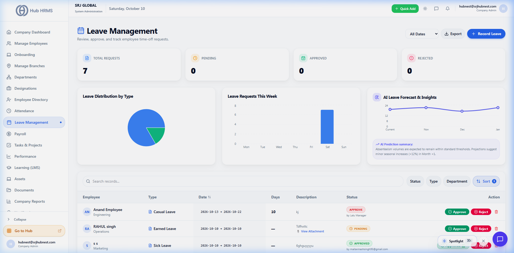
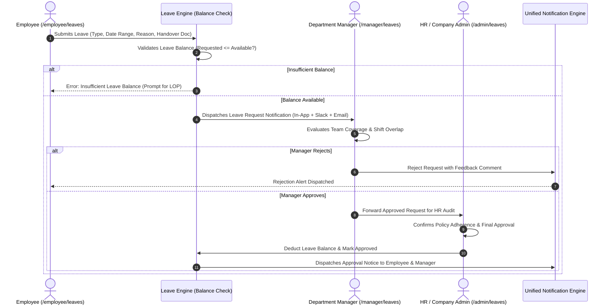

# Leave Management & Multi-Level Approvals

The **Leave Management** module (`/admin/leaves`) streamlines corporate time-off policies, tracks real-time leave balances, and enforces automated **multi-tier approval hierarchies**. Employees can plan leaves transparently while managers maintain team availability.

---

## 📅 Live Leave Management Console

Below is the live production interface of the **Leave Management** workspace:

{ width="100%" }

---

## 🏖️ Leave Types & Accrual Rules

Hub HRMS supports standard corporate and statutory leave categories:

| Leave Category | Code | Annual Entitlement | Policy & Accrual Rules |
| :--- | :---: | :---: | :--- |
| **Casual Leave** | `CL` | `12 Days` | 1 day accrued monthly. Intended for personal matters and unplanned short leaves. |
| **Sick Leave** | `SL` | `10 Days` | Credited on joining/annual renewal. Medical certificate mandatory for > 2 consecutive days. |
| **Earned / Paid Leave** | `PL` | `15 Days` | Pro-rated based on active attendance. Unused balance eligible for year-end carry forward or encashment. |
| **Maternity Leave** | `ML` | `26 Weeks` | Paid statutory leave for female employees per labor compliance regulations. |
| **Paternity Leave** | `PTL` | `5 Days` | Short paid leave for new fathers upon child delivery. |
| **Loss of Pay (Unpaid)** | `LOP` | As Needed | Unpaid time-off. Automatically connects to the payroll engine to deduct day-rate compensation. |

---

## 🔄 Multi-Level Leave Approval Sequence

Leave requests follow an automated approval chain defined by organizational hierarchy:

---

## 📆 Holiday Calendars & The Sandwich Rule

* **Branch Holiday Calendars**: Set state-specific and national public holidays per office branch.
* **Optional Sandwich Rule Enforcement**: If an employee takes leaves on both Friday and the following Monday, organizations can configure whether the weekend (Saturday/Sunday) counts as leave days or regular weekly offs.
