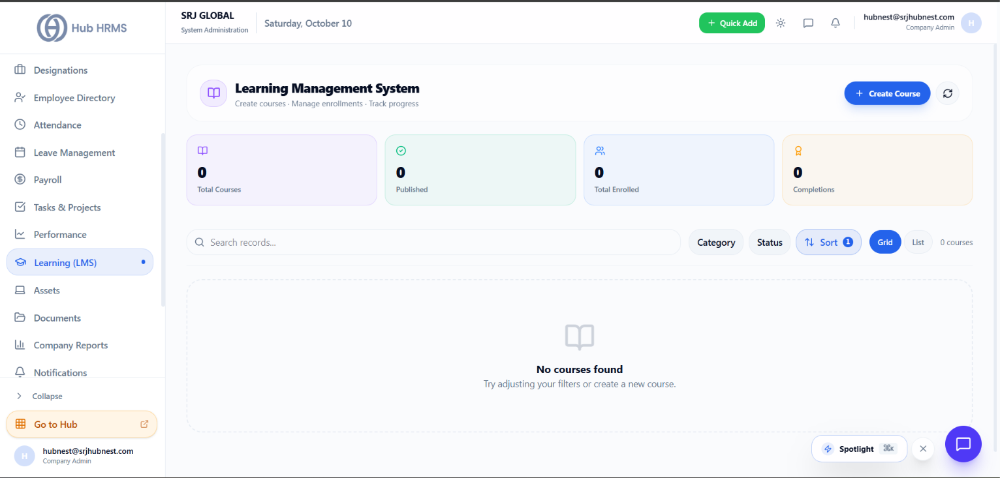
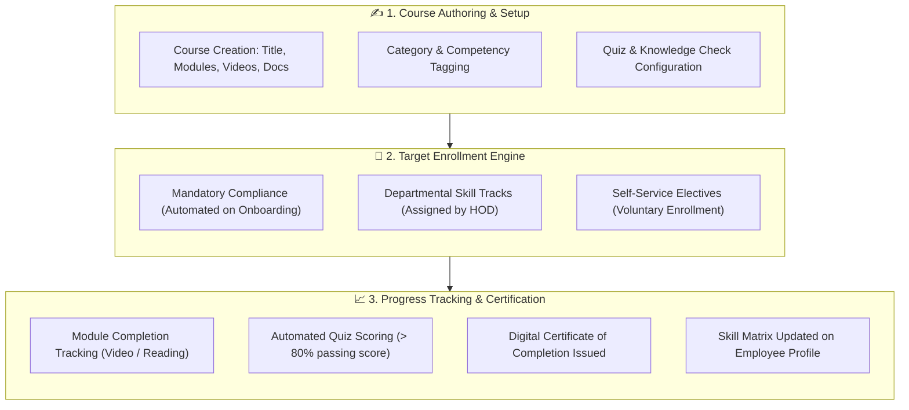

# Learning Management System (LMS) & Training

Continuous skill development drives organizational agility and retention. The **Learning (LMS)** module (`/admin/lms`) in **Hub HRMS** provides an integrated corporate university platform. It allows organizations to author courses, assign mandatory statutory compliance training (e.g., POSH, Data Privacy, InfoSec), and track employee certification progress.

---

## 📚 Live Interface Overview

Below is the live production console of the **Learning Management System** workspace:

{ width="100%" }

---

## 🧭 System Architecture & Employee Learning Lifecycle

From new hire onboarding to executive leadership development, the LMS engine manages the end-to-end learning journey:

---

## 📊 Dashboard Metric Cards Explained

At the top of the `/admin/lms` workspace, four operational cards summarize training adoption:

| Metric Card | Definition & Logic | Operational Significance |
| :--- | :--- | :--- |
| **📖 Total Courses** | Total number of courses authored across all corporate categories. | Displays training curriculum depth and learning resources. |
| **✅ Published** | Courses currently live and accessible in the student catalog. | Draft courses remain hidden while undergoing curriculum review. |
| **👥 Total Enrolled** | Active student registrations across all published courses. | Reflects workforce engagement and ongoing participation. |
| **🎖️ Completions** | Total count of successfully completed course certifications. | Key metric for statutory compliance audits and talent upskilling. |

---

## 🛠️ Step-by-Step LMS Workflows

### 1. Creating a New Course (`+ Create Course`)
1. Click the blue **+ Create Course** button in the upper-right corner.
2. Fill in the course creation form:
   * **Course Title**: Clear descriptive title (e.g., *Information Security & GDPR Compliance 2026*).
   * **Category**: Choose from *Compliance & Legal*, *Engineering & Tech*, *Sales Enablement*, *Leadership*, or *Soft Skills*.
   * **Difficulty Level**: `Beginner`, `Intermediate`, or `Advanced`.
   * **Estimated Duration**: Target completion hours (e.g., *4 Hours*).
   * **Course Modules**: Add lessons with rich text content, embedded video links, PDF attachments, and downloadable slide decks.
   * **Passing Assessment**: Attach a multiple-choice quiz with a configurable passing grade (e.g., 80%).
3. Click **Publish Course**.

### 2. Mandatory vs. Self-Service Enrollments
* **Automated Mandatory Training**: When a new employee is onboarded (`/admin/onboarding`), the system automatically enrolls them in statutory compliance modules (POSH, Security, Code of Conduct) with a 30-day completion deadline.
* **Self-Service Catalog**: Employees can browse the course catalog in **Grid** or **List** view and enroll in career-growth electives.

---

## 💡 Best Practices & Common FAQs

> [!TIP]
> **Tie Course Completions to Appraisals:** Require employees in junior roles to complete at least two specialized departmental tracks per year. Certified achievements sync directly with the **Skills Matrix** and quarterly performance reviews.

### Frequently Asked Questions

#### Q1: Can external vendor SCORM packages or video links be uploaded?
Yes, course modules support YouTube/Vimeo embeds, MP4 video uploads, and external web resource links.

#### Q2: What happens if an employee fails a mandatory quiz?
Employees can be granted 1–3 retake attempts depending on company policy before the course is flagged for supervisor review.
