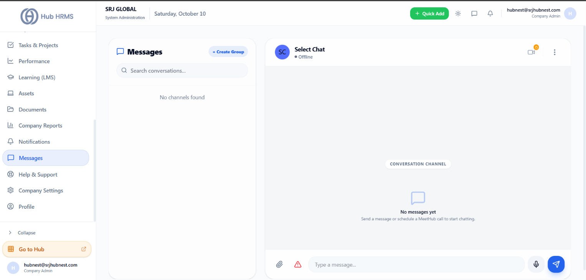
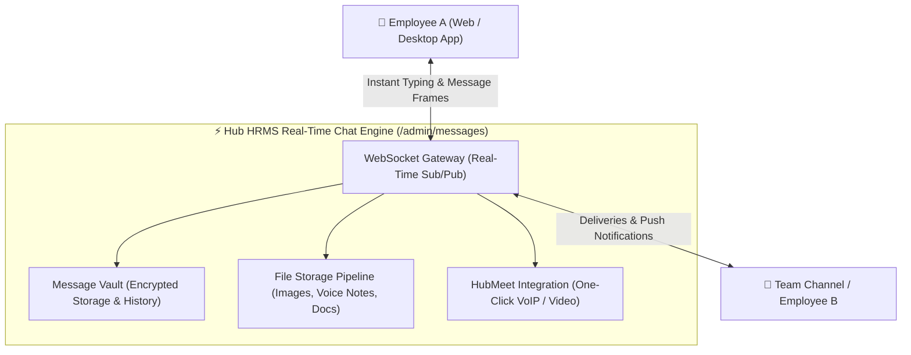

# Team Messages, Channels & Real-Time Chat

Seamless real-time communication eliminates organizational silos. The **Messages** module (`/admin/messages`) in **Hub HRMS** provides an enterprise instant messaging platform built directly into your workplace OS.

Employees and managers can collaborate through **Direct 1-on-1 Messages**, create **Project Channels**, share documents, record voice notes, and launch instant video conferences powered by **HubMeet**.

---

## 💬 Live Interface Overview

Below is the live production console of the **Messages** workspace:

{ width="100%" }

---

## 🧭 System Architecture & Real-Time WebSocket Infrastructure

The messaging platform uses low-latency WebSockets with persistent database message archiving:

---

## 🗂️ Core Functional Layout

The workspace is structured into an intuitive two-pane communication center:

### 1. Left Channel List & Directory
* **Search Conversations (`Search conversations...`)**: Quickly locate existing chat threads by colleague name or channel keyword.
* **`+ Create Group`**: Launch dedicated group channels for cross-functional initiatives (e.g., `#finance-audit-2026`, `#devops-incidents`, `#office-announcements`).
* **Presence Indicators**: Real-time visual status dots:
  * 🟢 **Online**: Currently active on web, desktop, or mobile app.
  * 🟡 **Away / Idle**: Inactive for $> 15$ minutes.
  * 🔴 **In a Meeting**: Currently engaged in a HubMeet call.
  * ⚪ **Offline**: Signed out.

### 2. Right Conversation Canvas & Action Bar
* **Header Controls**:
  * **Video Call Shortcut (📹 Icon)**: One-click instant launch of a secure **HubMeet** meeting room.
  * **Channel Settings (⋮ Menu)**: View channel member roster, manage notification mute settings, or add collaborators.
* **Rich Input Bar**:
  * **📎 Attachment Clip**: Share project spreadsheets, PDF specifications, screenshots, and logs (up to 50 MB per file).
  * **🎙️ Voice Note Recording**: Record crisp audio voice memos for rapid updates when typing isn't practical.
  * **⚠️ Priority Flag**: Mark messages as urgent to bypass user mute settings.

---

## 🛠️ Step-by-Step Messaging Workflows

### 1. Creating a Cross-Departmental Group (`+ Create Group`)
1. Click **+ Create Group** at the top of the conversation sidebar.
2. Enter the **Channel Name** (e.g., *Product Launch Q4*).
3. Select channel privacy:
   * **Public**: Any employee can discover and join the channel.
   * **Private**: Access restricted to invited members only.
4. Select team members from the employee directory selector.
5. Click **Create Channel**. The system dispatches invites and establishes the conversation feed.

### 2. Starting an Instant Video Call from Chat
When text discussion requires face-to-face alignment:
1. Click the **Video Camera (📹)** icon in the top right of the conversation header.
2. Hub HRMS generates a temporary end-to-end encrypted **HubMeet** room.
3. An interactive joining card automatically posts into the chat feed, enabling all channel participants to join with a single click.

---

## 💡 Best Practices & Common FAQs

> [!TIP]
> **Use Threaded Conversations:** In active group channels, hover over specific messages and reply in thread to keep central channel feeds uncluttered and discussions easy to follow.

### Frequently Asked Questions

#### Q1: Are direct messages private from company administrators?
Direct messages (DMs) between two employees are encrypted and private. However, standard enterprise acceptable-use audit logs maintain message archives accessible under formal legal discovery protocols.

#### Q2: Can files shared in chat be accessed later?
Yes. Open the channel options menu and select **Shared Files** to inspect all historical attachments shared in that conversation.
